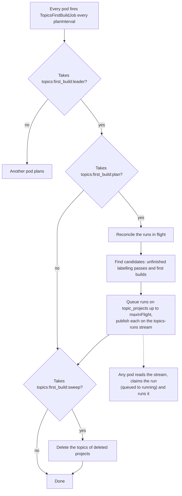
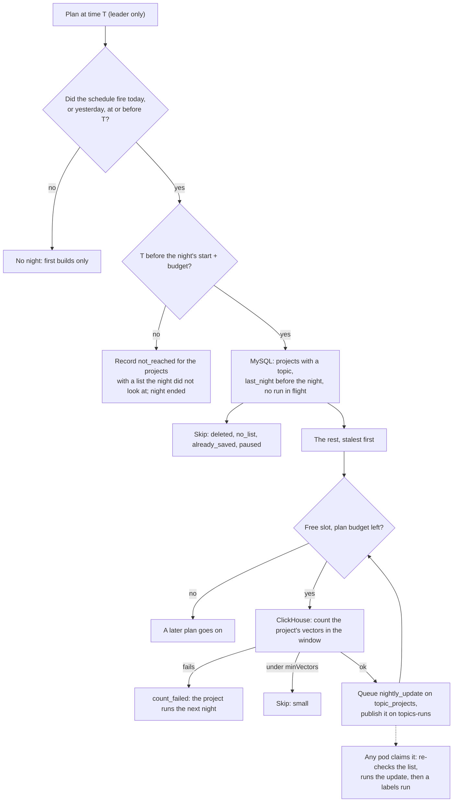

# ai-labels runbook

ai-labels labels every ended trace in opted-in workspaces with AI-generated labels, computed by opik-inference. It
runs only where `AI_LABELS_ENABLED=true`, and is off by default everywhere, OSS included. Nothing stops an OSS install
from turning it on, but it needs an opik-inference deployment and its credential, which only Comet-hosted deployments
have.

## Turning it on for a deployment

| Env var | Value |
|---|---|
| `AI_LABELS_ENABLED` | `true` |
| `AI_LABELS_INFERENCE_URL` | the opik-inference cell, e.g. `https://opik-inference.comet.com`. The backend refuses to start with an `http` URL, except to `localhost` or a loopback address, even with `AI_LABELS_ENABLED=false`: guardrails use the same URL |
| `AI_LABELS_INFERENCE_CREDENTIAL` | the deployment's opik-inference credential, from a secret (`component.backend.secretRefs`) |

- The backend refuses to start with ai-labels on unless `ANALYTICS_DB_DATA_MODEL_TRACE_COLUMNS_NON_NULLABLE=true`
  (the cut-over `traces` table). The `spans` cutover doesn't need to be done.
- opik-inference: the deployment needs its own `deployments` entry and credential in `config/inference.yaml`, with
  `allowed_orgs: "*"`. Opik sends workspace ids as `org_id`, so a real-org allow-list answers 403 `org_not_allowed`.
- Calls to opik-inference (ai-labels, guardrails and topic vectors) never follow a redirect, and read at most
  `AI_LABELS_INFERENCE_MAX_RESPONSE_BYTES` (32 MiB) of a response body. A redirect or a longer body fails the call
  as `upstream_error`; a longer body's connection is closed without reading the rest.
- Every other `aiLabels` setting is in `apps/opik-backend/config.yml` and overridable as `AI_LABELS_*`.

## Opting workspaces in and out

Opt-in is the `ai_label_workspaces` table in the state database (MySQL). There is no API.

Before enabling a workspace, check how much it will backfill: its traces in the horizon (7 days by default). Traces
created before a task's `applies_from` are never labeled.

```sql
-- ClickHouse
SELECT count()
FROM traces
WHERE workspace_id = '<workspace_id>'
  AND created_at >= now64(6) - INTERVAL 7 DAY;
```

The pool's throughput binds first: one L40S on the 4B model labels about 3 traces a second at 7K tokens each (22K
tokens/s), and a trace with large spans costs up to 50 times a small one. The sweep takes the newest traces first, so a
backfill works backward from now, and when the pool can't keep up the oldest traces age out of the horizon unlabeled
(`ai_labels.unsettled` stops shrinking). The global budget (`AI_LABELS_BUDGET_BYTES`, about 3 minutes of the pool by
default) bounds how much waits in opik-inference, and is shared out evenly between the workspaces that have traces to
label.

```sql
-- MySQL: enable (or re-enable) a workspace
INSERT INTO ai_label_workspaces (workspace_id, enabled, added_by)
VALUES ('<workspace_id>', TRUE, '<your name>')
ON DUPLICATE KEY UPDATE enabled = TRUE, added_by = '<your name>';

-- MySQL: disable a workspace. Immediate: the next sweep drops it. Jobs in flight still load, and labels stay.
UPDATE ai_label_workspaces SET enabled = FALSE WHERE workspace_id = '<workspace_id>';

-- MySQL: list the enabled workspaces
SELECT workspace_id, added_at, added_by FROM ai_label_workspaces WHERE enabled = TRUE ORDER BY added_at;
```

## Reading summaries

There is no UI yet. Take each trace's latest label (by write time):

```sql
-- ClickHouse
SELECT trace_id, task_version, JSONExtractString(output, 'summary') AS summary
FROM ai_labels
WHERE workspace_id = '<workspace_id>'
  AND project_id = '<project_id>'
  AND task = 'trace_summary'
  AND key = 'output'
ORDER BY workspace_id, project_id, task, trace_id, key, updated_at DESC
LIMIT 1 BY workspace_id, project_id, task, trace_id, key;
```

## What to watch

| Metric | Meaning |
|---|---|
| `ai_labels.unsettled_past_slo` | Unsettled (trace, task) pairs past the SLO, per workspace. The headline. |
| `ai_labels.budget.in_flight` / `.limit` | Cost in flight against the budget. Pinned at the limit means the pool is the bottleneck. |
| `ai_labels.unsettled` | Unsettled (trace, task) pairs in the horizon: the backlog. |
| `ai_labels.tick.phase_seconds` by `phase` | Time in load, sweep and submit. Loading stops starting jobs at 40% of the tick budget. |
| `ai_labels.tick.interval_seconds`, `.budget_seconds` | The tick cadence and the time a tick may use, as configured (`AI_LABELS_TICK_INTERVAL`, `AI_LABELS_TICK_BUDGET`). Loading stops at 40% of the budget, the sweep at 70%, submit at all of it. |
| `ai_labels.sweep.buckets` / `.buckets_reached` | N as configured vs the buckets the latest sweep got through before its share of the tick budget. Fewer than N means the sweep ran out of time (`ai_labels.sweep.overrun`); the first bucket swept rotates, so none starves. |
| `ai_labels.sweep.candidates` / `ai_labels.tick.workspaces` | Traces the latest sweep found to label, and the workspaces they span. Many candidates but few admitted (`ai_labels.submit.traces`) means the budget, not the sweep, bounds throughput. |
| `ai_labels.jobs.submitted` by `endpoint` | Jobs opik-inference accepted (202) and the tick recorded as open. Flat while `ai_labels.sweep.candidates` is high means submits fail: see `ai_labels.submit.throttled`, `.rejected` and the logs. |
| `ai_labels.jobs.open` | Jobs submitted and not yet loaded, as the leader last knew them. Growing while `ai_labels.items.done` is flat means jobs finish slower than they start, or never: the pool, or the service, is behind. |
| `ai_labels.jobs.oldest_open_seconds` | How long the oldest open job has been out, measured at scrape time. Past a few tick intervals the pipeline is stuck: the job is hung at the service, or the leader stopped ticking (the gauge then keeps growing on the last leader). 0 with none open. |
| `ai_labels.render.traces` / `ai_labels.submit.traces` | Traces rendered vs admitted. Far apart means renders are wasted: raise `AI_LABELS_MIN_ITEM_BYTES` toward a typical item. |
| `ai_labels.items.failed` by `error_code` | `render_over_budget`, `render_error`, `item_too_large`, `job_lost`, `missing_result`, `missing_answer`, or the service's code. |
| `ai_labels.submit.rejected` | A submit rejected with 400: a renderer or task bug. |
| `ai_labels.sweep.guard_trips` | A sweep query hit a ClickHouse guard: raise `AI_LABELS_SWEEP_BUCKETS`. |
| `ai_labels.render.compaction_level`, `.bytes` | How far traces had to be compacted to fit. |
| `ai_labels.render.history_turns`, `.history_bytes` | The earlier thread turns left in each fitted history, and their size. |
| `ai_labels.render.history_errors` | Failed reads of earlier turns. The chunk's render fails and is retried as `render_error`. |
| `ai_labels.render.duration_seconds` by `outcome` | Wall time per chunk (ClickHouse reads + render): `ok`, or `one_at_a_time` after a chunk read failed. |
| `ai_labels.render.cpu_seconds` | Java CPU spent rendering, excluding ClickHouse reads; its rate is cores. Spec 10 budgets about 0.25 core of Opik CPU per tick. Emitted only when the JVM supports and enables current-thread CPU time: no series means no measurement, not zero CPU or a met budget. ClickHouse's side is in `system.query_log`, where `log_comment` starts with `ai-labels:render:` (filter `log_comment LIKE 'ai-labels:render:%'`). |

## Topics first builds

A first build makes the topic list of a project that has none yet, from the project's topic vectors. A project with
a saved list is not built again: updating a list is the nightly update's work (see "Topics nightly updates"). First
builds read the same workspaces as ai-labels, and run only with `TOPICS_ENABLED=true`.

A first build reads the project's window: the 30 whole UTC days before the window's end. The planner's window ends at
tomorrow's start (UTC), so it holds today's traces so far. A window of more than 100,000 traces is sampled: the build
reads the 100,000 traces with the lowest `cityHash64(trace_id)`. That is an even sample over the window, and it
changes little from one day to the next. The run's stats keep both sizes: `window_traces` (the window's count) and
`sample_traces`. The build merges identical intent texts and groups them with k-means (30 to 50 groups, about one per
30 unique texts). It asks the LLM through opik-inference `/v1/generate` to name up to 10 topics over the groups. Then
it assigns every trace it read to its nearest topic prototype, or to Other. The prompt shows each group's share and 5
to 10 example requests. A topic name that is a catch-all as a whole ("Other", "General Requests") is dropped. It
writes:

| Table | Database | What |
|---|---|---|
| `topics` | MySQL | One row per live topic: name, definition, `born` (the window's end date, or the run's day if that is later), `size` (traces the run read: the window, or its sample), and `vectors`, the prototype vectors traces are assigned by. |
| `topic_projects` | MySQL | One row per project the topics jobs know, its current state only. The list columns: `saved_runs`, `list_run_id`, `window_until`, `labels_complete`, `other_vectors`. The run columns, for the current or last run: `run_id`, `run_mode`, `run_status`, `run_error_code`, `cancel_reason`, `run_queued_at`, `run_started_at`, `deadline_at`, `heartbeat_at`, `run_finished_at`, and `failed_runs` and `first_failed_at` for the failed first builds since the last saved one. The vectors tick writes the `backfill_*` columns. |
| `trace_topics` | ClickHouse | One row per window trace and run (`source = 'run'`): its `topic_id`, the all-zeros id for Other. The latest row by `last_updated_at` wins, a `run` row first on a tie; a latest row with `is_deleted = 1` hides the trace. |

### How runs work

Runs go through a queue across pods. The leader plans; any pod runs.



- Every pod fires the job every `TOPICS_FIRST_BUILD_PLAN_INTERVAL`, each at its own second. Three Redis locks make
  that one plan per interval across the cluster:
  - `topics:first_build:leader` is held for the plan and released when it ends, so two plans never overlap. Its lease
    is `TOPICS_RUNS_PLAN_BUDGET` + `TOPICS_BUILD_COUNT_TIMEOUT` + 1 minute. A plan that runs longer is cancelled.
  - `topics:first_build:plan` is taken by the leader before it plans and never released. It expires one interval
    (less up to 1s for trigger jitter) after the plan started, so a pod that fires sooner skips.
  - `topics:first_build:sweep` works the same way for `TOPICS_FIRST_BUILD_SWEEP_INTERVAL`.
- A plan first reconciles the runs in flight (see "Stuck runs"). Then it fills the free slots: `TOPICS_RUNS_MAX_IN_FLIGHT`
  minus the runs `queued`, `running` or `cancelling` across the cluster. During a night it takes the night's nightly
  updates first (see "Topics nightly updates"). Then it takes one unfinished labelling pass, then one first build, in
  turn.
- First build candidates: one MySQL read finds the projects of the opted-in workspaces with no list, no run in flight,
  and a `last_updated_trace_at` in the window. The retry wait (see "Retries") and the backfill gate (see "First builds
  and the vectors backfill") filter them. Then ClickHouse counts each workspace's vectors in the window, one query per
  workspace (`topics:count_window` in `system.query_log`). A project needs at least `TOPICS_BUILD_MIN_VECTORS`. The
  planner counts until `TOPICS_RUNS_PLAN_BUDGET` and queues what it found. It takes one project of each workspace in
  turn, the most vectors first within a workspace.
- The planner writes each run `queued` on its project's row, with a new `run_id`, then publishes it on the Redis stream
  `topics-runs` (`TOPICS_RUNS_STREAM_NAME`). The row is the lock: a project with a run in flight gets no second run.
- Any pod reads the stream in the consumer group `topics-runs-consumers`, `TOPICS_RUNS_CONSUMER_BATCH_SIZE` runs at a
  time. It claims the run with a compare-and-set on the row (`queued` to `running`) and sets `deadline_at`. A pod that
  loses the claim only acks the message.
- A running run writes `heartbeat_at` every `TOPICS_RUNS_HEARTBEAT_INTERVAL`. A heartbeat that updates no row stops the
  run: its row was cancelled or settled.
- When a pod stops, it puts its running runs back to `queued` (`requeued` in the logs). Another pod runs them. A
  shutdown does not count as a failure.
- A saved first build queues its labelling pass as a run of its own (`run_mode = 'labels'`).
- A first build under 1,000 traces is saved with `"provisional": true` in its stats.

The leader logs `Topics plan done` with the window end and the runs queued. Each run logs `claimed`, then its outcome
(`Topics run '<run_id>' saved` or `failed`, with its stats).

### Run states

`run_status` on `topic_projects`:

| `run_status` | Meaning |
|---|---|
| `queued` | The planner or a run by hand queued it. No pod has claimed it yet. |
| `running` | A pod claimed it. `deadline_at` and `heartbeat_at` are set. |
| `cancelling` | Cancelled while running. Its pod stops at its next heartbeat and ends it `failed`. `cancel_reason` says why: `deadline`, `project_deleted` or `workspace_disabled`. |
| `saved` | Ended well. For a first build, `list_run_id` is the run. |
| `failed` | Ended badly. `run_error_code` says why (see below). |

A cancelled run ends `failed` with `run_error_code = 'cancelled'`, or `timeout` when `cancel_reason = 'deadline'`.
Only `timeout` counts toward the retry wait. A queued run that is cancelled fails at once.

| `run_error_code` | Meaning |
|---|---|
| `llm_timeout` | The LLM call ran out of `TOPICS_BUILD_LLM_DEADLINE`. |
| `llm_error` | The LLM call failed after its retries, or with a 4xx. The run's `failed` log line has the code and HTTP status. |
| `llm_bad_answer` | The answer has no JSON object, or breaks the schema. The run logs the answer's length and SHA-256, not its text. |
| `window_read` | The ClickHouse window read failed (it stops after `TOPICS_BUILD_READ_TIMEOUT`), or the window had no usable vector. |
| `invariant` | The check before the save failed: a prototype without 384 values or not of unit length. |
| `timeout` | The run passed its deadline. |
| `save` | The MySQL transaction failed, or another run saved the project meanwhile. Nothing of the run is written. |
| `abandoned` | The run's heartbeat stopped: its pod died or lost MySQL. It counts toward the retry wait, as it can be the run's own out-of-memory. |
| `cancelled` | Its project was deleted or its workspace opted out. It does not count. |
| `internal` | A bug, or a labelling pass that failed: read the logs for the run id. |

### Settings

| Env var | Default | Meaning |
|---|---|---|
| `TOPICS_FIRST_BUILD_ENABLED` | `false` | Schedules the job. Needs `TOPICS_ENABLED=true`. |
| `TOPICS_FIRST_BUILD_PLAN_INTERVAL` | `5m` | How often the leader plans. From `10s` to `1h`. |
| `TOPICS_FIRST_BUILD_SWEEP_INTERVAL` | `24h` | How often the leader deletes the topics of deleted projects. From `1h` to `7d`. |
| `TOPICS_FIRST_BUILD_BACKFILL_MAX_WAIT` | `72h` | How long a first build waits for the project's vectors backfill (see "First builds and the vectors backfill"). |
| `TOPICS_FIRST_BUILD_TIMED_OUT_SHARE` | `0.99` | Past the max wait, the share of the backfill's traces with a vector that lets the build start. |
| `TOPICS_RUNS_MAX_IN_FLIGHT` | `2` | Runs `queued`, `running` or `cancelling` across the cluster. Runs by hand do not wait for a slot. |
| `TOPICS_RUNS_CONSUMER_BATCH_SIZE` | `1` | Runs one pod runs at a time. Each holds a window in memory. |
| `TOPICS_RUNS_HEARTBEAT_INTERVAL` | `20s` | How often a running run writes `heartbeat_at`. |
| `TOPICS_RUNS_ABANDON_GRACE` | `60s` | A run whose heartbeat is older than this is `abandoned` at the next plan. |
| `TOPICS_RUNS_REPUBLISH_AFTER` | `10m` | A run `queued` this long ago and not claimed is published again. |
| `TOPICS_RUNS_PLAN_BUDGET` | `2m` | The planner stops counting candidates after this. |
| `TOPICS_RUNS_PENDING_MESSAGE_DURATION` | `5m` | A stream message no pod acked for this long goes to another pod. |
| `TOPICS_BUILD_PROJECT_TIMEOUT` | `15m` | A run's time limit. A first build's deadline adds its `trace_topics` insert bound (about 8.5 minutes by default). |
| `TOPICS_BUILD_MIN_VECTORS` | `100` | A project is built when its window holds at least this many traces with a vector. |
| `TOPICS_BUILD_WINDOW_DAYS` | `30` | The window, in whole UTC days before its end. |
| `TOPICS_BUILD_MAX_VECTORS` | `100000` | A larger window is sampled. |
| `TOPICS_BUILD_LLM_DEADLINE` | `120s` | The deadline of the LLM call. Under the project timeout. |
| `TOPICS_BUILD_COUNT_TIMEOUT` | `60s` | One ClickHouse window count. |

The `topics.runs` block also holds the stream settings: `TOPICS_RUNS_STREAM_NAME`, `TOPICS_RUNS_CONSUMER_GROUP_NAME`,
`TOPICS_RUNS_POOLING_INTERVAL`, `TOPICS_RUNS_LONG_POLLING_DURATION`, `TOPICS_RUNS_CLAIM_INTERVAL_RATIO`,
`TOPICS_RUNS_MAX_RETRIES`, `TOPICS_RUNS_STREAM_MAX_LEN` and `TOPICS_RUNS_STREAM_TRIM_LIMIT`.

To turn planning off, set `TOPICS_FIRST_BUILD_ENABLED=false` and restart. Saved lists stay. Pods still run the runs
already queued, and a run by hand still works. The sweep stops with the job. Nothing reconciles the runs in flight
until the job is on again.

To stop first builds for one workspace, remove it from `TOPICS_ENABLED_WORKSPACES` (a deploy). Without a deploy,
disable it in `ai_label_workspaces`, which also stops its ai-labels summaries (see "Opting workspaces in and out").
Either one also stops its topic vectors. The next plan cancels its runs in flight with `cancel_reason =
'workspace_disabled'`.

### Retries

A failed first build writes nothing but the run columns of its row. `failed_runs` grows by one, except for
`cancelled`. The planner queues the project again 1 hour after its first failed first build, 6 hours after its second,
and 24 hours after each later one (`topics.firstBuild.retryDelays`). It waits from `run_finished_at`. A run by hand
does not wait. A failed labelling pass waits the first delay, 1 hour, and does not count in `failed_runs`.

### Saving and labelling

A run saves in this order: one MySQL transaction (the list columns of the project's row, the topics with their
prototype vectors, the run `saved`), then the `trace_topics` insert. The insert is retried up to
`TOPICS_BUILD_INSERT_RETRIES` (3) times, and each attempt stops after `TOPICS_BUILD_READ_TIMEOUT`. If the insert still
fails, the run stays saved and an ERROR names it (`saved, but its trace_topics insert failed`). The labelling pass then
gives the window's traces their topics. If the project was deleted before the commit, the run deletes its topics and
logs `saved after its project was deleted`.

The labelling pass gives a `trace_topics` row of the run to every window trace that has none: the traces outside the
sample, and the run's own traces when its insert failed. It is a run of its own, `run_mode = 'labels'`, queued right
after the save. It reads the saved prototypes from MySQL and the vectors from ClickHouse in pages of
`TOPICS_BUILD_LABEL_PAGE_TRACES` (`topics:read_unlabelled` in `system.query_log`). It assigns them in the backend and
inserts each page. It stops at the run's deadline less one heartbeat interval, and logs `labelling pass ended` with its
outcome.

The save writes `labels_complete = false`. A pass that reaches the end of the window sets it to true, but only while
`list_run_id` still names its run. What is left is read from ClickHouse each time, so a pass that was cut or failed
loses nothing. The planner queues a `labels` run for each project with `labels_complete = false`, the oldest save
first. A pass cut by its deadline ends `saved`, and the next plan queues the rest.

To see the projects that wait:

```sql
-- MySQL: projects whose saved list's labels are not complete, the oldest save first.
SELECT workspace_id, project_id, list_run_id, last_success_at, run_mode, run_status, run_error_code
FROM topic_projects
WHERE list_run_id IS NOT NULL AND labels_complete = FALSE
ORDER BY last_success_at;
```

When a project stays on that list:

1. Check that its workspace is opted in to both topics and ai-labels (see "Opting workspaces in and out").
2. Search the logs for its project id. `labelling pass ended` with `trigger 'resume'` means a pod ran it.
3. Read how the pass ended: `labelling pass ended` with its outcome, `labelling pass cut by its deadline`, or
   `labelling pass failed`. A pass that fails again and again usually means a ClickHouse read or insert failure: look
   for `topics:read_unlabelled` and `topics:insert_trace_topics` in `system.query_log`.
4. `topics.label.passes` with `trigger = resume` and an outcome other than `complete` growing plan after plan means the
   passes start but do not finish.
5. To start over, forget the project's list and build it again (see "Running by hand").

### Today's runs

`topic_projects` keeps each project's last run only; the runs before it are in the logs.

```sql
-- MySQL: the projects whose last run was queued since midnight UTC, newest first
SELECT workspace_id, project_id, run_id, run_mode, run_status, run_error_code, cancel_reason,
       run_queued_at, run_started_at, run_finished_at, failed_runs, saved_runs, list_run_id
FROM topic_projects
WHERE run_queued_at >= UTC_DATE()
ORDER BY run_queued_at DESC;

-- MySQL: a project's live topics
SELECT name, size, born, definition FROM topics
WHERE workspace_id = '<workspace_id>' AND project_id = '<project_id>'
ORDER BY size DESC;
```

```sql
-- ClickHouse: a project's trace counts per topic in the last saved window
-- (window_until is on the project's topic_projects row; window_from is TOPICS_BUILD_WINDOW_DAYS before it)
SELECT topic_id, count() AS traces
FROM (
    SELECT trace_id, topic_id, is_deleted
    FROM trace_topics
    WHERE workspace_id = '<workspace_id>' AND project_id = '<project_id>'
    AND trace_created_at >= '<window_from>' AND trace_created_at < '<window_until>'
    ORDER BY trace_id, last_updated_at DESC, source = 'run' DESC
    LIMIT 1 BY trace_id
)
WHERE is_deleted = 0
GROUP BY topic_id
ORDER BY traces DESC;
```

Each run logs at INFO, by run id: one `built` line with the window, the vectors, the topic sizes, the Other share and
the phase timings. Its `saved` or `failed` line logs the run's `stats`: `unique_texts`, `k` (the k-means groups),
`seed`, `other_groups`, `vectors`, `window_traces`, `sample_traces` and `provisional`.

The author prompt and the raw answer hold users' trace text, so no log level prints them. The run logs their length
and a SHA-256 of each. Each LLM call's request id is `<run_id>:<call>`, for example `<run_id>:author`, so the call can
be found in opik-inference's logs. Search the logs for `Topics run '<run_id>'`.

### Stuck runs

The leader settles the runs in flight at the start of each plan:

| Row | What the plan does |
|---|---|
| `queued`, project deleted or workspace opted out | Fails it at once with `cancelled`. |
| `queued` before `TOPICS_RUNS_REPUBLISH_AFTER` | Publishes it again on the stream (`published again` in the logs): its message was lost. |
| `running`, `heartbeat_at` older than `TOPICS_RUNS_ABANDON_GRACE` | Fails it with `abandoned`. |
| `running`, past `deadline_at`, or project deleted, or workspace opted out | Sets `cancelling` with the reason (`cancelled, project ..., reason ...` in the logs). |
| `cancelling`, `heartbeat_at` older than the grace | Ends it `failed`, as its pod would have. |

To see the runs in flight:

```sql
-- MySQL: every run queued, running or cancelling, with how long since its heartbeat
SELECT workspace_id, project_id, run_id, run_mode, run_status, cancel_reason, run_queued_at, run_started_at,
       deadline_at, heartbeat_at, TIMESTAMPDIFF(SECOND, heartbeat_at, UTC_TIMESTAMP(6)) AS heartbeat_age_s
FROM topic_projects
WHERE run_status IN ('queued', 'running', 'cancelling')
ORDER BY run_queued_at;
```

```bash
# Redis: the stream's consumer group and the messages delivered but not acked
XINFO GROUPS topics-runs
XPENDING topics-runs topics-runs-consumers
```

When a run stays in flight:

1. Check that a leader plans: search the logs for `Topics plan done` in the last `TOPICS_FIRST_BUILD_PLAN_INTERVAL`.
   No line means the job is off (`TOPICS_FIRST_BUILD_ENABLED`) or every plan fails (`Topics plan failed`). Nothing
   settles runs without a plan.
2. A `queued` row that no pod claims: look for `claimed` and `not claimed` with its run id. The plan publishes it again
   after `TOPICS_RUNS_REPUBLISH_AFTER`.
3. A `running` row with a fresh `heartbeat_at` is a live run: wait for its `deadline_at`. Past the deadline, the next
   plan cancels it, and it ends `timeout`.
4. A `running` or `cancelling` row whose heartbeat stopped is ended by the next plan after `TOPICS_RUNS_ABANDON_GRACE`.

Do not edit a row in flight by hand: every transition is a compare-and-set on `run_id` and `run_status`, and the plan
settles each case above.

### Running by hand

An internal endpoint queues a project's first build now instead of waiting for the next plan. Call it from inside the
cluster. It works while `TOPICS_ENABLED` is on, also with the job off, and answers `501` otherwise.

```bash
curl -X POST "http://<opik-backend>:8080/v1/internal/topics/projects/<project_id>/run?workspace_id=<workspace_id>"
```

The planner's rules apply: the workspace is opted in to topics, the project has no list and no run in flight, its
window holds at least `TOPICS_BUILD_MIN_VECTORS` vectors, and its vectors backfill has drained (see "First builds and
the vectors backfill"). The retry wait and `TOPICS_RUNS_MAX_IN_FLIGHT` do not apply. `&night=yyyy-MM-dd` sets the
window's end: today (UTC) by default, so the window ends at today's start. It is at most tomorrow, whose window holds
today's traces so far, and at least 365 days ago. `&ignore_backfill=true` builds it anyway, from the vectors it has so
far; the call logs a WARN `ignores the vectors backfill gate`.

| Answer | Meaning |
|---|---|
| `202` | The run is queued. The body is `{"run_id": "..."}`. Any pod runs it; read its outcome on the project's row or in the logs. |
| `409` | The workspace is not opted in, the project has a list or a run in flight or no trace in the window, the window has too few vectors, or the backfill has not drained. The body's message says which. |
| `400` | The night is not a date, is after tomorrow, or is more than 365 days ago. |
| `503` | The run could not be started, so nothing is queued. Try again. |

To build a project that already has a list again (for example after a bad first build), delete its list first. Keep
the project's `topic_projects` row: its `backfill_*` columns are the vectors tick's, and the first build waits for
them. Its `trace_topics` rows stay until the new run replaces them:

```sql
-- MySQL: forget a project's list, so the next plan (or the endpoint) builds it again. Not while a run is in flight.
DELETE FROM topics WHERE workspace_id = '<workspace_id>' AND project_id = '<project_id>';
UPDATE topic_projects
SET list_run_id = NULL, window_until = NULL, labels_complete = FALSE, other_vectors = NULL, embed_model = NULL
WHERE workspace_id = '<workspace_id>' AND project_id = '<project_id>'
AND (run_status IS NULL OR run_status IN ('saved', 'failed'));
```

### First builds and the vectors backfill

When a workspace is opted in, the topic vectors tick embeds the traces it already has in a backfill, project by
project. A project's first list waits until the project's backfill has drained. Otherwise the list is built from the
part of the window that has vectors so far.

The gate reads two MySQL tables that only the vectors tick writes: the `backfill_*` columns of `topic_projects`, and
`topic_workspaces`. The gate reads nothing from ClickHouse. The columns: `backfill_started_at`,
`backfill_drained_at` (null until drained), `backfill_traces_total` and `backfill_traces_done`, and the workspace's
`vectors_checked_at` (the last time the tick discovered the workspace's projects, about once per
`TOPICS_VECTORS_LONG_WINDOW_INTERVAL`, `1d` by default).

Each project gets one of four states. "Fresh" means the workspace's `vectors_checked_at` is within 2 ×
`TOPICS_VECTORS_LONG_WINDOW_INTERVAL`.

| State | When | First build |
|---|---|---|
| `open` | `backfill_drained_at` is set and the workspace is fresh. | Built. |
| `waiting` | Not `open`, and the backfill started `TOPICS_FIRST_BUILD_BACKFILL_MAX_WAIT` (`72h`) ago or less. | Waits. |
| `timed_out_open` | Not `open`, the backfill started more than `72h` ago, and `backfill_traces_done` is at least `TOPICS_FIRST_BUILD_TIMED_OUT_SHARE` (99%) of `backfill_traces_total`. | Built. |
| `timed_out_waiting` | Not `open`, the backfill started more than `72h` ago, and fewer have a vector, or `backfill_traces_total` is 0. | Waits. |

A project with no backfill is `open` when its workspace is fresh. When the workspace is not fresh, the project is
`waiting`.

For a workspace with `timed_out_waiting` projects, each plan logs a WARN with their count and the longest wait:
`Topics first builds held back: the vectors tick stopped checking the workspace, or a backfill ran past
topics.firstBuild.backfillMaxWait`. Then check that the vectors tick still runs for the workspace:

```sql
-- MySQL: when the tick last discovered the workspace's projects
SELECT vectors_checked_at FROM topic_workspaces WHERE workspace_id = '<workspace_id>';

-- MySQL: the workspace's backfills not drained yet, the oldest first
SELECT project_id, backfill_started_at, backfill_traces_done, backfill_traces_total
FROM topic_projects
WHERE workspace_id = '<workspace_id>' AND backfill_started_at IS NOT NULL AND backfill_drained_at IS NULL
ORDER BY backfill_started_at;
```

- A `vectors_checked_at` older than 2 × `TOPICS_VECTORS_LONG_WINDOW_INTERVAL`: the tick has stopped for the
  workspace. Check that the workspace is opted in to both topics and ai-labels, and search the logs for
  `Topic vectors` WARNs with the workspace id.
- A fresh workspace whose `backfill_traces_done` grows from one check to the next: the backfill goes on. Wait for it.
- A fresh workspace whose `backfill_traces_done` stays below 99%: some traces never get a vector (for example the
  embed service refuses them).

To build the project anyway, call the endpoint with `&ignore_backfill=true` (see "Running by hand"). The list is then
built only from the traces that have a vector now, so its topics can miss what the other traces are about.

### What to watch

Every metric of one workspace's work has `workspace_id` and `workspace_name` (the name falls back to the id). Runs
move between pods, so read the counters with `sum` across pods.

| Metric | Meaning |
|---|---|
| `topics.runs` by `status`, `error_code` | Ended runs. |
| `topics.run.duration_seconds` by `phase` | Time in `window` (ClickHouse read), `cluster`, `llm`, `assign`, `save`, `label` (the labelling pass). |
| `topics.label.passes` by `trigger`, `outcome` | Labelling passes. |
| `topics.llm.calls` by `call`, `outcome` | `call` is `author`; `outcome` is `ok`, `timeout`, `error`, `bad_answer`. |
| `topics.save.rows` by `table` | Rows saved runs wrote. |
| `topics.trace_topics.inserts` by `outcome` | `trace_topics` inserts after a save and per labelling page: `ok`, or `failed` after the retries. |
| `topics.run.other_share` | The Other share of each saved run (its `stats.other_share`). No threshold is set. |

A failed window count logs a WARN (`Topics first builds count failed`) with the workspace. The planner then counts
each project of that workspace alone. The Prometheus names replace the dots with underscores, for example
`topics_runs_total`. ClickHouse queries of the runs have a `log_comment` that starts with `topics:`.

No alert reads first builds yet: the planner publishes no gauge. Watch the WARN above and the runs in flight.

### Deletes

A `trace_topics` row lives as long as its trace, as for `topic_vectors`: retention and the trace-delete cascade delete
both. Deleting a project:

- cancels its runs in flight: a `queued` run fails at once with `cancelled`, a `running` one goes to `cancelling` with
  `cancel_reason = 'project_deleted'` and stops at its next heartbeat;
- deletes its `topics`, with their prototype vectors;
- deletes its `topic_projects` row.

When that fails, the next plan cancels its runs, the job's sweep (every `TOPICS_FIRST_BUILD_SWEEP_INTERVAL`) deletes
its topics, and the vectors tick deletes its `topic_projects` row. A save that commits after its project was deleted
deletes its own topics. Deleting a workspace does not delete its MySQL rows, as for `ai_labels`.

## Topics nightly updates

A nightly update changes the saved list of a project once a night: it births topics, retires topics and labels the
window's traces again. A project with a topic list is the night's. A project without one is the first build's.

There is no nightly job of its own. The night is a pass of each plan of the first-build job (see "How runs work"):
the leader queues the night's nightly updates as runs of `run_mode = 'nightly_update'` on the same queue, and any pod
runs them from the `topics-runs` stream. Nightly updates and first builds share `TOPICS_RUNS_MAX_IN_FLIGHT`.

### Settings

| Env var | Default | Meaning |
|---|---|---|
| `TOPICS_NIGHTLY_ENABLED` | `true` | The plans queue nightly updates. Needs `TOPICS_ENABLED=true` and `TOPICS_FIRST_BUILD_ENABLED=true`: the first-build job plans. |
| `TOPICS_NIGHTLY_SCHEDULE` | `0 0 2 * * ?` | Quartz cron, UTC. It only marks the night's start: the night is the UTC date it fires on, and starts at its first fire that day. No job runs on it. |
| `TOPICS_NIGHTLY_BUDGET` | `2h` | No nightly update is queued after this much of the night, from its start. The rest run the next night, first. At most `20h`. |
| `TOPICS_BUILD_NAMING_DEADLINE` | `30s` | The deadline of a nightly update's naming calls. At most `300s`, under the project timeout. |
| `TOPICS_BUILD_VERIFY_DEADLINE` | `60s` | The deadline of a nightly update's verify call. At most `300s`, under the project timeout. |

The other `TOPICS_BUILD_*` settings apply to a nightly update as to a first build: the project timeout, the minimum and
maximum vectors, the window days. A nightly update's deadline is the project timeout plus its `trace_topics` insert
bound, as for a first build.

To turn nightly updates off, set `TOPICS_NIGHTLY_ENABLED=false` and restart. Saved lists stay and freeze at their last
saved night. This is the rollback of the nightly update. First builds go on. Pods still run the nightly updates already
queued.

To stop them for one workspace, opt the workspace out (see "Opting workspaces in and out"). The next plan skips it and
cancels its runs in flight.

### How a night runs



- The night is the UTC date of the schedule's fire, today or yesterday, that is at or before the plan's time. It
  starts at that day's first fire. The night's window ends at the night's start date (00:00 UTC), so it holds the 30
  whole days before it.
- From the night's start until `TOPICS_NIGHTLY_BUDGET` after it, each plan decides on the projects with a topic in the
  opted-in workspaces that the night has not looked at yet (`last_night` before the night) and that have no run in
  flight. A project with a run in flight waits for a later plan.
- The plan first writes the skips that need no count: `deleted` (the project row is gone; the sweep deletes its
  topics), `no_list`, `already_saved` (its list's `window_until` is at or after the night's start), and `paused`. A
  project is paused when `failed_runs` is 3 or more and its last attempt started in the 7 nights before the night. So
  a project that keeps failing does not take the budget every night. A saved run sets `failed_runs` back to 0.
- Then, while slots are free, it counts the rest one by one, stalest first: the oldest `window_until`, then the project
  id. A project under `TOPICS_BUILD_MIN_VECTORS` is skipped (`small`). A count that fails is `count_failed`: the
  project runs the next night, and the other projects are not affected. The others are queued with their count. A plan
  stops counting after `TOPICS_RUNS_PLAN_BUDGET`, and no plan counts past the night's budget.
- The night's nightly updates take the free slots before the first builds and the labelling passes.
- The first plan after the budget records every project with a list that the night did not look at as `not_reached`.
  Its `not_reached_nights` grows by one, once per night, however many plans run. A project that a night does not reach
  has the oldest `window_until`, so it goes first the next night.
- A leader that takes over during the night goes on with it: the night's state is on the project rows. Only the night
  counter and the night's end line come from the leader that saw the end.

Each decision writes the project's night fields on `topic_projects`: any decision but `not_reached` sets `last_night`
to the night and `not_reached_nights` to 0, so later plans of the night leave the project alone. A write that fails
logs a WARN (`could not write its decision`) for the first of the night, DEBUG for the rest, and a WARN with their count
at the night's end; the night goes on.

### The claim re-check

A pod claims a nightly update with a compare-and-set on the row (`queued` to `running`) that also checks the project
still has a list that does not cover the night. When it does not, the run ends `failed` with `run_error_code =
'cancelled'`, which does not count in `failed_runs`. It is counted as a skip in `topics.nightly.decisions`, with reason
`no_list` or `already_saved`, and logs `Topics run '<run_id>' skipped at its claim` with the reason. This covers a list
that changed between the queue and the claim, for example a nightly update run by hand meanwhile.

### Nightly update

A project with topics keeps its list and updates it. A topic's prototypes never move: a topic keeps the group centres
it was born with and the ones a night's decision adds, while they take traces (step 7), so its meaning does not drift
from its name. The run reads the window (or its sample, as a first build does) and the saved list (the topics with
their prototype vectors, the project's known-Other prototypes, `saved_runs`), then:

1. Every trace it read goes to its nearest prototype at cosine 0.75 (with the 0.95 gate on known Other, as in the first
   build): a topic, known Other, or unassigned.
2. The Other traces (known Other and unassigned together) are grouped by k-means when they number 20 or more. A group
   of 20 or more traces is a candidate; a candidate is big when its share of the window is 2% or more.
3. `naming` (`naming_group.md`): one LLM call per night for every candidate tight enough (0.80). A loose candidate is
   known Other without a call, and a night without a candidate makes no call. The LLM sees the topics and may give a
   candidate to one of them, put same-kind candidates into one new topic, or send a candidate to Other. A candidate
   given to a topic is checked by one batched verify call (`verify_naming`, `verify_batch.md`); a rejected one goes to
   a second call (`naming_new`, `naming_group_new.md`) that offers a new topic or Other only. A new name equal to a
   topic's (case and spaces ignored) joins that topic, and equal new names are one topic. A new topic is born only when
   its candidates' share of the window is 2% or more; below that its candidates stay in Other. On a full list a new
   topic replaces the topic (not born tonight) with the lowest share of the window, if that share is below the new
   topic's. A full list with no such topic, a catch-all or blank name, or a candidate the answers leave out goes to
   known Other, and the run goes on. So does an answer that is not a JSON object: it counts as `bad_answer` in
   `topics.llm.calls`, the run logs a WARN (`answer could not be read`), and the candidates it covers stay in Other.
   A naming or verify call that fails or runs out of its deadline fails the run.
4. The centre of each candidate given to a topic becomes one more prototype of that topic. The known-Other memory keeps
   its prototypes whose traces mostly stayed in Other, then the centre of each candidate left in Other (not a loose
   one), unless one kept is within cosine 0.95 of it.
5. Every trace it read is assigned again, as in the first build (cosine 0.75, the 0.95 gate on known Other).
6. Lifecycle, then a reassignment when a topic was retired:
   - A topic that holds no trace is retired the same night (`low_share`).
   - Otherwise `low_nights` counts saved nights in a row under 0.5% of the window; at 3 the topic is retired
     (`low_share`). A topic born after the first build is measured as any other.
   - A birth on a full list replaces a topic, so the list never grows past 10.
   - A retired topic does not come back. When its theme returns, the naming sees it as new traffic, and it is born as
     a new topic with a new id.
7. A known-Other prototype that held none of the traces in the final assignment is dropped. Then a topic's prototype
   that took none of them is dropped; a topic keeps at least its first prototype.

A retired topic's row is deleted. The save logs one line per retired topic, `Topics run '<run_id>' retired topic
'<topic_id>'`, with the project, the reason and the size, and counts it in `topics.retired`. The reason is
`low_share` or `replaced` (replaced by a new topic on a full list). The line holds ids only: a name and definition
come from trace text and are never logged. This line is the only record of a retired topic, so its name and definition
are gone with its row. A new topic's `born` is the night, or the day of the run if that is earlier.

Most nights make no LLM call. A night with a candidate makes one to three: the naming, the verify of its assigns, and
the second naming for the rejected ones.

The save works as a first build's (see "Saving and labelling"): one MySQL transaction (the retired topics deleted, the
kept topics' `low_nights`, size and prototype vectors updated, the new topics inserted, the list columns of the
project's row with `saved_runs` + 1 and `labels_complete = false`, the run `saved`), then the `trace_topics` insert of
the traces the run read. The transaction checks that `list_run_id` is still the one the run read; if another run saved
the project meanwhile, the run fails with `save` and writes nothing. A saved nightly update queues its labelling pass
as a `labels` run, as a first build does, and the row then shows that run.

A night can retire every topic. The save then deletes all the project's topics, clears the list columns of its row
(`list_run_id`, `window_until`, `other_vectors`), and writes no `trace_topics` rows: the traces keep their last topics.
The project has no list now, so the next plans build it again as a first build, with new topic ids.

The run's stats hold the churn, computed in memory over every trace it read: the trace's label by the list saved
before tonight against tonight's label.

- `churn_any` is the share whose label changed, Other included.
- `churn` is the same over the traces in a topic both before and after: a trace that moved from one topic to another.

A trace that moved to or from Other counts in `churn_any` only. A trace now in a topic born tonight has changed. No
alert reads the churn yet: a threshold will be chosen from live values.

A nightly update's `run_error_code` values are the first build's (see "Run states"). `llm_timeout`, `llm_error` and
`llm_bad_answer` name the naming or verify call in the run's `failed` line.

### A night's runs

`topic_projects` keeps each project's last run only. After a saved nightly update the row shows its `labels` run, and
`list_run_id` is the nightly update's run. The runs before are in the logs.

```sql
-- MySQL: the projects a night looked at (any decision but not_reached), with their current run
SELECT workspace_id, project_id, last_night, list_run_id, window_until, saved_runs, last_success_at,
       run_id, run_mode, run_status, run_error_code, failed_runs
FROM topic_projects
WHERE last_night = '<yyyy-MM-dd>'
ORDER BY workspace_id, project_id;

-- MySQL: the nightly updates queued since midnight UTC that are in flight or failed, newest first
SELECT workspace_id, project_id, run_id, run_status, run_error_code, cancel_reason, run_queued_at, run_started_at,
       deadline_at, run_finished_at, failed_runs
FROM topic_projects
WHERE run_mode = 'nightly_update' AND run_queued_at >= UTC_DATE()
ORDER BY run_queued_at DESC;

-- MySQL: projects with a list the night has not looked at yet, the stalest first
SELECT workspace_id, project_id, window_until, last_night, not_reached_nights, run_mode, run_status
FROM topic_projects
WHERE list_run_id IS NOT NULL AND (last_night IS NULL OR last_night < '<yyyy-MM-dd>')
ORDER BY window_until, project_id;
```

A nightly update's `saved` or `failed` log line holds its `stats`. Besides `vectors`, `topics`, `other_share`,
`window_traces`, `sample_traces` and `seconds`:

| Key | Meaning |
|---|---|
| `mode` | `nightly_update`. |
| `saved_runs_before`, `topics_before` | `saved_runs` and the topics the run started from. |
| `unassigned`, `candidates`, `big` | Other traces before the night's decisions (known Other included); candidate groups; the ones with 2% of the window. `candidates` 0 means no LLM call. |
| `forced` | Candidates by outcome: `born`, `assigned` (given to a topic and verified), `same_name`, `other_loose`, `other_small` (named new, under 2%), `other_full`, `other_name`. |
| `born`, `retired` | The number of tonight's new topics; tonight's retirements by reason. |
| `other_prototypes` | Known-Other prototypes after the night. |
| `churn`, `churn_any` | See "Nightly update". |
| `llm_calls`, `llm_input_tokens`, `llm_output_tokens` | The number of LLM calls, and their tokens summed. |

Prompts and the LLM's answers hold users' trace text, so no log level prints them. The run logs each naming and verify
prompt and each answer at INFO as its length and SHA-256, with `call '<call>'`: `naming`, `naming_new` or
`verify_naming`. The call's request id is `<run_id>:<call>`, so the call can be found in opik-inference's logs. In
`topics.llm.calls`, `call` is `naming` (both namings) or `verify`. Topic names and definitions are never logged; read a
live topic's from `topics`. Search the logs for `Topics run '<run_id>'`, and for the night's lines, `Topics night
'<yyyy-MM-dd>'` (`queued run`, `decided`, `plan done`, `ended`, `pass failed`).

### Running by hand

An internal endpoint queues one project's nightly update now instead of waiting for the night. Call it from inside the
cluster. It works while `TOPICS_ENABLED` is on, also with the first-build job off, and answers `501` otherwise.

```bash
curl -X POST "http://<opik-backend>:8080/v1/internal/topics/projects/<project_id>/night?workspace_id=<workspace_id>&night=<yyyy-MM-dd>"
```

`night` is today (UTC) by default, at most tomorrow, and at least 365 days ago; the window ends at its start. The rules:
`TOPICS_NIGHTLY_ENABLED` is on, the workspace is opted in to topics, the project has a list whose `window_until` is
before the night's start, its window holds at least `TOPICS_BUILD_MIN_VECTORS` vectors, and it has no run in flight.
`TOPICS_RUNS_MAX_IN_FLIGHT` and the night's budget do not apply. It is one project's run, not a night: it writes no
decision and leaves `last_night` as it is. When the night's own pass reaches the project later, it skips it as
`already_saved`.

| Answer | Meaning |
|---|---|
| `202` | The run is queued. The body is `{"run_id": "..."}`. Any pod runs it; read its outcome on the project's row or in the logs. |
| `409` | The nightly update is off, the workspace is not opted in, the project has no list, its list already covers the night, the window has too few vectors, or a run is in flight. The body's message says which. |
| `400` | The night is not a date, is after tomorrow, or is more than 365 days ago. |

There is no endpoint for a whole night. A night that a pod restart or a short budget cut off goes on at the next
plan while the budget lasts; after it, the projects left run the next night, first.

### What to watch

The metrics carry `workspace_id` and `workspace_name`, except the two whole-night ones. Each night sets every
`topics.nightly.nights` outcome and, for each opted-in workspace, every `topics.nightly.decisions` series to 0 before
it decides anything, so `increase()` sees the night's first event.

| Metric | Meaning |
|---|---|
| `topics.nightly.nights` by `outcome` | Nights (no workspace): `finished` at the first plan after the budget, or `failed` for a plan whose night pass failed (the ERROR `Topics night '<night>' pass failed` has the error; the next plan goes on). |
| `topics.nightly.decisions` by `decision`, `reason` | Projects per decision: `nightly_update` (queued), `not_reached` (the budget ran out; above zero means the budget is too short or `TOPICS_RUNS_MAX_IN_FLIGHT` too low), `count_failed` (the window count failed; the WARN `Topics night count read failed` has the project and the error), or `skip` with a `reason`: `small`, `deleted`, `paused`, `already_saved`, `no_list`. The claim re-check counts its skips here too. |
| `topics.nightly.budget_used_seconds` | From the night's start to its last queued nightly update, or the whole budget when a project was `not_reached` (no workspace). Near `TOPICS_NIGHTLY_BUDGET` means projects will soon be `not_reached`. |
| `topics.topics.live` | Topics of a project after each saved nightly update. |
| `topics.topics.born` | Topics born by saved nightly updates. A few a week per project is normal; many every night means the list does not settle. |
| `topics.retired` by `reason` | `low_share`, `replaced`. |
| `topics.run.churn`, `topics.run.churn_any` | Per saved nightly update, see "Nightly update". No alert. |

`topics.runs`, `topics.run.duration_seconds` (nightly phases `window`, `state`, `update`, `llm` within `update`,
`save`), `topics.llm.calls`, `topics.save.rows`, `topics.label.passes` and `topics.run.other_share` count nightly
updates as they count first builds (see the first builds' "What to watch").

The state gauges come from `topic_projects`. Each pod reads it once a minute and keeps the result; a scrape reads no
table. Every pod publishes the same values: read them with `max`, never `sum`. They are published only while
`TOPICS_ENABLED` and `TOPICS_NIGHTLY_ENABLED` are on, except the heartbeat `state_age_seconds`, only after the pod's
first read. A workspace counts only while it is opted in to both topics and ai-labels; each such workspace has a
series, 0 when it has no such project.

| Gauge | Value |
|---|---|
| `topics.nightly.state_age_seconds` | Seconds since this pod last read `topic_projects`; before its first good read, since it started trying. Above a few minutes, every other state gauge is stale. |
| `topics.nightly.state_refresh_failures` | A counter: failed reads (WARN `Topics nightly gauges could not read topic_projects`). |
| `topics.nightly.last_night_age_seconds` | Seconds since the start (00:00 UTC) of the latest night that looked at a project. Not published before the first. |
| `topics.nightly.stale_projects` by workspace | Projects with a list whose last 3 attempts or more failed in a row (`failed_runs >= 3`, first builds and abandoned runs included). A saved run sets `failed_runs` back to 0. |
| `topics.nightly.starved_projects` by workspace | Projects `not_reached` on the last 2 nights or more in a row (`not_reached_nights >= 2`). |

The Prometheus names replace the dots with underscores, for example `topics_nightly_stale_projects`; the counters end
in `_total`.

```sql
-- MySQL: stale projects: a list, and the last 3 attempts or more failed
SELECT workspace_id, project_id, failed_runs, first_failed_at, run_id, run_mode, run_status, run_error_code,
       run_started_at, last_success_at
FROM topic_projects
WHERE list_run_id IS NOT NULL AND failed_runs >= 3
ORDER BY workspace_id, run_started_at;

-- MySQL: starved projects: not reached on the last 2 nights or more
SELECT workspace_id, project_id, not_reached_nights, last_night, window_until
FROM topic_projects
WHERE not_reached_nights >= 2
ORDER BY not_reached_nights DESC, window_until;
```

For a stale project, read `run_error_code` and search the logs for its `run_id`: `llm_*` points at opik-inference,
`window_read` and `save` at ClickHouse or MySQL, `abandoned` at pod restarts. For starved projects, raise
`TOPICS_NIGHTLY_BUDGET` or `TOPICS_RUNS_MAX_IN_FLIGHT`. When no night looks at any project (`last_night_age_seconds`
above a day), check that a leader plans (see "Stuck runs", step 1): no plan, no night.
