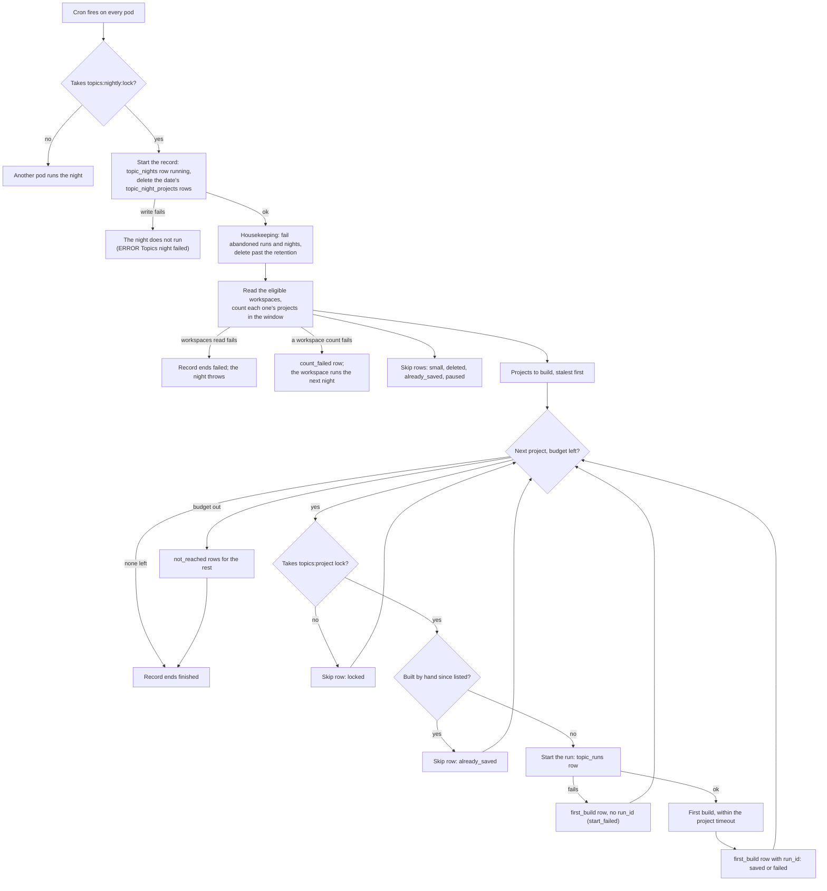

# ai-labels runbook

ai-labels labels every ended trace in opted-in workspaces with AI-generated labels, computed by opik-inference. It
runs only where `AI_LABELS_ENABLED=true`, and is off by default everywhere, OSS included. Nothing stops an OSS install
from turning it on, but it needs an opik-inference deployment and its credential, which only Comet-hosted deployments
have.

## Turning it on for a deployment

| Env var | Value |
|---|---|
| `AI_LABELS_ENABLED` | `true` |
| `AI_LABELS_INFERENCE_URL` | the opik-inference cell, e.g. `https://opik-inference.comet.com`. The backend refuses to start with an `http` URL, except to `localhost` or a loopback address, even with `AI_LABELS_ENABLED=false`: guardrails use the same URL |
| `AI_LABELS_INFERENCE_CREDENTIAL` | the deployment's opik-inference credential, from a secret (`component.backend.secretRefs`) |

- The backend refuses to start with ai-labels on unless `ANALYTICS_DB_DATA_MODEL_TRACE_COLUMNS_NON_NULLABLE=true`
  (the cut-over `traces` table). The `spans` cutover doesn't need to be done.
- opik-inference: the deployment needs its own `deployments` entry and credential in `config/inference.yaml`, with
  `allowed_orgs: "*"`. Opik sends workspace ids as `org_id`, so a real-org allow-list answers 403 `org_not_allowed`.
- Calls to opik-inference (ai-labels and topic vectors) never follow a redirect, and read at most
  `AI_LABELS_INFERENCE_MAX_RESPONSE_BYTES` (32 MiB) of a response body. A redirect or a longer body fails the call
  as `upstream_error`; a longer body's connection is closed without reading the rest.
- Every other `aiLabels` setting is in `apps/opik-backend/config.yml` and overridable as `AI_LABELS_*`.

## Opting workspaces in and out

Opt-in is the `ai_label_workspaces` table in the state database (MySQL). There is no API.

Before enabling a workspace, check how much it will backfill: its traces in the horizon (7 days by default). Traces
created before a task's `applies_from` are never labeled.

```sql
-- ClickHouse
SELECT count()
FROM traces
WHERE workspace_id = '<workspace_id>'
  AND created_at >= now64(6) - INTERVAL 7 DAY;
```

The pool's throughput binds first: one L40S on the 4B model labels about 3 traces a second at 7K tokens each (22K
tokens/s), and a trace with large spans costs up to 50 times a small one. The sweep takes the newest traces first, so a
backfill works backward from now, and when the pool can't keep up the oldest traces age out of the horizon unlabeled
(`ai_labels.unsettled` stops shrinking). The global budget (`AI_LABELS_BUDGET_BYTES`, about 3 minutes of the pool by
default) bounds how much waits in opik-inference, and is shared out evenly between the workspaces that have traces to
label.

```sql
-- MySQL: enable (or re-enable) a workspace
INSERT INTO ai_label_workspaces (workspace_id, enabled, added_by)
VALUES ('<workspace_id>', TRUE, '<your name>')
ON DUPLICATE KEY UPDATE enabled = TRUE, added_by = '<your name>';

-- MySQL: disable a workspace. Immediate: the next sweep drops it. Jobs in flight still load, and labels stay.
UPDATE ai_label_workspaces SET enabled = FALSE WHERE workspace_id = '<workspace_id>';

-- MySQL: list the enabled workspaces
SELECT workspace_id, added_at, added_by FROM ai_label_workspaces WHERE enabled = TRUE ORDER BY added_at;
```

## Reading summaries

There is no UI yet. Take each trace's latest label (by write time):

```sql
-- ClickHouse
SELECT trace_id, task_version, JSONExtractString(output, 'summary') AS summary
FROM ai_labels
WHERE workspace_id = '<workspace_id>'
  AND project_id = '<project_id>'
  AND task = 'trace_summary'
  AND key = 'output'
ORDER BY workspace_id, project_id, task, trace_id, key, updated_at DESC
LIMIT 1 BY workspace_id, project_id, task, trace_id, key;
```

## What to watch

| Metric | Meaning |
|---|---|
| `ai_labels.unsettled_past_slo` | Unsettled (trace, task) pairs past the SLO, per workspace. The headline. |
| `ai_labels.budget.in_flight` / `.limit` | Cost in flight against the budget. Pinned at the limit means the pool is the bottleneck. |
| `ai_labels.unsettled` | Unsettled (trace, task) pairs in the horizon: the backlog. |
| `ai_labels.tick.phase_seconds` by `phase` | Time in load, sweep and submit. Loading stops starting jobs at 40% of the tick budget. |
| `ai_labels.tick.interval_seconds`, `.budget_seconds` | The tick cadence and the time a tick may use, as configured (`AI_LABELS_TICK_INTERVAL`, `AI_LABELS_TICK_BUDGET`). Loading stops at 40% of the budget, the sweep at 70%, submit at all of it. |
| `ai_labels.sweep.buckets` / `.buckets_reached` | N as configured vs the buckets the latest sweep got through before its share of the tick budget. Fewer than N means the sweep ran out of time (`ai_labels.sweep.overrun`); the first bucket swept rotates, so none starves. |
| `ai_labels.sweep.candidates` / `ai_labels.tick.workspaces` | Traces the latest sweep found to label, and the workspaces they span. Many candidates but few admitted (`ai_labels.submit.traces`) means the budget, not the sweep, bounds throughput. |
| `ai_labels.jobs.submitted` by `endpoint` | Jobs opik-inference accepted (202) and the tick recorded as open. Flat while `ai_labels.sweep.candidates` is high means submits fail: see `ai_labels.submit.throttled`, `.rejected` and the logs. |
| `ai_labels.jobs.open` | Jobs submitted and not yet loaded, as the leader last knew them. Growing while `ai_labels.items.done` is flat means jobs finish slower than they start, or never: the pool, or the service, is behind. |
| `ai_labels.jobs.oldest_open_seconds` | How long the oldest open job has been out, measured at scrape time. Past a few tick intervals the pipeline is stuck: the job is hung at the service, or the leader stopped ticking (the gauge then keeps growing on the last leader). 0 with none open. |
| `ai_labels.render.traces` / `ai_labels.submit.traces` | Traces rendered vs admitted. Far apart means renders are wasted: raise `AI_LABELS_MIN_ITEM_BYTES` toward a typical item. |
| `ai_labels.items.failed` by `error_code` | `render_over_budget`, `render_error`, `item_too_large`, `job_lost`, `missing_result`, `missing_answer`, or the service's code. |
| `ai_labels.submit.rejected` | A submit rejected with 400: a renderer or task bug. |
| `ai_labels.sweep.guard_trips` | A sweep query hit a ClickHouse guard: raise `AI_LABELS_SWEEP_BUCKETS`. |
| `ai_labels.render.compaction_level`, `.bytes` | How far traces had to be compacted to fit. |
| `ai_labels.render.history_turns`, `.history_bytes` | The earlier thread turns left in each fitted history, and their size. |
| `ai_labels.render.history_errors` | Failed reads of earlier turns. The chunk's render fails and is retried as `render_error`. |
| `ai_labels.render.duration_seconds` by `outcome` | Wall time per chunk (ClickHouse reads + render): `ok`, or `one_at_a_time` after a chunk read failed. |
| `ai_labels.render.cpu_seconds` | Java CPU spent rendering, excluding ClickHouse reads; its rate is cores. Spec 10 budgets about 0.25 core of Opik CPU per tick. Emitted only when the JVM supports and enables current-thread CPU time: no series means no measurement, not zero CPU or a met budget. ClickHouse's side is in `system.query_log`, where `log_comment` starts with `ai-labels:render:` (filter `log_comment LIKE 'ai-labels:render:%'`). |

## Topics nightly job

Once a night the job builds each project's topic list from its topic vectors. Stage 2a has the first build only: a
project with a saved list is skipped every night until the nightly update ships. It reads the same workspaces as
ai-labels, and runs only with `TOPICS_ENABLED=true`. During the day, the first-build job builds a new project's first
list without waiting for the night (see "First builds during the day").

A first build reads the project's window (the 30 whole UTC days before the night, the newest 100,000 traces at most),
merges identical intent texts, groups them with k-means (30 to 50 groups, about one per 30 unique texts), asks Qwen
through opik-inference `/v1/generate` to name up to 10 topics over the groups, and assigns every window trace to its
nearest topic prototype or to Other. The prompt shows each group's share and 5 to 10 example requests (the most
frequent, then the ones nearest the group's centre); the answer names the topics and places every group in one topic
or in Other, and a name that is a catch-all as a whole ("Other", "General Requests") is dropped. It writes:

| Table | Database | What |
|---|---|---|
| `topics` | MySQL | One row per topic: name, definition, `born` (the night), `size` (window traces). |
| `topic_prototypes` | MySQL | The vectors traces are assigned by, several per topic, and the known-Other ones (`topic_id` null). |
| `topic_project_states` | MySQL | One row per project with a saved list: `rebuilds`, `last_run_id`, `window_until`. |
| `topic_runs` | MySQL | One row per run: `running`, then `saved` or `failed` with `error_code`. Kept 90 days. |
| `topic_run_counts` | MySQL | One row per topic of a saved run, and one for Other: `traces` in the run's window and `rank` (null for Other). The topics API compares a project's last two saved runs. Kept 90 days. |
| `trace_topics` | ClickHouse | One row per window trace and run: its `topic_id`, the all-zeros id for Other. The latest row by `last_updated_at` wins across sources (dedupe by `trace_id`, not by the sort key); a latest row with `is_deleted = 1` hides the trace. The sort key ends in `source`, so merges keep one night row and one arrival row per trace. |

### Turning it on and off

| Env var | Default | Meaning |
|---|---|---|
| `TOPICS_NIGHTLY_ENABLED` | `true` | Runs the job. Needs `TOPICS_ENABLED=true`. |
| `TOPICS_NIGHTLY_SCHEDULE` | `0 0 2 * * ?` | Quartz cron, UTC. The night is the UTC date the job starts on. |
| `TOPICS_NIGHTLY_BUDGET` | `2h` | No project starts after this; the rest run the next night. |
| `TOPICS_NIGHTLY_PROJECT_TIMEOUT` | `15m` | One run is stopped and failed with `timeout` after this. Under the budget. |
| `TOPICS_NIGHTLY_MIN_VECTORS` | `100` | A project is built when its window holds at least this many traces with a vector. At most 100000. |
| `TOPICS_NIGHTLY_WINDOW_DAYS` | `30` | The window, in whole UTC days before the night. |
| `TOPICS_NIGHTLY_MAX_VECTORS` | `100000` | A larger window keeps its newest traces. |
| `TOPICS_NIGHTLY_QWEN_DEADLINE` | `120s` | The deadline of the Qwen call. The call uses the `batch` lane, which takes up to 300s. |
| `TOPICS_NIGHTLY_RUNS_RETENTION` | `90d` | `topic_runs` and `topic_run_counts` rows and the night records (`topic_nights`, `topic_night_projects`) are deleted after this. At most `365d`. |

The window count and the window read also use `TOPICS_VECTORS_FIND_MAX_ROWS_TO_READ` as their ClickHouse
`max_rows_to_read`.

To turn it off, set `TOPICS_NIGHTLY_ENABLED=false` and restart. Saved lists stay.

To stop it for one workspace, remove the workspace from `TOGGLE_TOPICS_WORKSPACES` (a deploy), or, without a deploy,
disable it in `ai_label_workspaces`, which also stops its ai-labels summaries (see "Opting workspaces in and out").
Either one also stops its topic vectors. The next night skips it; a night already running reads the workspaces once,
at its start, so it still runs the workspace's projects.

### How a night runs

Where a night stops and where it goes on:



Every record write after the start is best-effort: a failed one is logged and the night goes on (see "What to watch").

- Every pod fires the job on the cron. The first to take the Redis lock `topics:nightly:lock` runs the night and keeps
  the lock until it expires (budget + project timeout + 5 minutes), so no other pod runs the same night. If that pod
  dies during the night (a deploy), the rest of the night waits for the next night: the cron does not fire again, and
  the night endpoint answers `409` until the lock expires. To finish the night sooner, delete the Redis key
  `topics:nightly:lock` and call the night endpoint (see "Running by hand").
- The night first fails runs left `running` by an earlier night (`error_code = 'abandoned'`), and deletes runs and
  run counts older than the retention. It does the same for the night records: a night left `running` past the night
  lock's lease is set to `failed`, and records older than the retention are deleted.
- It counts each enabled workspace's projects in the window, drops those under `TOPICS_NIGHTLY_MIN_VECTORS` and those
  with a saved list, and runs the rest one at a time, stalest first: a project without a list, then the oldest
  `window_until`, and among equals the fewest vectors. Stage 2a builds only projects without a list, so for now the
  smallest go first; a project with a list that a night does not reach has the oldest `window_until`, so it goes first
  the next night.
- A project whose last 3 runs all failed (`abandoned` included) is skipped as `paused` for 7 nights from the night of
  the last failure, so it does not take the budget every night; then the night tries it again. A run by hand ignores
  the pause, and a saved run ends it. A paused project counts as stale (see "What to watch").
- Each run holds the Redis lock `topics:project:<project_id>`, so a run started by hand and the night never build the
  same project at once.
- A first build under 1,000 traces is saved with `"provisional": true` in its stats.

A failed run writes nothing but its `topic_runs` row; the project is built again the next night.

A run saves in this order: one MySQL transaction (state, topics, prototypes, run counts, the run `saved`), then the
`trace_topics` insert, retried up to 3 times; each attempt stops after 120s. If the insert still fails, the run stays
saved and an ERROR names it (`saved, but its trace_topics insert failed`); the window's traces keep the topics they had
(none, after a first build) until a later saved run writes the window again. To write them now, forget the project's
list and build it again (see "Running by hand"). A timeout that comes after the MySQL commit finds the run saved: it
logs a WARN (`saved, ... but its trace_topics insert outlasted the stop`), the run counts as saved, and the project's
locks are held until the insert ends (at most about 8.5 minutes; the lock leases cover it).

| `error_code` | Meaning |
|---|---|
| `qwen_timeout` | The Qwen call ran out of `TOPICS_NIGHTLY_QWEN_DEADLINE`. |
| `qwen_error` | The Qwen call failed after its 2 retries, or with a 4xx. `error_message` has the code and HTTP status. |
| `qwen_bad_answer` | Qwen's answer has no JSON object, or breaks the schema: opik-inference answers `schema_violation` for a cut or off-schema answer, which is not retried. The run logs the answer's length and SHA-256, not its text. |
| `window_read` | The ClickHouse window read failed (it stops after 120s, or after `TOPICS_NIGHTLY_PROJECT_TIMEOUT` if shorter), or the window had no usable vector. |
| `invariant` | A check before the save failed: more than 10 topics, a blank name or one that is a catch-all as a whole, a prototype not of unit length, a trace not labelled once. |
| `timeout` | The run outlasted `TOPICS_NIGHTLY_PROJECT_TIMEOUT`, or the job was interrupted. |
| `save` | The MySQL transaction failed, or another run saved the project meanwhile (`error_message` says so; only if the project's Redis lock was lost). Nothing of the run is written: the `trace_topics` insert comes after the commit. |
| `abandoned` | The pod stopped during the run. |
| `internal` | A bug: read the logs for the run id. |

### Tonight's runs

```sql
-- MySQL: the runs started since midnight UTC, newest first
SELECT run_id, workspace_id, project_id, mode, status, error_code, started_at, finished_at,
       JSON_EXTRACT(stats, '$.vectors') AS vectors, JSON_EXTRACT(stats, '$.topics') AS topics,
       JSON_EXTRACT(stats, '$.other_share') AS other_share, JSON_EXTRACT(stats, '$.provisional') AS provisional
FROM topic_runs
WHERE started_at >= UTC_DATE()
ORDER BY started_at DESC;

-- MySQL: a project's live topics
SELECT name, size, born, definition FROM topics
WHERE project_id = '<project_id>' AND retired_at IS NULL
ORDER BY size DESC;
```

```sql
-- ClickHouse: a project's trace counts per topic in the last saved window
-- (window_from and window_until are in the run's stats)
SELECT topic_id, count() AS traces
FROM (
    SELECT trace_id, topic_id, is_deleted
    FROM trace_topics
    WHERE workspace_id = '<workspace_id>' AND project_id = '<project_id>'
    AND trace_created_at >= '<window_from>' AND trace_created_at < '<window_until>'
    ORDER BY trace_id, last_updated_at DESC, run_id DESC
    LIMIT 1 BY trace_id
)
WHERE is_deleted = 0
GROUP BY topic_id
ORDER BY traces DESC;
```

Each run logs at INFO, by run id: Qwen's token counts, and one line with the window, vectors, unique texts, k, seed,
the topics with their sizes, the Other share and the phase timings. The author prompt and Qwen's raw answer hold
users' trace text, so no log level prints them: the run logs their length, the prompt's group count and a SHA-256 of
each, which matches the same prompt or answer across runs.
Search the logs for `Topics run '<run_id>'`.

### Running by hand

Two internal endpoints start work now instead of waiting for the night. Call them from inside the cluster. Both answer
`501` when `TOPICS_ENABLED` is off and `409` when `TOPICS_NIGHTLY_ENABLED` is off. Both take `&night=yyyy-MM-dd`
(`?night=` for the night endpoint): the night is today (UTC) by default, so the window ends at today's start. `night`
is at most tomorrow, whose window holds today's traces so far, and at least 365 days ago.

**One project.** The night's rules apply: the workspace is opted in to topics, and the project's window holds at least
`TOPICS_NIGHTLY_MIN_VECTORS` vectors. Only one run by hand goes at a time across the cluster.

```bash
curl -X POST "http://<opik-backend>:8080/v1/internal/topics/projects/<project_id>/run?workspace_id=<workspace_id>"
```

It answers `202` with the `run_id`. The run goes on in the background with the same timeout; read its outcome in
`topic_runs`. It answers `409` when the workspace is not opted in, the window is too small (or the project is not the
workspace's), a run of the project or another run by hand is in progress, or the project already has a list.

**A whole night.** It runs every eligible project, as the scheduled job does, under the same night lock. The lock is
released when the night ends, so the scheduled job is skipped only while a night started by hand is still running.

```bash
curl -X POST "http://<opik-backend>:8080/v1/internal/topics/nights/run"
```

It answers `202` with the `night`, and `409` when a night is in progress. Each project's outcome is its `topic_runs`
row.

To build a project that already has a list again (for example after a bad first build), delete its list first. Its
`trace_topics` rows stay until the new run replaces them:

```sql
-- MySQL: forget a project's list, so the next night (or the endpoint) builds it again
DELETE FROM topics WHERE workspace_id = '<workspace_id>' AND project_id = '<project_id>';
DELETE FROM topic_prototypes WHERE workspace_id = '<workspace_id>' AND project_id = '<project_id>';
DELETE FROM topic_project_states WHERE workspace_id = '<workspace_id>' AND project_id = '<project_id>';
```

### First builds during the day

A project that reaches `TOPICS_NIGHTLY_MIN_VECTORS` during the day does not wait for the night: every 10 minutes the
first-build job builds the first list of each project that has none, for tomorrow's night (UTC). Tomorrow's window ends
at tomorrow's start, so it holds today's traces so far.

| Env var | Default | Meaning |
|---|---|---|
| `TOPICS_FIRST_BUILD_ENABLED` | `true` | Runs the job. Needs `TOPICS_ENABLED=true` and `TOPICS_NIGHTLY_ENABLED=true`. |
| `TOPICS_FIRST_BUILD_INTERVAL` | `10m` | How often every pod fires the job; one run per interval across the cluster. At most `1d`. |
| `TOPICS_FIRST_BUILD_BUDGET` | `9m` | No project starts after this much of a run; the rest wait for the next run. Under the interval. |

- Every pod fires the job every interval, each at its own second. Two Redis locks make that one run per interval
  across the cluster:
  - `topics:first_build:leader` is held for the run and released when it ends, so two runs never overlap. Its lease is
    budget + project timeout + 5 minutes. It matters only when the pod dies mid-run.
  - `topics:first_build:run` is taken by the leader before it runs and never released. It expires one interval (less
    up to 1s for trigger jitter) after the run started, so a pod that fires sooner skips.
- A run counts each opted-in workspace's projects in tomorrow's window, with the night's count query and guards. It
  takes the projects with at least `TOPICS_NIGHTLY_MIN_VECTORS` vectors that exist, have no list, are not paused (as
  the night counts it) and had no run started in the last 24 hours, the most vectors first.
- It builds them one at a time through the run by hand of one project (see "Running by hand"): the same checks and
  locks (`topics:by_hand`, `topics:project:<project_id>`) and timeout, and the same `topic_runs` row. It waits for each
  run before it starts the next one.
- The night: a run is skipped while the night holds `topics:nightly:lock` (from 02:00 UTC for the night's budget +
  project timeout + 5 minutes). The job reads the lock and never takes it. A run going on when the night starts
  finishes its current project and starts no other. A list the job saved is for tomorrow's night, so that night skips
  the project as `already_saved`.
- A failed run is not retried by the job for 24 hours: the night takes the project, and the pause after 3 failed runs
  applies.
- By hand: while the job builds a project it holds `topics:by_hand`, so the project endpoint answers `409`. A run by
  hand in progress, or any project that cannot start, stops the job's run; the next run reads the projects again.

To turn it off, set `TOPICS_FIRST_BUILD_ENABLED=false` and restart; `TOPICS_NIGHTLY_ENABLED=false` turns it off too.
Each run logs `Topics first builds started` and `Topics first builds finished` with the night and its counts; each
project's outcome is its `topic_runs` row.

### What to watch

Every metric of one workspace's work has `workspace_id` and `workspace_name` (the name falls back to the id). These
counters and histograms are for the dashboard. A nightly series starts on the night's pod, so `increase()` misses the
event that creates it: the alerts read the state gauges further down, not these.

| Metric | Meaning |
|---|---|
| `topics.nightly.projects` by `decision`, `reason` | Projects the night looked at: `skip` with a `reason` (`small`: under the minimum; `deleted`; `already_saved`: a list already built; `locked`: held by a run started by hand; `paused`: its last 3 runs failed within 7 nights), `first_build`, `not_reached` (the budget ran out: they run the next night). `not_reached` above zero means the budget is too short. |
| `topics.runs` by `status`, `error_code` | Finished runs. Each failed run counts once: `start_failed` when the run could not start (it has no `topic_runs` row), `abandoned` when the next night's housekeeping fails a run left `running`. A run is counted by the write that ends its row: when marking a run failed throws, its row stays `running` and nothing counts it until housekeeping fails it as `abandoned`. |
| `topics.run.duration_seconds` by `phase` | Time in `window` (ClickHouse read), `kmeans`, `qwen`, `assign`, `save`. |
| `topics.qwen.calls` by `outcome` | `ok`, `timeout`, `error`, `bad_answer`. A call counts after its answer is read: an answer that cannot be read is `bad_answer`, not `ok`. |
| `topics.save.rows` by `table` | Rows saved runs wrote. A `trace_topics` insert that failed after the save adds none. |
| `topics.run.other_share` | The Other share of each saved run (its `stats.other_share`). No alert: no threshold is set. |
| `topics.nightly.count_failures` by workspace, `error_type` | Workspaces whose window count read failed. The night skips all their projects; they run the next night. |
| `topics.nightly.budget_used_seconds` | Wall time of each night (no workspace). Near `TOPICS_NIGHTLY_BUDGET` means projects will soon be `not_reached`. |

Each night writes its record as it goes:

| Table | What |
|---|---|
| `topic_nights` | One row per night (the UTC date): `started_at`, `finished_at`, `outcome` (`running`, `finished`, or `failed` when a read of the workspaces, lists or projects failed), `eligible_workspaces`, `count_failures`, and `projects` (JSON, projects per decision). Written when the night starts and when it ends, also with no project. A night run again for the same date replaces its row and its project rows. |
| `topic_night_projects` | One row per project the night looked at, skips included: `workspace_id`, `project_id`, `vectors`, `decision`, `reason`, `run_id` (null when no run started). A workspace whose count read failed has one row with a null `project_id` and decision `count_failed`. |

A night whose start write fails does not run, so a rerun of a date never mixes its rows with the earlier run's; if
starts keep failing, "Night not started" fires. A later record write that fails logs a WARN (`could not write its record`) for the first
of the night, DEBUG for the rest, and a WARN with their count at the night's end; the night goes on.

The state gauges come from these tables. Each pod reads them once a minute and keeps the result; a scrape reads no
table. Every pod publishes the same values: read them with `max`, never `sum`. They are published only while
`TOPICS_ENABLED` and `TOPICS_NIGHTLY_ENABLED` are on, and only from the first night on, except the heartbeat
`state_age_seconds`. A workspace counts only while it is opted in to both topics and ai-labels.

| Gauge | Value |
|---|---|
| `topics.nightly.state_age_seconds` | Seconds since this pod last read the night tables; before its first good read, since it started trying. Published whenever the job is on, also before the first night. Above a few minutes, every other state gauge is stale. |
| `topics.nightly.state_refresh_failures` | A counter: failed reads of the night tables (WARN `could not read the night tables`). Set to 0 at startup when the job is on. |
| `topics.nightly.last_started_age_seconds` | Seconds since the latest night started, scheduled or by hand. Before the first night ever, seconds since the pod started reading. |
| `topics.nightly.running_seconds` | Age of the oldest night still `running`; 0 when none. A night whose pod died stays `running` until the next night's housekeeping fails it. |
| `topics.nightly.last_night.projects` by workspace, `decision`, `reason` | Projects per decision in the latest ended night, `count_failed` included. |
| `topics.nightly.last_night.runs` by workspace, `status` | Runs the latest ended night started, by their `topic_runs` status: `saved`, `failed` (a run that could not start counts here), `running` (marking it failed threw). |
| `topics.nightly.last_night.failed` | 1 when the latest ended night failed (a read failed, or its pod died and the next night's housekeeping failed it), 0 when it finished. |
| `topics.nightly.stale_projects` by workspace | Projects expected on each of the last 3 ended nights with no saved run since the first of them (a run by hand counts). Expected is any decision but a skip as `small`, `deleted` or `already_saved`: this covers `not_reached`, failed first builds, start failures and `paused`. 0 for each workspace without one. |
| `topics.nightly.starved_projects` by workspace | Projects `not_reached` on each of the last 2 ended nights. 0 for each workspace without one. |
| `topics.workspaces.mismatched` by workspace | 1 for a workspace in `TOGGLE_TOPICS_WORKSPACES` and not enabled in `ai_label_workspaces`: no night runs it. |

The Prometheus names replace the dots with underscores, for example `topics_nightly_stale_projects`; the counters end
in `_total`.

ClickHouse queries of the job have a `log_comment` that starts with `topics:`.

### Alerts

The rules live in comet-monitoring as a PrometheusRule, armed per environment, not in this repo. They read the state
gauges only, and every rule groups by `k8s_namespace_name`.

| Alert | Condition | PromQL | Check | First step |
|---|---|---|---|---|
| Night not started | No night started for 25 hours. Before the first night ever, the age counts from the pod's start, so a first night that never starts fires too. | `max by (k8s_namespace_name) (topics_nightly_last_started_age_seconds) > 25 * 3600` | The latest nights query below. | Read the logs for `Topics night` around the cron time. A night lock left by a dead pod (`topics:nightly:lock`) blocks nights until it expires. Run the night by hand (see "Running by hand"). |
| Night too long | A night runs longer than budget + project timeout + 30 minutes (2 h 45 m with the defaults). | `max by (k8s_namespace_name) (topics_nightly_running_seconds) > 9900` | The latest nights query below; its `running` row. | A night whose pod died stays `running` until the next night: check for a pod restart. Otherwise find the `running` run in `topic_runs` and its logs. |
| Last night failed | The latest ended night failed: a read failed, or its pod died and the next night's housekeeping failed it. A night whose reads fail writes no project rows, so no other nightly rule sees it. | `max by (k8s_namespace_name) (topics_nightly_last_night_failed) > 0` | The latest nights query below; its `failed` row. | The ERROR `Topics night failed` (or `started by hand failed`) has the error. No ERROR: the pod died, check for a restart. Clears when the next night finishes. |
| Stale projects | A project was expected on each of the last 3 nights and got no saved run. | `max by (k8s_namespace_name, workspace_id, workspace_name) (topics_nightly_stale_projects) > 0` | The stale-project query below. | Find its runs in `topic_runs`: failed (read `error_code`), never started (a `first_build` row with no `run_id`), `not_reached` (the budget), or skipped as `paused` (its last 3 runs failed: fix the cause, then run it by hand). |
| Starved projects | A project was `not_reached` on each of the last 2 nights. | `max by (k8s_namespace_name, workspace_id, workspace_name) (topics_nightly_starved_projects) > 0` | The starved-project query below. | Raise `TOPICS_NIGHTLY_BUDGET`, or split the night. |
| Failed share | More than 20% of the latest night's runs failed, with at least 5 runs in the namespace. | See below. | The latest night query below. | Group the failures by `error_code`: `qwen_*` points at opik-inference, `window_read` and `save` at ClickHouse or MySQL. A `first_build` row with no `run_id` could not start: MySQL. |
| Count read failed | A workspace's window count read failed in the latest night. | `max by (k8s_namespace_name, workspace_id, workspace_name) (topics_nightly_last_night_projects{decision="count_failed"}) > 0` | The latest night query below. | The WARN `Topics night count read failed, workspace '<workspace_id>'` has the ClickHouse error (often a guard trip). The workspace runs the next night. |
| Workspace mismatch | A workspace is opted in to topics and not to ai-labels, for 1 hour. Warning. | `max by (k8s_namespace_name, workspace_id, workspace_name) (topics_workspaces_mismatched) > 0` with `for: 1h` | The mismatch query below. | Opt the workspace in to ai-labels, or out of topics. |
| State gauges stale | A pod has not read the night tables for 10 minutes: the other nightly alerts are blind. | `max by (k8s_namespace_name) (topics_nightly_state_age_seconds) > 600` | `topics_nightly_state_refresh_failures_total`. | The WARN `Topics nightly gauges could not read the night tables` has the MySQL error. |

The failed-share rule (a pod's series per workspace, so `max` first):

```promql
sum by (k8s_namespace_name) (max by (k8s_namespace_name, workspace_id, status) (topics_nightly_last_night_runs{status="failed"}))
  / sum by (k8s_namespace_name) (max by (k8s_namespace_name, workspace_id, status) (topics_nightly_last_night_runs)) > 0.2
and sum by (k8s_namespace_name) (max by (k8s_namespace_name, workspace_id, status) (topics_nightly_last_night_runs)) >= 5
```

A quiet day fires none of these but the heartbeats (Night not started, State gauges stale). A night with no project
still writes its record. A project under the minimum, a deleted project and a project with a list are not expected, so
they are never stale. A workspace turned off in both opt-in tables is not counted; turned off in only one of them, it
is a mismatch. With the job off, no gauge is published.

```sql
-- MySQL: the latest nights
SELECT night, outcome, started_at, finished_at, eligible_workspaces, count_failures, projects
FROM topic_nights
ORDER BY started_at DESC
LIMIT 5;

-- MySQL: the latest ended night, per workspace, decision and run outcome
SELECT np.workspace_id, np.decision, np.reason, r.status, r.error_code, COUNT(*) AS projects
FROM topic_night_projects np
LEFT JOIN topic_runs r ON r.run_id = np.run_id
WHERE np.night = (SELECT night FROM topic_nights WHERE outcome <> 'running' ORDER BY started_at DESC LIMIT 1)
GROUP BY np.workspace_id, np.decision, np.reason, r.status, r.error_code;

-- MySQL: stale projects: expected on each of the last 3 ended nights, no saved run since the first of them
WITH nights AS (
    SELECT night, started_at FROM topic_nights WHERE outcome <> 'running' ORDER BY started_at DESC LIMIT 3
)
SELECT np.workspace_id, np.project_id, GROUP_CONCAT(DISTINCT np.decision) AS decisions
FROM topic_night_projects np
JOIN nights n ON n.night = np.night
WHERE np.project_id IS NOT NULL AND np.decision <> 'count_failed'
  AND NOT (np.decision = 'skip' AND np.reason IN ('small', 'deleted', 'already_saved'))
  AND NOT EXISTS (SELECT 1 FROM topic_runs r
                  WHERE r.project_id = np.project_id AND r.status = 'saved'
                    AND r.started_at >= (SELECT MIN(started_at) FROM nights))
GROUP BY np.workspace_id, np.project_id
HAVING COUNT(DISTINCT np.night) = 3;

-- MySQL: starved projects: not_reached on each of the last 2 ended nights
WITH nights AS (
    SELECT night FROM topic_nights WHERE outcome <> 'running' ORDER BY started_at DESC LIMIT 2
)
SELECT np.workspace_id, np.project_id, MAX(np.vectors) AS vectors
FROM topic_night_projects np
JOIN nights n ON n.night = np.night
WHERE np.decision = 'not_reached'
GROUP BY np.workspace_id, np.project_id
HAVING COUNT(DISTINCT np.night) = 2;

-- MySQL: of the workspaces in TOGGLE_TOPICS_WORKSPACES, the ones enabled in ai-labels. A listed id missing here is
-- mismatched: no night runs it.
SELECT workspace_id
FROM ai_label_workspaces
WHERE enabled = TRUE AND workspace_id IN ('<workspace_id>', '<workspace_id>');
```

The gauges also leave out workspaces no longer opted in and deleted projects; these queries do not.

### Deletes

A `trace_topics` row lives as long as its trace, as for `topic_vectors`: retention and the trace-delete cascade delete
both. Deleting a project deletes its MySQL rows too: `topics`, `topic_prototypes`, `topic_project_states` and
`topic_runs`, since names, definitions and prototypes come from its traces. `topic_runs` rows go after 90 days anyway,
and so do the night records (`topic_nights`, `topic_night_projects`); a project's night rows stay until then.
Deleting a workspace does not delete its MySQL rows, as for `ai_labels`.
