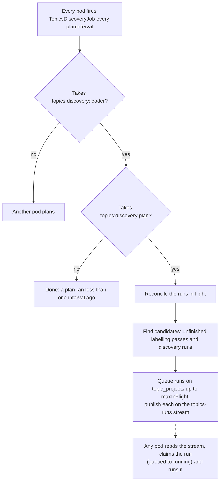

# ai-labels runbook

ai-labels labels every ended trace in opted-in workspaces with AI-generated labels, computed by opik-inference. It
runs only where `AI_LABELS_ENABLED=true`, and is off by default everywhere, OSS included. Nothing stops an OSS install
from turning it on, but it needs an opik-inference deployment and its credential, which only Comet-hosted deployments
have.

## Turning it on for a deployment

| Env var | Value |
|---|---|
| `AI_LABELS_ENABLED` | `true` |
| `AI_LABELS_INFERENCE_URL` | the opik-inference cell, e.g. `https://opik-inference.comet.com`. The backend refuses to start with an `http` URL, except to `localhost` or a loopback address, even with `AI_LABELS_ENABLED=false`: guardrails use the same URL |
| `AI_LABELS_INFERENCE_CREDENTIAL` | the deployment's opik-inference credential, from a secret (`component.backend.secretRefs`) |

- The backend refuses to start with ai-labels on unless `ANALYTICS_DB_DATA_MODEL_TRACE_COLUMNS_NON_NULLABLE=true`
  (the cut-over `traces` table). The `spans` cutover doesn't need to be done.
- opik-inference: the deployment needs its own `deployments` entry and credential in `config/inference.yaml`, with
  `allowed_orgs: "*"`. Opik sends workspace ids as `org_id`, so a real-org allow-list answers 403 `org_not_allowed`.
- Calls to opik-inference (ai-labels, guardrails and topic vectors) never follow a redirect, and read at most
  `OPIK_INFERENCE_MAX_RESPONSE_BYTES` (32 MiB) of a response body. A redirect or a longer body fails the call
  as `upstream_error`; a longer body's connection is closed without reading the rest.
- Every other `aiLabels` setting is in `apps/opik-backend/config.yml` and overridable as `AI_LABELS_*`.

## Opting workspaces in and out

Opt-in is the `ai_label_workspaces` table in the state database (MySQL). There is no API.

Before enabling a workspace, check how much it will backfill: its traces in the horizon (7 days by default). Traces
created before a task's `applies_from` are never labeled.

```sql
-- ClickHouse
SELECT count()
FROM traces
WHERE workspace_id = '<workspace_id>'
  AND created_at >= now64(6) - INTERVAL 7 DAY;
```

The pool's throughput binds first: one L40S on the 4B model labels about 3 traces a second at 7K tokens each (22K
tokens/s), and a trace with large spans costs up to 50 times a small one. The sweep takes the newest traces first, so a
backfill works backward from now, and when the pool can't keep up the oldest traces age out of the horizon unlabeled
(`ai_labels.unsettled` stops shrinking). The global budget (`AI_LABELS_BUDGET_BYTES`, about 3 minutes of the pool by
default) bounds how much waits in opik-inference, and is shared out evenly between the workspaces that have traces to
label.

```sql
-- MySQL: enable (or re-enable) a workspace
INSERT INTO ai_label_workspaces (workspace_id, enabled, added_by)
VALUES ('<workspace_id>', TRUE, '<your name>')
ON DUPLICATE KEY UPDATE enabled = TRUE, added_by = '<your name>';

-- MySQL: disable a workspace. Immediate: the next sweep drops it. Jobs in flight still load, and labels stay.
UPDATE ai_label_workspaces SET enabled = FALSE WHERE workspace_id = '<workspace_id>';

-- MySQL: list the enabled workspaces
SELECT workspace_id, added_at, added_by FROM ai_label_workspaces WHERE enabled = TRUE ORDER BY added_at;
```

## Reading summaries

There is no UI yet. Take each trace's latest label (by write time):

```sql
-- ClickHouse
SELECT trace_id, task_version, JSONExtractString(output, 'summary') AS summary
FROM ai_labels
WHERE workspace_id = '<workspace_id>'
  AND project_id = '<project_id>'
  AND task = 'trace_summary'
  AND key = 'output'
ORDER BY workspace_id, project_id, task, trace_id, key, updated_at DESC
LIMIT 1 BY workspace_id, project_id, task, trace_id, key;
```

## What to watch

| Metric | Meaning |
|---|---|
| `ai_labels.unsettled_past_slo` | Unsettled (trace, task) pairs past the SLO, per workspace. The headline. |
| `ai_labels.budget.in_flight` / `.limit` | Cost in flight against the budget. Pinned at the limit means the pool is the bottleneck. |
| `ai_labels.unsettled` | Unsettled (trace, task) pairs in the horizon: the backlog. |
| `ai_labels.tick.phase_seconds` by `phase` | Time in load, sweep and submit. Loading stops starting jobs at 40% of the tick budget. |
| `ai_labels.tick.interval_seconds`, `.budget_seconds` | The tick cadence and the time a tick may use, as configured (`AI_LABELS_TICK_INTERVAL`, `AI_LABELS_TICK_BUDGET`). Loading stops at 40% of the budget, the sweep at 70%, submit at all of it. |
| `ai_labels.sweep.buckets` / `.buckets_reached` | N as configured vs the buckets the latest sweep got through before its share of the tick budget. Fewer than N means the sweep ran out of time (`ai_labels.sweep.overrun`); the first bucket swept rotates, so none starves. |
| `ai_labels.sweep.candidates` / `ai_labels.tick.workspaces` | Traces the latest sweep found to label, and the workspaces they span. Many candidates but few admitted (`ai_labels.submit.traces`) means the budget, not the sweep, bounds throughput. |
| `opik.http.client.pool.connections` by `route` and `state`, `.pending`, `.max` by `route` | The shared HTTP client's pool, in all (`route=all`) and on the route to opik-inference (`route=opik-inference`), which ai-labels, guardrail checks and Topics share. `pending` above zero on that route means calls wait for a connection: raise `JERSEY_CLIENT_MAX_CONNECTIONS_PER_ROUTE`, keeping the concurrency sum the backend checks at startup below it. |
| `ai_labels.jobs.submitted` by `endpoint` | Jobs opik-inference accepted (202) and the tick recorded as open. Flat while `ai_labels.sweep.candidates` is high means submits fail: see `ai_labels.submit.throttled`, `.rejected` and the logs. |
| `ai_labels.jobs.open` | Jobs submitted and not yet loaded, as the leader last knew them. Growing while `ai_labels.items.done` is flat means jobs finish slower than they start, or never: the pool, or the service, is behind. |
| `ai_labels.jobs.oldest_open_seconds` | How long the oldest open job has been out, measured at scrape time. Past a few tick intervals the pipeline is stuck: the job is hung at the service, or the leader stopped ticking (the gauge then keeps growing on the last leader). 0 with none open. |
| `ai_labels.render.traces` / `ai_labels.submit.traces` | Traces rendered vs admitted. Far apart means renders are wasted: raise `AI_LABELS_MIN_ITEM_BYTES` toward a typical item. |
| `ai_labels.items.failed` by `error_code` | `render_over_budget`, `render_error`, `item_too_large`, `job_lost`, `missing_result`, `missing_answer`, or the service's code. |
| `ai_labels.submit.rejected` | A submit rejected with 400: a renderer or task bug. |
| `ai_labels.sweep.guard_trips` | A sweep query hit a ClickHouse guard: raise `AI_LABELS_SWEEP_BUCKETS`. |
| `ai_labels.render.compaction_level`, `.bytes` | How far traces had to be compacted to fit. |
| `ai_labels.render.history_turns`, `.history_bytes` | The earlier thread turns left in each fitted history, and their size. |
| `ai_labels.render.history_errors` | Failed reads of earlier turns. The chunk's render fails and is retried as `render_error`. |
| `ai_labels.render.duration_seconds` by `outcome` | Wall time per chunk (ClickHouse reads + render): `ok`, or `one_at_a_time` after a chunk read failed. |
| `ai_labels.render.cpu_seconds` | Java CPU spent rendering, excluding ClickHouse reads; its rate is cores. Spec 10 budgets about 0.25 core of Opik CPU per tick. Emitted only when the JVM supports and enables current-thread CPU time: no series means no measurement, not zero CPU or a met budget. ClickHouse's side is in `system.query_log`, where `log_comment` starts with `ai-labels:render:` (filter `log_comment LIKE 'ai-labels:render:%'`). |

## Reading topics

`GET /v1/private/topics?project_id=<project_id>` returns a project's live topics and their trace counts over the
window: the last `TOPICS_RUN_WINDOW_DAYS` UTC days (default 30), today included. The UI calls it. It reads MySQL,
then reads ClickHouse (one query for `collecting`, one per window day for `ready`), and writes nothing.

```bash
curl "http://<opik-backend>:8080/v1/private/topics?project_id=<project_id>" \
  -H "Authorization: <api_key>" \
  -H "Comet-Workspace: <workspace_name>"
```

The caller needs `PROJECT_DATA_VIEW` in the workspace. For a project in a workspace you cannot view, run the queries
under [Reading a project by hand](#reading-a-project-by-hand). They apply the same rules.

### Status

Every body has `today` and `window_from` (UTC dates, both included) and `topics` (empty unless `ready`).

| `status` | When | Other fields |
|---|---|---|
| `disabled` | The workspace is not opted in to both topics and ai-labels, or `TOPICS_ENABLED_WORKSPACES` lists it at a stage before `ui`. This includes a workspace opted out after a run: its topics stay in MySQL and are not shown. | None. No ClickHouse query. |
| `collecting` | Opted in, and the project has no live topic: before its discovery run, or after all its topics retired. | `vectors_in_window` (traces with a topic vector in the window) and `min_vectors` (`TOPICS_RUN_MIN_VECTORS`). `last_run_at` after a saved run. `attempt` (`status` only) when the project's newest `topic_runs` row (by `started_at`, then `run_id`) is `running` or `failed`. |
| `ready` | Opted in, and the project has at least one live topic. | `last_run_at`, `total_traces`, `labelled_from`, `topics` in rank order, `other`. |
| `too_large` | Opted in, and a ClickHouse read of `collecting` or `ready` hit a `TOPICS_READ_*` size guard: rows (158), memory (241), bytes (307) or rows or bytes (396). A retry fails the same way, so the page shows the state and does not retry. The backend logs a WARN `Topics read is too large` with the workspace and the project. | None. Not cached: the next request reads again. |

A `collecting` body is one of these cases:

| `attempt` | `last_run_at` | Meaning |
|---|---|---|
| none | none | Queued: no run yet. The discovery job runs the project once `vectors_in_window` reaches `min_vectors` and its vectors backfill allows it (see "Discovery runs and the vectors backfill"). |
| `running` | none or set | A run is in progress. |
| `failed` | none or set | The newest run failed. The job tries again 1 hour after the first failed discovery run, 6 hours after the second, and 1 day after each later one (see "Retries"). |
| none | set | A run saved and left no live topic. |

The housekeeping at the start of every discovery run fails a `running` row whose pod died, so the API shows the
row as it is.

### How it counts

- **Window.** The `TOPICS_RUN_WINDOW_DAYS` UTC days that end today: `[today - (windowDays - 1) days, today + 1 day)`.
  The day of a trace is `toDate(trace_created_at, 'UTC')`, the column the runs use. Near midnight UTC it can differ
  from the day the traces list shows.
- **Traces.** Only the traces the Logs page lists count. In `traces`, that is `source` `sdk` (or `unknown`, rows from
  before sources) and `visibility_mode` `default`, the filters the Logs page adds by itself. A trace counts when any
  of its rows matches, as in the traces list. Topics are built from every labelled trace. So experiment, playground,
  optimization and evaluator traces and hidden traces have topic rows, but no count includes them. A topic's `count`
  is then the number of traces Logs lists for it.
- **Rows.** Every row counts: arrival rows and run rows. A run writes its rows only after its MySQL save commits, so a
  failed run has none. A run's rows still count after retention deletes its `topic_runs` row.
- **Latest row.** Each trace counts once, by its latest row (the greatest `last_updated_at`, a run row over an
  arrival row stamped at the same time). A trace whose
  latest row is a tombstone (`is_deleted = 1`) does not count.
- **Other.** The all-zeros id. A row whose `topic_id` is not a live topic counts as Other.
- **Numbers.** `count`: the topic's counted traces in the window. `total_traces`: all counted traces, Other included.
  `share`: `count / total_traces`, 0 with no trace. `series`: one `{day, count}` entry per window day, oldest first,
  today last. `rank`: by `count` descending, then `born`, then `id`. `is_new`: born after the discovery run's date and
  in the last 7 days. `other`: only its `series`; add it to the topics' series for the project's total per day.
- **`labelled_from`.** The first day in the window with any row, omitted with no row. Zeros before it mean nothing was
  labelled yet (a new opt-in), not that there was no traffic.
- **Cache.** The counts of a `ready` project are kept in Redis for `CACHE_MANAGER_TOPICS_DAY_COUNTS_DURATION`
  (default 5 minutes), so they can be up to that old: a trace labelled on arrival shows in the counts after at most
  that time. A saved run, or a new UTC day, starts a new entry at once. The `collecting` vector count is kept for
  `CACHE_MANAGER_TOPICS_VECTOR_COUNTS_DURATION` (default 1 minute, one vectors tick). The MySQL reads, `too_large` and
  errors are not cached.

### Reading a project by hand

The queries only read, so a read-only database user can run them for any workspace. Run the MySQL ones first: the ClickHouse query
takes their output.

```sql
-- MySQL: 1 when the workspace is enabled in ai-labels. The workspace must also be in TOPICS_ENABLED_WORKSPACES, with no
-- stage or as `<id>:ui`. Not in the list, at an earlier stage, or 0 here, means `disabled`
SELECT COUNT(*) > 0 AS eligible
FROM ai_label_workspaces
WHERE workspace_id = '<workspace_id>' AND enabled = TRUE;

-- MySQL: the discovery run and the last saved run (`last_run_at`). No row means no live topic: `collecting`
SELECT first_built_at, last_success_at, last_run_id
FROM topic_project_states
WHERE workspace_id = '<workspace_id>' AND project_id = '<project_id>';

-- MySQL: the project's live topics; none means `collecting`
SELECT id, name, born
FROM topics
WHERE workspace_id = '<workspace_id>' AND project_id = '<project_id>' AND retired_at IS NULL
ORDER BY born, id;

-- MySQL: the newest run, for `attempt` in `collecting`: shown when `running` or `failed`, omitted when `saved`
SELECT run_id, status, started_at, error_code
FROM topic_runs
WHERE workspace_id = '<workspace_id>' AND project_id = '<project_id>'
ORDER BY started_at DESC, run_id DESC
LIMIT 1;

-- MySQL: the live topic ids for the ClickHouse query, quoted and comma-separated
SELECT CONCAT('''', GROUP_CONCAT(id SEPARATOR ''','''), '''') AS live_ids
FROM topics
WHERE workspace_id = '<workspace_id>' AND project_id = '<project_id>' AND retired_at IS NULL;
```

The ClickHouse query below is for the default window of 30 days: each `- 29` is `windowDays - 1`.

```sql
-- ClickHouse: the API's counts per topic and UTC day. Paste <live_ids> from MySQL.
-- The API runs the same query once per UTC day; this one covers the window at once.
SELECT if(t.topic_id IN (<live_ids>), t.topic_id, '00000000-0000-0000-0000-000000000000') AS topic,
       toDate(t.trace_created_at, 'UTC') AS day,
       count() AS traces
FROM (
    SELECT trace_id, topic_id, trace_created_at
    FROM (
        SELECT trace_id, topic_id, trace_created_at, is_deleted
        FROM trace_topics
        WHERE workspace_id = '<workspace_id>'
          AND project_id = '<project_id>'
          AND trace_created_at >= toDateTime64(toDate(now(), 'UTC') - 29, 6, 'UTC')
          AND trace_created_at < toDateTime64(toDate(now(), 'UTC') + 1, 6, 'UTC')
        ORDER BY workspace_id, project_id, trace_id, last_updated_at DESC, source = 'run' DESC
        LIMIT 1 BY workspace_id, project_id, trace_id
    )
    WHERE is_deleted = 0
) AS t
INNER JOIN (
    SELECT id
    FROM traces
    WHERE workspace_id = '<workspace_id>'
      AND project_id = '<project_id>'
      AND created_at >= toDateTime64(toDate(now(), 'UTC') - 29, 6, 'UTC')
      AND created_at < toDateTime64(toDate(now(), 'UTC') + 1, 6, 'UTC')
      AND source IN ('sdk', 'unknown')
      AND visibility_mode = 'default'
    ORDER BY workspace_id, project_id, id
    LIMIT 1 BY workspace_id, project_id, id
) AS tr ON t.trace_id = tr.id
GROUP BY topic, day
ORDER BY day, topic
SETTINGS join_algorithm = 'full_sorting_merge';
```

From the result: a topic's `count` is the sum of its `traces`, and `total_traces` is the sum of all rows. To compare
with the API, run the query on the same UTC date and at least `CACHE_MANAGER_TOPICS_DAY_COUNTS_DURATION` after the
project's last API call, or the API can answer from its cache. A run that saves between the two reads changes the
counts.

### Traces filtered by topic

The traces list takes a `topic_id` filter. "View all logs" on a topic opens the list with it. The value is a topic's
`id` from this endpoint, or Other's all-zeros id. The field is `STRING_EXACT`, the type of the other id fields: the
value is compared exactly, and ids are lower case. The page and the Logs chip use `=`. A value that is not an id
matches no trace. The filter applies to the list and its `total`, to `GET /v1/private/traces/stats`, to the search
stream (`POST /v1/private/traces/search`), to the trace KPI cards (`POST /v1/private/projects/{id}/kpi-cards`) and to
the trace metrics (`POST /v1/private/projects/{id}/metrics`, `trace_filters`). `GET /v1/private/projects/stats`
ignores it: it spans many projects, and a topic belongs to one.

```json
[{"field": "topic_id", "operator": "=", "value": "<topic_id>"}]
```

The filter uses the rules of [How it counts](#how-it-counts). Every row counts, each trace goes by its latest row,
and a topic that is not live is Other. A trace with no counted row fails every operator, `!=` included: `!=` keeps
only traces that have a topic row, so it is not the opposite of `=`. With topics off, a workspace not opted in or
listed at a stage before `ui`, or a project with no live topic, the filter returns no trace and no error.

The page's link opens Logs with the time range, which bounds the list by the time in the trace id. The read API counts
by the trace's `created_at`. So the list's `total` can differ from the topic's `count` for traces whose id time is
outside the window (late or imported traces), and around UTC midnight. For an exact match, add two `created_at`
filters, `>=` the start of `window_from` and `<` the start of the day after `today`, both in UTC
(`2026-10-06T00:00:00Z`), and the Logs page's filters `source = sdk` and `visibility_mode = default`. With these, the
list's `total` equals the topic's `count`, and with the Other filter, the sum of `other.series`. A run that saves
between the two requests can change both.

The backend reads MySQL first: whether the workspace is eligible, then the project's live topics. Then each trace
query gets `AND id IN (<subquery>)`, as score filters do. The subquery reads the project's `trace_topics` rows, keeps
the latest row of each trace, and returns the ids that pass the filter. It is bounded only by the trace id range of
the list: its time range and its cursor. With neither, it reads the project's whole history in `trace_topics`. It has
no `log_comment` of its own: in `system.query_log` it is part of the list's queries (`find_traces_by_project_id`,
`count_traces_by_project`). The KPI cards and the metrics carry the same subquery, bounded by their own id range.

A query with a topic filter has two guards on the whole query, the trace read and the subquery together:
`max_execution_time` from `TOPICS_FILTER_MAX_EXECUTION_TIME` (30 s) and `max_memory_usage` from
`TOPICS_FILTER_MAX_MEMORY_USAGE` (4 GiB). The list, its count, the stats, the KPI cards and the trace metrics have them;
a query without a topic filter has neither. A query that stops at a guard answers `503` with `Retry-After: 5` (see
"Errors"). The search stream has already sent its status then, so it ends with an error, as for any ClickHouse error.
A project whose "All time" filter trips a guard on every retry needs a narrower date range, or a higher limit if
ClickHouse has the memory. The time guard takes at most 4 minutes: a longer query outlives the progress headers the
driver can take at the default `ANALYTICS_DB_HTTP_HEADERS_PROGRESS_INTERVAL_MS`, and fails instead of answering `503`.

### Errors

| Code | When |
|---|---|
| 501 | `TOPICS_ENABLED=false`. No body. The first check inside the endpoint, before the project. |
| 404 | The project is not in the workspace. |
| 400 | A request without `project_id`. |
| 503, `Topics are busy; retry shortly`, `Retry-After: 5` | A query hit its time guard (159), `TOPICS_READ_BUDGET` ran out, or ClickHouse did not answer within the budget and 2 s. The per-day counts of a large project take a fraction of the budget, so this is load, not size. The backend logs a WARN `Topics read is busy` with the workspace and the project. |
| 503, `Retry-After: 5`, traces filtered by topic | A trace query with a topic filter (list, count, stats, KPI cards, trace metrics) stopped at a guard: time (159, `TOPICS_FILTER_MAX_EXECUTION_TIME`) or memory (241, `TOPICS_FILTER_MAX_MEMORY_USAGE`). A retry can pass. The backend logs a WARN `Trace query filtered by topic hit a guard`. |
| 429 | More than `RATE_LIMIT_GET_PROJECT_TOPICS_PER_WORKSPACE_LIMIT` requests from one workspace in `RATE_LIMIT_GET_PROJECT_TOPICS_DURATION_IN_SEC` (60 s). |
| 500 | Any other error. |

The reads run under their own guards, `TOPICS_READ_*`, apart from the run's and the vectors job's. Each query has
`TOPICS_READ_MAX_ROWS_TO_READ`, `TOPICS_READ_MAX_MEMORY_USAGE` and `TOPICS_READ_MAX_THREADS`; a request's queries
share `TOPICS_READ_BUDGET` (10 s), each running for what is left of it. A day's query reads that day's `trace_topics`
and `traces` rows, the latter for the Logs filters. Raise the guards if a `too_large` project should fit.

### Load

The counts query is the run's topic counts query (`countByTopic`), run once per UTC day, so its memory follows one
day's traces, not the window. Both sides stream in sort-key order into a merge join. Measured locally over a whole
window at once: 215 MiB at 1,000,000 traces and 557 MiB at 3,000,000. One day is a fraction of that. Many unmerged
versions per trace raise the rows read.

### What to watch

| Metric | Prometheus name | Meaning |
|---|---|---|
| `topics.api.duration_seconds` by `status` | `topics_api_duration_seconds` | Wall time of a request after its project check, a native histogram. `status` is `ready`, `collecting`, `disabled`, `too_large` or `error`. No workspace attributes. A 404 records nothing. |

In ClickHouse `system.query_log`, the counts query's `log_comment` starts with `topics:count_by_topic_and_day:` (filter
`log_comment LIKE 'topics:count_by_topic_and_day:%'`), then the workspace id and the project. A read served from the
cache runs no query. No alert reads these metrics.

### Turning it off

| Env var | Default | Meaning |
|---|---|---|
| `TOPICS_ENABLED` | `false` | Off: the endpoint answers 501. It also stops the vectors and the runs. |
| `RATE_LIMIT_GET_PROJECT_TOPICS_PER_WORKSPACE_LIMIT` | `60` | Requests per workspace in one time bucket. |
| `RATE_LIMIT_GET_PROJECT_TOPICS_DURATION_IN_SEC` | `60` | The time bucket, in seconds. |
| `CACHE_MANAGER_TOPICS_DAY_COUNTS_DURATION` | `PT5M` | How long the counts of a `ready` project stay in Redis. |

The endpoint has no deployment-wide switch of its own. The rollback is `TOPICS_ENABLED=false` and a restart; stored
topics and rows stay. To hide topics for one workspace and keep its jobs running, list it in
`TOPICS_ENABLED_WORKSPACES` at a stage before `ui` (for example `<id>:nightly`); it is a Helm value, so the change
needs a deploy.

## Topics discovery runs

A discovery run makes the topic list of a project that has none yet, from the project's topic vectors. A project
with a saved list gets no second discovery run: updating a list is the nightly update's work, which is not shipped
yet. Discovery runs read the same workspaces as ai-labels, only those listed in `TOPICS_ENABLED_WORKSPACES` at stage
`build` or later (an id with no `:stage` suffix is at every stage), and run only with `TOPICS_ENABLED=true`.

A discovery run reads the project's window: the 30 whole UTC days before the window's end. The planner's window ends at
tomorrow's start (UTC), so it holds today's traces so far. A window of more than 100,000 traces is sampled: the build
reads the 100,000 traces with the lowest `cityHash64(trace_id)`. That is an even sample over the window, and it
changes little from one day to the next. The run's stats keep both sizes: `window_traces` (the window's count) and
`sample_traces`. The build merges identical intent texts and groups them with k-means (30 to 50 groups, about one per
30 unique texts). It asks the LLM through opik-inference `/v1/generate` to name up to 10 topics over the groups. Then
it assigns every trace it read to its nearest topic prototype, or to Other. The prompt shows each group's share and 5
to 10 example requests. A topic name that is a catch-all as a whole ("Other", "General Requests") is dropped. It
writes:

| Table | Database | What |
|---|---|---|
| `topics` | MySQL | One row per live topic: name, definition, `born` (the window's end date, or the run's day if that is later), `size` (traces the run read: the window, or its sample), and `vectors`, the prototype vectors traces are assigned by. |
| `topic_projects` | MySQL | One row per project the topics jobs know, its current state only. The list columns: `saved_runs`, `list_run_id`, `window_until`, `labels_complete`, `other_vectors`. The run columns, for the current or last run: `run_id`, `run_mode`, `run_status`, `run_error_code`, `cancel_reason`, `run_queued_at`, `run_started_at`, `deadline_at`, `heartbeat_at`, `run_finished_at`, and `failed_runs` and `first_failed_at` for the failed discovery runs since the last saved one. The vectors tick writes the `backfill_*` columns. |
| `trace_topics` | ClickHouse | One row per window trace and run (`source = 'run'`): its `topic_id`, the all-zeros id for Other. The latest row by `last_updated_at` wins, a `run` row first on a tie; a latest row with `is_deleted = 1` hides the trace. |

### How runs work

Runs go through a queue across pods. The leader plans; any pod runs.



- Every pod fires the job every `TOPICS_RUNS_PLAN_INTERVAL`, each at its own second. Two Redis locks make
  that one plan per interval across the cluster:
  - `topics:discovery:leader` is held for the plan and released when it ends, so two plans never overlap. Its lease
    is `TOPICS_RUNS_PLAN_BUDGET` + `TOPICS_RUN_COUNT_TIMEOUT` + `TOPICS_RUNS_LEASE_SLACK`. A plan that runs longer is
    cancelled.
  - `topics:discovery:plan` is taken by the leader before it plans and never released. It expires one interval
    (less up to 1s for trigger jitter) after the plan started, so a pod that fires sooner skips.
- A plan first reconciles the runs in flight (see "Stuck runs"). Then it fills the free slots: `TOPICS_RUNS_MAX_IN_FLIGHT`
  minus the runs `queued`, `running` or `cancelling` across the cluster. It takes one unfinished labelling pass, then
  one discovery run, in turn.
- Discovery candidates: one MySQL read finds the projects of the opted-in workspaces with no list, no run in flight,
  and a `last_updated_trace_at` in the window. The retry wait (see "Retries") and the backfill gate (see "Discovery runs
  and the vectors backfill") filter them. Then ClickHouse counts each workspace's vectors in the window, one query per
  workspace (`topics:count_window` in `system.query_log`). A project needs at least `TOPICS_RUN_MIN_VECTORS`. The
  planner counts until `TOPICS_RUNS_PLAN_BUDGET` and queues what it found. It takes one project of each workspace in
  turn, the most vectors first within a workspace.
- The planner writes each run `queued` on its project's row, with a new `run_id`, then publishes it on the Redis stream
  `topics-runs` (`TOPICS_RUNS_STREAM_NAME`). The row is the lock: a project with a run in flight gets no second run.
- Any pod reads the stream in the consumer group `topics-runs-consumers`, `TOPICS_RUNS_CONSUMER_BATCH_SIZE` runs at a
  time. It claims the run with a compare-and-set on the row (`queued` to `running`) and sets `deadline_at`. A pod that
  loses the claim only acks the message.
- A running run writes `heartbeat_at` every `TOPICS_RUNS_HEARTBEAT_INTERVAL`. A heartbeat that updates no row stops the
  run: its row was cancelled or settled.
- When a pod stops, it puts its running runs back to `queued` and publishes each again (`requeued and published
  again` in the logs). Another pod runs them at once. A shutdown does not count as a failure.
- A saved discovery run queues its labelling pass as a run of its own (`run_mode = 'labels'`).
- A discovery run under 1,000 traces is saved with `"provisional": true` in its stats.

The leader logs `Topics plan done` with the window end and the runs queued. Each run logs `claimed`, then its outcome
(`Topics run '<run_id>' saved` or `failed`, with its stats).

### Run states

`run_status` on `topic_projects`:

| `run_status` | Meaning |
|---|---|
| `queued` | The planner or a run by hand queued it. No pod has claimed it yet. |
| `running` | A pod claimed it. `deadline_at` and `heartbeat_at` are set. |
| `cancelling` | Cancelled while running. Its pod stops at its next heartbeat and ends it `failed`. `cancel_reason` says why: `deadline`, `project_deleted` or `workspace_disabled`. |
| `saved` | Ended well. For a discovery run, `list_run_id` is the run. |
| `failed` | Ended badly. `run_error_code` says why (see below). |

A cancelled run ends `failed` with `run_error_code = 'cancelled'`, or `timeout` when `cancel_reason = 'deadline'`.
Only `timeout` counts toward the retry wait. A queued run that is cancelled fails at once.

| `run_error_code` | Meaning |
|---|---|
| `llm_timeout` | The LLM call ran out of `TOPICS_RUN_LLM_DEADLINE`. |
| `llm_error` | The LLM call failed after its retries, or with a 4xx. The run's `failed` log line has the code and HTTP status. |
| `llm_bad_answer` | The answer has no JSON object, or breaks the schema. The run logs the answer's length and SHA-256, not its text. |
| `window_read` | The ClickHouse window read failed (it stops after `TOPICS_RUN_READ_TIMEOUT`), or the window had no usable vector. |
| `invariant` | The check before the save failed: a prototype without 384 values or not of unit length. |
| `timeout` | The run passed its deadline. |
| `save` | The MySQL transaction failed, or another run saved the project meanwhile. Nothing of the run is written. |
| `abandoned` | The run's heartbeat stopped: its pod died or lost MySQL. It counts toward the retry wait, as it can be the run's own out-of-memory. |
| `cancelled` | Its project was deleted or its workspace opted out. It does not count. |
| `internal` | A bug, or a labelling pass that failed: read the logs for the run id. |

### Settings

| Env var | Default | Meaning |
|---|---|---|
| `TOPICS_RUNS_PLAN_INTERVAL` | `5m` | How often the leader plans. Longer than `TOPICS_RUNS_PLAN_BUDGET`, from `10s` to `1h`. |
| `TOPICS_RUNS_LEASE_SLACK` | `1m` | How much longer than the plan's budget and one count the leader lock lasts. At most `5m`. |
| `TOPICS_STORAGE_SWEEP_INTERVAL` | `24h` | How often each pod's `TopicsSweepJob` deletes the topics of deleted projects. From `1h` to `7d`. |
| `TOPICS_STORAGE_SWEEP_TIMEOUT` | `5m` | How long one sweep, and its lock `topics:sweep`, may last. A cut sweep frees the lock, so the next fire sweeps again. From `10s` to `30m`. |
| `TOPICS_DISCOVERY_BACKFILL_MAX_WAIT` | `72h` | How long a discovery run waits for the project's vectors backfill (see "Discovery runs and the vectors backfill"). |
| `TOPICS_DISCOVERY_TIMED_OUT_SHARE` | `0.99` | Past the max wait, the share of the backfill's traces with a vector that lets the build start. |
| `TOPICS_RUNS_MAX_IN_FLIGHT` | `2` | Runs `queued`, `running` or `cancelling` across the cluster. Runs by hand do not wait for a slot. |
| `TOPICS_RUNS_CONSUMER_BATCH_SIZE` | `2` | Runs one pod runs at a time. Each holds its window in memory, so this is a per-pod memory budget; set it to `TOPICS_RUNS_MAX_IN_FLIGHT` so one pod can fill every slot. At most `8`. |
| `TOPICS_RUNS_HEARTBEAT_INTERVAL` | `20s` | How often a running run writes `heartbeat_at`. |
| `TOPICS_RUNS_ABANDON_GRACE` | `60s` | A run whose heartbeat is older than this is `abandoned` at the next plan. |
| `TOPICS_RUNS_REPUBLISH_AFTER` | `10m` | A run `queued` this long ago and not claimed is published again. |
| `TOPICS_RUNS_PLAN_BUDGET` | `2m` | The planner stops counting candidates after this. |
| `TOPICS_RUNS_PENDING_MESSAGE_DURATION` | `5m` | A stream message no pod acked for this long goes to another pod. |
| `TOPICS_RUN_PROJECT_TIMEOUT` | `15m` | A run's time limit. A discovery run's deadline adds its `trace_topics` insert bound (about 8.5 minutes by default). |
| `TOPICS_RUN_MIN_VECTORS` | `100` | A project gets a discovery run when its window holds at least this many traces with a vector. |
| `TOPICS_RUN_WINDOW_DAYS` | `30` | The window, in whole UTC days before its end. |
| `TOPICS_RUN_MAX_VECTORS` | `100000` | A larger window is sampled. |
| `TOPICS_RUN_LLM_DEADLINE` | `120s` | The deadline of the LLM call. Under the project timeout. |
| `TOPICS_RUN_COUNT_TIMEOUT` | `60s` | One ClickHouse window count. |

The `topics.runs` block also holds the stream settings: `TOPICS_RUNS_STREAM_NAME`, `TOPICS_RUNS_CONSUMER_GROUP_NAME`,
`TOPICS_RUNS_POOLING_INTERVAL`, `TOPICS_RUNS_LONG_POLLING_DURATION`, `TOPICS_RUNS_CLAIM_INTERVAL_RATIO`,
`TOPICS_RUNS_MAX_RETRIES`, `TOPICS_RUNS_STREAM_MAX_LEN` and `TOPICS_RUNS_STREAM_TRIM_LIMIT`.

The job runs whenever `TOPICS_ENABLED` is on; it has no switch of its own. To stop discovery runs for every workspace
without a code change, list every workspace at `:vectors` in `TOPICS_ENABLED_WORKSPACES` (a deploy), for example
`<workspace_id>:vectors`. Their vectors go on, saved lists stay, the next plan cancels their runs in flight with
`cancel_reason = 'workspace_disabled'`, and a run by hand answers `409`. The job still runs the sweep.

To stop discovery runs for one workspace, list it at `:vectors`, or remove it from `TOPICS_ENABLED_WORKSPACES`, which
also stops its topic vectors (a deploy). Without a deploy,
disable it in `ai_label_workspaces`, which also stops its ai-labels summaries (see "Opting workspaces in and out").
Either one also stops its topic vectors. The next plan cancels its runs in flight with `cancel_reason =
'workspace_disabled'`.

### Retries

A failed discovery run writes nothing but the run columns of its row. `failed_runs` grows by one, except for
`cancelled`. The planner queues the project again 1 hour after its first failed discovery run, 6 hours after its second,
and 24 hours after each later one (`topics.discovery.retryDelays`). It waits from `run_finished_at`. A run by hand
does not wait. A failed labelling pass waits the first delay, 1 hour, and does not count in `failed_runs`.

### Saving and labelling

A run saves in this order: one MySQL transaction (the list columns of the project's row, the topics with their
prototype vectors, the run `saved`), then the `trace_topics` insert. The insert is retried up to
`TOPICS_RUN_INSERT_RETRIES` (3) times, and each attempt stops after `TOPICS_RUN_READ_TIMEOUT`. If the insert still
fails, the run stays saved and an ERROR names it (`saved, but its trace_topics insert failed`). The labelling pass then
gives the window's traces their topics. If the project was deleted before the commit, the run deletes its topics and
logs `saved after its project was deleted`.

The labelling pass gives a `trace_topics` row of the run to every window trace that has none: the traces outside the
sample, and the run's own traces when its insert failed. It is a run of its own, `run_mode = 'labels'`, queued right
after the save. It reads the saved prototypes from MySQL and the vectors from ClickHouse in pages of
`TOPICS_RUN_LABEL_PAGE_TRACES` (`topics:read_unlabelled` in `system.query_log`). It assigns them in the backend and
inserts each page. It stops at the run's deadline less one heartbeat interval, and logs `labelling pass ended` with its
outcome.

The save writes `labels_complete = false`. A pass that reaches the end of the window sets it to true, but only while
`list_run_id` still names its run. What is left is read from ClickHouse each time, so a pass that was cut or failed
loses nothing. The planner queues a `labels` run for each project with `labels_complete = false`, the oldest save
first. A pass cut by its deadline ends `saved`, and the next plan queues the rest.

To see the projects that wait:

```sql
-- MySQL: projects whose saved list's labels are not complete, the oldest save first.
SELECT workspace_id, project_id, list_run_id, last_success_at, run_mode, run_status, run_error_code
FROM topic_projects
WHERE list_run_id IS NOT NULL AND labels_complete = FALSE
ORDER BY last_success_at;
```

When a project stays on that list:

1. Check that its workspace is opted in to both topics and ai-labels (see "Opting workspaces in and out").
2. Search the logs for its project id. `labelling pass ended` with `trigger 'resume'` means a pod ran it.
3. Read how the pass ended: `labelling pass ended` with its outcome, `labelling pass cut by its deadline`, or
   `labelling pass failed`. A pass that fails again and again usually means a ClickHouse read or insert failure: look
   for `topics:read_unlabelled` and `topics:insert_trace_topics` in `system.query_log`.
4. `topics.label.passes` with `trigger = resume` and an outcome other than `complete` growing plan after plan means the
   passes start but do not finish.
5. To start over, forget the project's list and build it again (see "Running by hand").

### Today's runs

`topic_projects` keeps each project's last run only; the runs before it are in the logs.

```sql
-- MySQL: the projects whose last run was queued since midnight UTC, newest first
SELECT workspace_id, project_id, run_id, run_mode, run_status, run_error_code, cancel_reason,
       run_queued_at, run_started_at, run_finished_at, failed_runs, saved_runs, list_run_id
FROM topic_projects
WHERE run_queued_at >= UTC_DATE()
ORDER BY run_queued_at DESC;

-- MySQL: a project's live topics
SELECT name, size, born, definition FROM topics
WHERE workspace_id = '<workspace_id>' AND project_id = '<project_id>'
ORDER BY size DESC;
```

```sql
-- ClickHouse: a project's trace counts per topic in the last saved window
-- (window_until is on the project's topic_projects row; window_from is TOPICS_RUN_WINDOW_DAYS before it)
SELECT topic_id, count() AS traces
FROM (
    SELECT trace_id, topic_id, is_deleted
    FROM trace_topics
    WHERE workspace_id = '<workspace_id>' AND project_id = '<project_id>'
    AND trace_created_at >= '<window_from>' AND trace_created_at < '<window_until>'
    ORDER BY trace_id, last_updated_at DESC, source = 'run' DESC
    LIMIT 1 BY trace_id
)
WHERE is_deleted = 0
GROUP BY topic_id
ORDER BY traces DESC;
```

Each run logs at INFO, by run id: one `built` line with the window, the vectors, the topic sizes, the Other share and
the phase timings. Its `saved` or `failed` line logs the run's `stats`: `unique_texts`, `k` (the k-means groups),
`seed`, `other_groups`, `vectors`, `window_traces`, `sample_traces` and `provisional`.

The author prompt and the raw answer hold users' trace text, so no log level prints them. The run logs their length
and a SHA-256 of each. Each LLM call's request id is `<run_id>:<call>`, for example `<run_id>:author`, so the call can
be found in opik-inference's logs. Search the logs for `Topics run '<run_id>'`.

### Stuck runs

The leader settles the runs in flight at the start of each plan:

| Row | What the plan does |
|---|---|
| `queued`, project deleted or workspace opted out | Fails it at once with `cancelled`. |
| `queued` before `TOPICS_RUNS_REPUBLISH_AFTER` | Publishes it again on the stream (`published again` in the logs): its message was lost. |
| `running`, `heartbeat_at` older than `TOPICS_RUNS_ABANDON_GRACE` | Fails it with `abandoned`. |
| `running`, past `deadline_at`, or project deleted, or workspace opted out | Sets `cancelling` with the reason (`cancelled, project ..., reason ...` in the logs). |
| `cancelling`, `heartbeat_at` older than the grace | Ends it `failed`, as its pod would have. |

To see the runs in flight:

```sql
-- MySQL: every run queued, running or cancelling, with how long since its heartbeat
SELECT workspace_id, project_id, run_id, run_mode, run_status, cancel_reason, run_queued_at, run_started_at,
       deadline_at, heartbeat_at, TIMESTAMPDIFF(SECOND, heartbeat_at, UTC_TIMESTAMP(6)) AS heartbeat_age_s
FROM topic_projects
WHERE run_status IN ('queued', 'running', 'cancelling')
ORDER BY run_queued_at;
```

```bash
# Redis: the stream's consumer group and the messages delivered but not acked
XINFO GROUPS topics-runs
XPENDING topics-runs topics-runs-consumers
```

When a run stays in flight:

1. Check that a leader plans: search the logs for `Topics plan done` in the last `TOPICS_RUNS_PLAN_INTERVAL`.
   No line means topics are off (`TOPICS_ENABLED`) or every plan fails (`Topics plan failed`). Nothing
   settles runs without a plan.
2. A `queued` row that no pod claims: look for `claimed` and `not claimed` with its run id. The plan publishes it again
   after `TOPICS_RUNS_REPUBLISH_AFTER`.
3. A `running` row with a fresh `heartbeat_at` is a live run: wait for its `deadline_at`. Past the deadline, the next
   plan cancels it, and it ends `timeout`.
4. A `running` or `cancelling` row whose heartbeat stopped is ended by the next plan after `TOPICS_RUNS_ABANDON_GRACE`.

Do not edit a row in flight by hand: every transition is a compare-and-set on `run_id` and `run_status`, and the plan
settles each case above.

### Running by hand

An internal endpoint queues a project's discovery run now instead of waiting for the next plan. Call it from inside the
cluster.

```bash
curl -X POST "http://<opik-backend>:8080/v1/internal/topics/projects/<project_id>/run?workspace_id=<workspace_id>"
```

The planner's rules apply: the workspace is opted in to topics at stage `build` or later, the project has no list and no
run in flight, its window holds at least `TOPICS_RUN_MIN_VECTORS` vectors, and its vectors backfill has drained (see
"Discovery runs and the vectors backfill"). The retry wait and `TOPICS_RUNS_MAX_IN_FLIGHT` do not apply.
`&night=yyyy-MM-dd` sets the window's end: today (UTC) by default, so the window ends at today's start. It is at most
tomorrow, whose window holds today's traces so far. It is no older than the vectors backfill reaches:
`TOPICS_VECTORS_BACKFILL_WINDOW` when set, else `TOPICS_VECTORS_LONG_WINDOW`. `&ignore_backfill=true` builds it anyway,
from the vectors it has so far; the call logs a WARN `ignores the vectors backfill gate`.

| Answer | Meaning |
|---|---|
| `202` | The run is queued. The body is `{"run_id": "..."}`. Any pod runs it; read its outcome on the project's row or in the logs. |
| `409` | The workspace is not opted in at stage `build` or later (or topics are off), the project has a list or a run in flight or no trace in the window, the window has too few vectors, or the backfill has not drained. The body's message says which. |
| `400` | The night is not a date, is after tomorrow, or is older than the vectors backfill reaches. |
| `503` | The run could not be started, so nothing is queued. Try again. |

To build a project that already has a list again (for example after a bad discovery run), forget its list first. An
internal endpoint does it in one transaction: it clears the list on the project's `topic_projects` row, only when the
project has no run in flight, and then deletes the project's topics.

```bash
curl -X POST "http://<opik-backend>:8080/v1/internal/topics/projects/<project_id>/reset?workspace_id=<workspace_id>"
```

The row stays, with its run state and its `backfill_*` columns: those are the vectors tick's, and the discovery run waits
for them. The project's `trace_topics` rows stay too. No read uses them while the project has no list, and the new run
writes a newer row for each trace it labels. A trace the new run does not label keeps its old row, whose topic is gone,
so it counts under Other. The next plan, or the run endpoint above, builds the list again.

| Answer | Meaning |
|---|---|
| `204` | The list is forgotten and the project's topics are deleted. |
| `409` | The workspace is not opted in at stage `build` or later (or topics are off), or the project has no `topic_projects` row or a run in flight. Nothing changed. The body's message says which. |

### Discovery runs and the vectors backfill

When a workspace is opted in, the topic vectors tick embeds the traces it already has in a backfill, project by
project. A project's first list waits until the project's backfill has drained. Otherwise the list is made from the
part of the window that has vectors so far.

The gate reads two MySQL tables that only the vectors tick writes: the `backfill_*` columns of `topic_projects`, and
`topic_workspaces`. The gate reads nothing from ClickHouse. The columns: `backfill_started_at`,
`backfill_drained_at` (null until drained), `backfill_traces_total` and `backfill_traces_done`, and the workspace's
`vectors_checked_at` (the last time the tick discovered the workspace's projects, about once per
`TOPICS_VECTORS_LONG_WINDOW_INTERVAL`, `1d` by default).

The tick decides from `vectors_checked_at` which workspaces are due for discovery, so a change of the ticking pod does
not start them again. Discovery runs after the fresh phase, which leaves it `TOPICS_VECTORS_DISCOVERY_MIN_SHARE` of the
tick's budget, and takes at most half the budget. A discovery must finish within one tick. One that the budget cuts
short writes nothing, and the next tick starts it again from its first read; `vectors_checked_at` is set only when a
discovery finishes. `topics.vectors.discoveries_total` counts each discovery by `outcome` (`complete`, `cut`,
`failed`). A discovery makes two reads per slice of `TOPICS_VECTORS_FIND_DISCOVERY_SLICE_SIZE` over the backfill
window plus `AI_LABELS_HORIZON` and `TOPICS_VECTORS_FIND_CREATED_AT_SLACK`: 6 reads with the defaults. A workspace
whose `cut` count grows every tick never finishes its discovery, so raise `TOPICS_VECTORS_FIND_DISCOVERY_SLICE_SIZE`.

A workspace with more projects in backfill than `TOPICS_VECTORS_MAX_EXCLUDED_PROJECTS` is left to its backfill: each
tick counts it in `topics.vectors.workspaces_not_read_total` with `reason = over_excluded`.

Each project gets one of four states. "Fresh" means the workspace's `vectors_checked_at` is within 2 ×
`TOPICS_VECTORS_LONG_WINDOW_INTERVAL`.

| State | When | Discovery run |
|---|---|---|
| `open` | `backfill_drained_at` is set and the workspace is fresh. | Runs. |
| `waiting` | Not `open`, and the backfill started `TOPICS_DISCOVERY_BACKFILL_MAX_WAIT` (`72h`) ago or less. | Waits. |
| `timed_out_open` | Not `open`, the backfill started more than `72h` ago, and `backfill_traces_done` is at least `TOPICS_DISCOVERY_TIMED_OUT_SHARE` (99%) of `backfill_traces_total`. | Runs. |
| `timed_out_waiting` | Not `open`, the backfill started more than `72h` ago, and fewer have a vector, or `backfill_traces_total` is 0. | Waits. |

A project with no backfill is `open` when its workspace is fresh. When the workspace is not fresh, the project is
`waiting`.

For a workspace with `timed_out_waiting` projects, each plan logs a WARN with their count and the longest wait:
`Topics discovery runs held back: the vectors tick stopped checking the workspace, or a backfill ran past
topics.discovery.backfillMaxWait`. Then check that the vectors tick still runs for the workspace:

```sql
-- MySQL: when the tick last discovered the workspace's projects
SELECT vectors_checked_at FROM topic_workspaces WHERE workspace_id = '<workspace_id>';

-- MySQL: the workspace's backfills not drained yet, the oldest first
SELECT project_id, backfill_started_at, backfill_traces_done, backfill_traces_total
FROM topic_projects
WHERE workspace_id = '<workspace_id>' AND backfill_started_at IS NOT NULL AND backfill_drained_at IS NULL
ORDER BY backfill_started_at;
```

- A `vectors_checked_at` older than 2 × `TOPICS_VECTORS_LONG_WINDOW_INTERVAL`: the tick has stopped for the
  workspace. Check that the workspace is opted in to both topics and ai-labels, and search the logs for
  `Topic vectors` WARNs with the workspace id.
- A fresh workspace whose `backfill_traces_done` grows from one check to the next: the backfill goes on. Wait for it.
- A fresh workspace whose `backfill_traces_done` stays below 99%: some traces never get a vector (for example the
  embed service refuses them).

To build the project anyway, call the endpoint with `&ignore_backfill=true` (see "Running by hand"). The list is then
made only from the traces that have a vector now, so its topics can miss what the other traces are about.

### What to watch

Every metric of one workspace's work has `workspace_id` and `workspace_name` (the name falls back to the id). Runs
move between pods, so read the counters with `sum` across pods.

| Metric | Meaning |
|---|---|
| `topics.runs` by `status`, `error_code` | Ended runs. |
| `topics.run.duration_seconds` by `phase` | Time in `window` (ClickHouse read), `cluster`, `llm`, `assign`, `save`, `label` (the labelling pass). |
| `topics.label.passes` by `trigger`, `outcome` | Labelling passes. |
| `topics.llm.calls` by `call`, `outcome` | `call` is `author`; `outcome` is `ok`, `timeout`, `error`, `bad_answer`. |
| `topics.save.rows` by `table` | Rows saved runs wrote. |
| `topics.trace_topics.inserts` by `outcome` | `trace_topics` inserts after a save and per labelling page: `ok`, or `failed` after the retries. |
| `topics.run.other_share` | The Other share of each saved run (its `stats.other_share`). No threshold is set. |

A failed window count logs a WARN (`Topics discovery runs count failed`) with the workspace. The planner then counts
each project of that workspace alone. The Prometheus names replace the dots with underscores, for example
`topics_runs_total`. ClickHouse queries of the runs have a `log_comment` that starts with `topics:`.

No alert reads discovery runs yet: the planner publishes no gauge. Watch the WARN above and the runs in flight.

### Deletes

A `trace_topics` row lives as long as its trace, as for `topic_vectors`: retention and the trace-delete cascade delete
both. Deleting a project:

- deletes its `topic_projects` row, run included: a run in flight then finds no row, writes nothing and stops at its
  next heartbeat;
- deletes its `topics`, with their prototype vectors, `TOPICS_STORAGE_DELETE_BATCH_SIZE` projects per transaction.

When that fails, `TopicsSweepJob` (every `TOPICS_STORAGE_SWEEP_INTERVAL` on each pod, in the same batches) deletes
its topics, and the vectors tick deletes its `topic_projects` row. A save that commits after its project was deleted
deletes its own topics. Deleting a workspace does not delete its MySQL rows, as for `ai_labels`.

Topic on arrival (see "Topic on arrival") writes rows only for traces whose vectors the tick's deleted-trace check saw
live. A trace deleted between that check and the arrival insert can still get an arrival row after the delete
cascade. The row holds ids only, no reader counts it (every reader of `trace_topics` takes only traces that exist), and
retention removes it.

## Topic on arrival

A new trace gets a topic within about a minute, before the next run of its project. The vectors tick reads a
workspace's traces (a fresh read, or a backfill turn), embeds them and writes their vectors chunk by chunk. Right after
the read's last chunk, each of its traces that is still live gets the topic of the nearest saved prototype of its
project, in one labelling and one `trace_topics` insert per read. A read that ends early (no time left, a failed chunk)
still labels the vectors written before. The rule is the algorithm's labeller (`TopicAlgorithm.labeller`), the same
rule the labelling pass uses. Code: `TopicsArrivalService`, called from `TopicVectorWriter`, in the fresh phase and in
the backfill phase.

Only a workspace listed at stage `arrival` or later in `TOPICS_ENABLED_WORKSPACES` gets arrival rows (`<id>:arrival`,
`<id>:nightly`, `<id>:ui`, or the id alone). The tick reads the listed stages once per tick.

### What it writes

- One `trace_topics` row per trace: `source = 'arrival'`, `run_id` null, the topic's id or the all-zeros id for Other.
- The list comes from MySQL, in one read-only transaction for the projects of a workspace read's live vectors, right
  before the labelling and the insert: the projects' `topics` rows (their `vectors`) and
  `topic_projects.other_vectors`. There is no cache.
- A project with no saved list (`list_run_id` or `window_until` null), or a list with no topic, has no labeller. Its
  traces get no row and wait for the project's next run.
- The insert goes through the same path as a run's `trace_topics` insert: retried on a transient error, counted in
  `topics.trace_topics.inserts`.

### Why a run's row wins

Readers take the latest row per trace by `last_updated_at`. A run writes its rows with `source = 'run'` and its run
id, later than the arrival row, so the run's row wins. On an equal `last_updated_at`, the run's row still wins:
readers then take the row with `source = 'run'`.

One race is left. An arrival step reads the lists, labels and inserts back to back. A step that read the old list just
before a run saves can insert a few rows after the run's rows. These rows hold the old list's topic until the next run
of the project labels those traces.

### Settings and turning it off

- `TOPICS_ARRIVAL_TIMEOUT` (`topics.arrival.timeout`, default `5s`, from `1s` to `60s`). The arrival steps of one
  workspace in one tick take this in total.
- `TOPICS_ARRIVAL_MIN_STEP_TIME` (`topics.arrival.minStepTime`, default `1s`, not above the timeout). A step starts
  only with at least this much left.

Arrival has no switch of its own: it runs with the vectors tick (`TOPICS_ENABLED`). To stop it for a workspace, list
the workspace at an earlier stage in `TOPICS_ENABLED_WORKSPACES` (a deploy), for example `<workspace_id>:build`: its
vectors and runs go on, and its traces get no arrival row. To stop it everywhere, list every workspace at `:build` or
`:vectors`.

### Failures

- Arrival is best effort. A failure is logged and counted. The tick writes and counts its vectors as without arrival.
- Any failure stops arrival for the workspace for the rest of the tick: the read, the insert, or the labelling. The
  traces of its later reads count as `after_failure`. The next run labels them. Other workspaces go on.
- A failed read of the listed stages is logged (`Topic arrival stage read failed`), and no workspace gets arrival that
  tick. The vectors go on.
- A shutdown is not a failure. It cancels the tick, its arrival steps included.
- The time bound: the steps of one workspace in one tick take `topics.arrival.timeout` in all, and each one ends
  before the tick's deadline. A step (the saved lists read, or the labelling and insert of one read) that would start
  with less than `topics.arrival.minStepTime` left does not start: its traces count as `over_budget`. A step that has
  built its rows inserts them with the time left; only when no time is left do they count as `over_budget`. A lists
  read or insert that runs out of time fails with `error_type = TimeoutException`.

### What to watch

| Metric | Labels | What it says |
|---|---|---|
| `topics.arrival.labelled` | `outcome`, `workspace_id`, `workspace_name` | Traces per outcome: `topic`, `other` (a row written), `no_prototypes` (the project has no saved list, or one with no topic), `over_budget` (no time left), `after_failure` (arrival stopped earlier in the tick for the workspace). |
| `topics.arrival.failures` | `phase`, `error_type`, `workspace_id`, `workspace_name` | Failed steps per phase: `read` (the saved lists read), `insert` (the `trace_topics` insert), `assign` (any other failure of a step). |
| `topics.arrival.duration_seconds` | `workspace_id`, `workspace_name` | Wall time of each step that started. |

There is no alert. A rise of `after_failure` or of `failures` says arrival stops early in the tick; a rise of
`over_budget` says the steps need more than `topics.arrival.timeout`.

### Checking a project's arrival rows

```sql
-- ClickHouse: the project's traces whose current topic came from arrival, newest first
SELECT trace_id, trace_created_at, topic_id, last_updated_at
FROM (
    SELECT trace_id, trace_created_at, topic_id, source, is_deleted, last_updated_at
    FROM trace_topics
    WHERE workspace_id = '<workspace_id>'
      AND project_id = '<project_id>'
    ORDER BY workspace_id, project_id, trace_id, last_updated_at DESC, source = 'run' DESC
    LIMIT 1 BY workspace_id, project_id, trace_id
)
WHERE source = 'arrival' AND is_deleted = 0
ORDER BY trace_created_at DESC
LIMIT 100;
```

The all-zeros `topic_id` is Other. The other ids are `topics.id` in MySQL.
