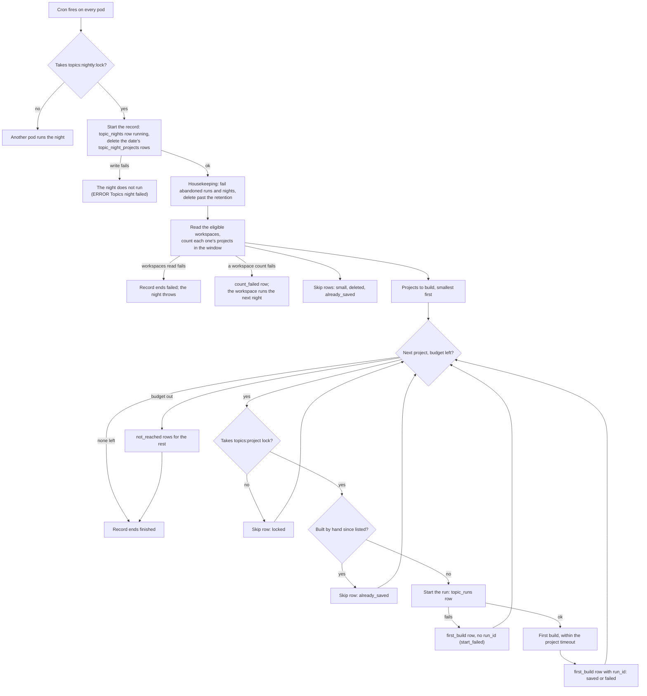

# ai-labels runbook

ai-labels labels every ended trace in opted-in workspaces with AI-generated labels, computed by opik-inference. It
runs only where `AI_LABELS_ENABLED=true`, and is off by default everywhere, OSS included. Nothing stops an OSS install
from turning it on, but it needs an opik-inference deployment and its credential, which only Comet-hosted deployments
have.

## Turning it on for a deployment

| Env var | Value |
|---|---|
| `AI_LABELS_ENABLED` | `true` |
| `AI_LABELS_INFERENCE_URL` | the opik-inference cell, e.g. `https://opik-inference.comet.com`. The backend refuses to start with an `http` URL, except to `localhost` or a loopback address |
| `AI_LABELS_INFERENCE_CREDENTIAL` | the deployment's opik-inference credential, from a secret (`component.backend.secretRefs`) |

- The backend refuses to start with ai-labels on unless `ANALYTICS_DB_DATA_MODEL_TRACE_COLUMNS_NON_NULLABLE=true`
  (the cut-over `traces` table). The `spans` cutover doesn't need to be done.
- opik-inference: the deployment needs its own `deployments` entry and credential in `config/inference.yaml`, with
  `allowed_orgs: "*"`. Opik sends workspace ids as `org_id`, so a real-org allow-list answers 403 `org_not_allowed`.
- Calls to opik-inference (ai-labels and topic vectors) never follow a redirect, and read at most
  `AI_LABELS_INFERENCE_MAX_RESPONSE_BYTES` (32 MiB) of a response body. A redirect or a longer body fails the call
  as `upstream_error`.
- Every other `aiLabels` setting is in `apps/opik-backend/config.yml` and overridable as `AI_LABELS_*`.

## Opting workspaces in and out

Opt-in is the `ai_label_workspaces` table in the state database (MySQL). There is no API.

Before enabling a workspace, check how much it will backfill: its traces in the horizon (7 days by default). Traces
created before a task's `applies_from` are never labeled.

```sql
-- ClickHouse
SELECT count()
FROM traces
WHERE workspace_id = '<workspace_id>'
  AND created_at >= now64(6) - INTERVAL 7 DAY;
```

The pool's throughput binds first: one L40S on the 4B model labels about 3 traces a second at 7K tokens each (22K
tokens/s), and a trace with large spans costs up to 50 times a small one. The sweep takes the newest traces first, so a
backfill works backward from now, and when the pool can't keep up the oldest traces age out of the horizon unlabeled
(`ai_labels.unsettled` stops shrinking). The global budget (`AI_LABELS_BUDGET_BYTES`, about 3 minutes of the pool by
default) bounds how much waits in opik-inference, and is shared out evenly between the workspaces that have traces to
label.

```sql
-- MySQL: enable (or re-enable) a workspace
INSERT INTO ai_label_workspaces (workspace_id, enabled, added_by)
VALUES ('<workspace_id>', TRUE, '<your name>')
ON DUPLICATE KEY UPDATE enabled = TRUE, added_by = '<your name>';

-- MySQL: disable a workspace. Immediate: the next sweep drops it. Jobs in flight still load, and labels stay.
UPDATE ai_label_workspaces SET enabled = FALSE WHERE workspace_id = '<workspace_id>';

-- MySQL: list the enabled workspaces
SELECT workspace_id, added_at, added_by FROM ai_label_workspaces WHERE enabled = TRUE ORDER BY added_at;
```

## Reading summaries

There is no UI yet. Take each trace's latest label (by write time):

```sql
-- ClickHouse
SELECT trace_id, task_version, JSONExtractString(output, 'summary') AS summary
FROM ai_labels
WHERE workspace_id = '<workspace_id>'
  AND project_id = '<project_id>'
  AND task = 'trace_summary'
  AND key = 'output'
ORDER BY workspace_id, project_id, task, trace_id, key, updated_at DESC
LIMIT 1 BY workspace_id, project_id, task, trace_id, key;
```

## What to watch

| Metric | Meaning |
|---|---|
| `ai_labels.unsettled_past_slo` | Unsettled (trace, task) pairs past the SLO, per workspace. The headline. |
| `ai_labels.budget.in_flight` / `.limit` | Cost in flight against the budget. Pinned at the limit means the pool is the bottleneck. |
| `ai_labels.unsettled` | Unsettled (trace, task) pairs in the horizon: the backlog. |
| `ai_labels.tick.phase_seconds` by `phase` | Time in load, sweep and submit. Loading stops starting jobs at 40% of the tick budget. |
| `ai_labels.tick.interval_seconds`, `.budget_seconds` | The tick cadence and the time a tick may use, as configured (`AI_LABELS_TICK_INTERVAL`, `AI_LABELS_TICK_BUDGET`). Loading stops at 40% of the budget, the sweep at 70%, submit at all of it. |
| `ai_labels.sweep.buckets` / `.buckets_reached` | N as configured vs the buckets the latest sweep got through before its share of the tick budget. Fewer than N means the sweep ran out of time (`ai_labels.sweep.overrun`); the first bucket swept rotates, so none starves. |
| `ai_labels.sweep.candidates` / `ai_labels.tick.workspaces` | Traces the latest sweep found to label, and the workspaces they span. Many candidates but few admitted (`ai_labels.submit.traces`) means the budget, not the sweep, bounds throughput. |
| `ai_labels.jobs.submitted` by `endpoint` | Jobs opik-inference accepted (202) and the tick recorded as open. Flat while `ai_labels.sweep.candidates` is high means submits fail: see `ai_labels.submit.throttled`, `.rejected` and the logs. |
| `ai_labels.jobs.open` | Jobs submitted and not yet loaded, as the leader last knew them. Growing while `ai_labels.items.done` is flat means jobs finish slower than they start, or never: the pool, or the service, is behind. |
| `ai_labels.jobs.oldest_open_seconds` | How long the oldest open job has been out, measured at scrape time. Past a few tick intervals the pipeline is stuck: the job is hung at the service, or the leader stopped ticking (the gauge then keeps growing on the last leader). 0 with none open. |
| `ai_labels.render.traces` / `ai_labels.submit.traces` | Traces rendered vs admitted. Far apart means renders are wasted: raise `AI_LABELS_MIN_ITEM_BYTES` toward a typical item. |
| `ai_labels.items.failed` by `error_code` | `render_over_budget`, `render_error`, `item_too_large`, `job_lost`, `missing_result`, `missing_answer`, or the service's code. |
| `ai_labels.submit.rejected` | A submit rejected with 400: a renderer or task bug. |
| `ai_labels.sweep.guard_trips` | A sweep query hit a ClickHouse guard: raise `AI_LABELS_SWEEP_BUCKETS`. |
| `ai_labels.render.compaction_level`, `.bytes` | How far traces had to be compacted to fit. |
| `ai_labels.render.history_turns`, `.history_bytes` | The earlier thread turns left in each fitted history, and their size. |
| `ai_labels.render.history_errors` | Failed reads of earlier turns. The chunk's render fails and is retried as `render_error`. |
| `ai_labels.render.duration_seconds` by `outcome` | Wall time per chunk (ClickHouse reads + render): `ok`, or `one_at_a_time` after a chunk read failed. |
| `ai_labels.render.cpu_seconds` | Java CPU spent rendering, excluding ClickHouse reads; its rate is cores. Spec 10 budgets about 0.25 core of Opik CPU per tick. Emitted only when the JVM supports and enables current-thread CPU time: no series means no measurement, not zero CPU or a met budget. ClickHouse's side is in `system.query_log`, where `log_comment` starts with `ai-labels:render:` (filter `log_comment LIKE 'ai-labels:render:%'`). |

## Topic vectors

The topic vectors job stores one bge-small vector (384 numbers, unit length) for every trace that has a `done`
`trace_summary` label. It embeds the summary text through opik-inference `/v1/embed` and writes the row to the
ClickHouse table `topic_vectors`, one row per (trace, task version). It is off by default everywhere.

### Opting workspaces in and out

Topics have their own opt-in, the env var `TOGGLE_TOPICS_WORKSPACES`: a comma-separated list of workspace ids, set
per environment in comet-helm. There is no API and no table. Topics read the ai-labels `trace_summary`, so a listed
workspace runs topics only while it is also enabled in `ai_label_workspaces`. Opting a workspace in to ai-labels does
not turn topics on.

- **Enable a workspace.** Check that it is enabled in `ai_label_workspaces` (see "Opting workspaces in and out" above).
  Then add its id to `TOGGLE_TOPICS_WORKSPACES` in a comet-helm PR. It runs after the deploy.
- **Disable a workspace.** Remove its id in a comet-helm PR. After the deploy, the next tick drops it. Stored vectors
  stay.
- **Stop one workspace now, without a deploy.** Disable it in `ai_label_workspaces`. The next tick drops it. This also
  stops its ai-labels summaries.

```sql
-- MySQL: of the listed workspaces, the ones topics run for. A listed id missing here does not run.
SELECT workspace_id, added_at, added_by
FROM ai_label_workspaces
WHERE enabled = TRUE AND workspace_id IN ('<workspace_id>', '<workspace_id>')
ORDER BY workspace_id;
```

A workspace opted in after its traces were labeled gets vectors for the last 7 days (the long window). For older
labels, see "Backfill".

### Turning it on

| Env var | Default | Meaning |
|---|---|---|
| `TOPICS_ENABLED` | `false` | Runs the job. The backend refuses to start with it on unless `AI_LABELS_ENABLED=true` and `AI_LABELS_INFERENCE_URL` is set: it uses the same opik-inference URL and credential. |
| `TOGGLE_TOPICS_WORKSPACES` | empty (none) | Comma-separated workspace ids topics run for, each only while it is also enabled in `ai_label_workspaces`. See "Opting workspaces in and out". |
| `TOPICS_VECTORS_TICK_INTERVAL` | `1m` | How often the job ticks. At most one tick runs per interval across all pods (see "How ticks run"). |
| `TOPICS_VECTORS_TICK_BUDGET` | `50s` | Every query and embed call of a tick starts within this. Must be under the tick interval. |
| `TOPICS_VECTORS_WINDOW` | `24h` | How far back, by `ai_label_status` write time, a normal tick looks. Never before the task's `applies_from`. |
| `TOPICS_VECTORS_LONG_WINDOW` | `7d` | The window of the long-window pass, for rows a normal tick missed. At least `TOPICS_VECTORS_WINDOW`. |
| `TOPICS_VECTORS_LONG_WINDOW_INTERVAL` | `1d` | How often the long-window pass starts. The pass stays on until it drains (see "How ticks run"); the interval runs from the tick that drained it. |
| `TOPICS_VECTORS_BACKFILL_WINDOW` | `0s` (off) | When above zero, the long-window pass uses this window instead of `TOPICS_VECTORS_LONG_WINDOW`. 0, or at least `TOPICS_VECTORS_WINDOW`; at most `365d`. See "Backfill". |
| `TOPICS_VECTORS_MAX_TRACES_PER_TICK` | `5000` | The most traces one tick embeds **per workspace**, oldest first. The tick budget bounds the total. The rest wait for the next tick. |
| `TOPICS_VECTORS_EMBED_BATCH_SIZE` | `256` | Texts per embed call. 256 is the most `/v1/embed` takes. |
| `TOPICS_VECTORS_EMBED_TIMEOUT` | `10s` | Each embed call's deadline. A chunk starts only with at least this much of the tick budget left; the rest is `over_budget`. Under the tick budget, at most 60s. |
| `TOPICS_VECTORS_FIND_MAX_ROWS_TO_READ` | `30000000` | ClickHouse `max_rows_to_read` of one workspace's window read. A trip fails that workspace's read for the tick. |
| `TOPICS_VECTORS_FIND_MAX_MEMORY_USAGE` | `1073741824` | ClickHouse `max_memory_usage` of one window read (1 GiB). |
| `TOPICS_VECTORS_FIND_MAX_EXECUTION_TIME` | `30s` | ClickHouse `max_execution_time` of one window read, cut to the time left in the tick. At most `TOPICS_VECTORS_TICK_BUDGET`. |
| `TOPICS_VECTORS_FIND_CREATED_AT_SLACK` | `1d` | The window read skips traces created before its lower bound minus `AI_LABELS_HORIZON` minus this margin. The margin covers the time from the ai-labels sweep to the status write. |

To turn it off, set `TOPICS_ENABLED=false` and restart. Stored vectors stay. When it is turned on again, the next
ticks write the vectors that are missing in the window, and the long-window pass writes the ones in the long window.
Older ones need a backfill.

### How ticks run

- Every pod fires the job every tick interval, each at its own second. Two Redis locks make that one tick per interval
  across the cluster:
  - `topics:vectors:leader` is held for the tick and released when it ends, so two ticks never overlap. Its lease is
    tick budget + embed timeout + find max execution time + 5s (95s by default). It matters only when the pod dies
    mid-tick: the next tick starts when the lease expires.
  - `topics:vectors:tick` is taken by the leader before it ticks and never released. It expires one interval (less up to
    1s for trigger jitter) after the tick started, so a pod that fires sooner skips.
- A skipped tick logs `Topic vectors tick skipped, lock '<name>' ...` at INFO. With several pods, expect most firings
  to skip on `topics:vectors:tick`. Ticks skipped on `topics:vectors:leader` for longer than one lease mean a tick
  is stuck.
- Each tick reads the enabled workspaces in turn, starting at an offset that moves by one every interval, so no
  workspace is always last. A read starts only with at least 1s of the budget left. A workspace that is not reached in
  time is read the next tick (one WARN).
- After an embed call fails with a 429 or a 5xx (whatever the error code), a timeout or a retryable code, the job stops
  calling for **that workspace** for the rest of the tick (`embed_failed`). Other workspaces go on.
- **Long-window pass.** Once per `TOPICS_VECTORS_LONG_WINDOW_INTERVAL` a tick uses the long window (Redis key
  `topics:vectors:long_window`). The pass stays on, tick after tick, until one of its ticks drains it: every workspace
  read with no failure, each under the per-workspace cap, and no candidate left for want of time (`over_budget`), a
  read (`read_failed`), a back-off or an insert (`insert_failed`). Then the interval starts. After an outage longer than
  the short window, the pass therefore runs every tick until the backlog in the long window is written. A summary that
  makes `/v1/embed` fail with a 5xx every time keeps the pass on until its status leaves the long window: each pass
  tick costs one long-window read per workspace.

### Backfill

The job only looks back as far as the long window (7 days). To write vectors for older labels, for example when
topics is turned on weeks after ai-labels, or a workspace is opted in to topics later than to ai-labels:

1. Set `TOPICS_VECTORS_BACKFILL_WINDOW` to the age to cover (for example `30d`), and restart.
2. Delete the Redis key `topics:vectors:long_window` to start the pass now. Otherwise it starts at the next interval.
3. Watch `topics.vectors.long_window.missed` and `topics.vectors.written`. The pass stays on until it drains.
4. Set `TOPICS_VECTORS_BACKFILL_WINDOW=0s` again, and restart.

Cost: the window read's cost grows with the window, not with what it finds. In the load test (one workspace, 2.07M
statuses) a 24h read took 220–440 ms and read 0.9–2.7M rows; a 7d read took 570–750 ms, read 2.4–5.0M rows and used
about 300 MiB. A 30d or 90d read of a large workspace reads proportionally more and can trip
`TOPICS_VECTORS_FIND_MAX_ROWS_TO_READ` or `..._MAX_MEMORY_USAGE`; the read then fails every pass tick for that workspace
(`topics.vectors.read.failures{phase=find}`). Raise the guards for the backfill, or backfill in steps (7d, 14d, 30d).
While the pass is on, every tick does this read for every enabled workspace.

### Checking that vectors flow

Run both queries for one workspace. The counts must match, up to the traces labeled since the last tick. A gap that
stays means the job skips traces: see `topics.vectors.skipped` and the logs.

```sql
-- ClickHouse: traces with a done trace_summary label in the last 24 hours (latest status per trace, as the job reads it)
SELECT count()
FROM (
    SELECT status, updated_at
    FROM ai_label_status
    WHERE workspace_id = '<workspace_id>'
      AND task = 'trace_summary'
    ORDER BY workspace_id, project_id, task, trace_id, updated_at DESC
    LIMIT 1 BY workspace_id, project_id, task, trace_id
)
WHERE status = 'done'
  AND updated_at >= now64(6) - INTERVAL 24 HOUR;

-- ClickHouse: vectors for the same traces
SELECT count()
FROM (
    SELECT trace_id, task_version
    FROM topic_vectors
    WHERE workspace_id = '<workspace_id>'
      AND (project_id, trace_id, task_version) IN (
          SELECT project_id, trace_id, task_version
          FROM (
              SELECT project_id, trace_id, task_version, status, updated_at
              FROM ai_label_status
              WHERE workspace_id = '<workspace_id>'
                AND task = 'trace_summary'
              ORDER BY workspace_id, project_id, task, trace_id, updated_at DESC
              LIMIT 1 BY workspace_id, project_id, task, trace_id
          )
          WHERE status = 'done'
            AND updated_at >= now64(6) - INTERVAL 24 HOUR
      )
    ORDER BY workspace_id, project_id, trace_id, task_version, updated_at DESC
    LIMIT 1 BY workspace_id, project_id, trace_id, task_version
);
```

### What to watch

Every metric but `topics.vectors.ticks` and `topics.vectors.tick.phase_seconds` carries `workspace_id` and
`workspace_name`. The name comes from the React service, once an hour per pod, and is the workspace id when the lookup
fails. Every series also carries `k8s_namespace_name`: group by it.

| Metric | Meaning |
|---|---|
| `topics.vectors.oldest_unvectored_seconds` by workspace | Age of the oldest done label without a vector that the last tick found in its window. The headline. It grows when the job falls behind or stops. Only the pod that ticked within the last two tick intervals publishes it, so read it with `max` across pods. A workspace whose window read failed, or was not reached, has no value for that tick: watch `topics.vectors.read.failures` and `topics.vectors.workspaces_not_read` with it. It sees only the window: after an outage longer than the short window it stays near the window's length until the long-window pass runs. Once a day the long-window tick can show a spike up to the long window: rows normal ticks missed. |
| `topics.vectors.ticks` by `outcome` | Firings of the job, per pod: `ran`; `not_due` (a tick ran less than one interval ago: most firings with several pods); `lock_held` (another pod holds `topics:vectors:leader`: every firing on a pod that is not the leader); `failed` (the tick threw: the log has `Topic vectors tick failed`). Summed over pods, about one `ran` per tick interval. Each outcome starts at 0 on every pod with topics on. No `ran` while every pod counts `lock_held` means a tick stuck past its lease, or Redis down: the lock service then takes the same path and logs `Failed to acquire lock, executing fallback action`. |
| `topics.vectors.workspaces_not_read` by workspace | Enabled workspaces a tick did not read because its budget ran out (one WARN per tick). They have no lag value for that tick. The offset moves by one workspace per tick, so the same workspaces can stay unread for many ticks in a row. Counted every tick: too many enabled workspaces, or slow window reads (see `topics.vectors.tick.phase_seconds{phase="find"}`). |
| `topics.vectors.written` by workspace | Vectors stored. |
| `topics.vectors.skipped` by `reason`, workspace | `missing_summary` (the output row the window read saw was gone or of another task version by the summary read, which usually clears on the next tick; a WARN per workspace per tick names the count and the oldest trace), `embed_failed` (the call failed, or the workspace backed off: the next tick retries), `invalid_vector` (a missing, null, zero or wrong-dimension vector), `over_budget` (not enough of the tick left to start a call: the next tick continues), `insert_failed` (the ClickHouse insert failed: the next tick embeds them again), `read_failed` (the summary read failed: the next tick reads them again). |
| `topics.vectors.read.failures` by `phase`, `error_type`, workspace | Failed ClickHouse reads: `find` (one workspace's window read, for example a guard trip) or `summaries` (one workspace's summary read). `error_type` is the root cause's class name. |
| `topics.vectors.embed.failures` by `http_status`, `code`, `error_type`, workspace | Failed embed calls. 429 `quota_exceeded` means the embed pool is full. Do not alert on it alone: a failure backs off one workspace for one tick, and the next tick retries. |
| `topics.vectors.embed.duration_seconds` by `outcome`, workspace | Wall time per embed call: `ok`, or the error code. |
| `topics.vectors.tick.phase_seconds` by `phase` | Time in `find` (ClickHouse window reads) and `embed` (summary reads, embed calls and inserts). |
| `topics.vectors.long_window.missed` by workspace | Vectors the long-window pass wrote for statuses older than the short window: rows normal ticks missed, for example after an outage longer than the window. Above zero outside a backfill or an outage means normal ticks miss rows. |

The window read leaves out a done status whose latest output is missing, of another task version, or empty or only
whitespace. Such a status gets no vector and is not counted, and it does not take a place in the per-workspace cap, so
it never holds back newer traces.

ClickHouse queries of the job have a `log_comment` that starts with `topics:`.

### Alerts

The rules live in comet-monitoring as a PrometheusRule, armed per environment, not in this repo. None fires on a
quiet day: a workspace with no new traces reports 0, and a disabled workspace, or a deployment with topics off,
publishes no series.

| Alert | PromQL | Drill down |
|---|---|---|
| Vectors lag | `min_over_time(max by (k8s_namespace_name, workspace_id, workspace_name) (topics_vectors_oldest_unvectored_seconds)[15m:1m]) > 1800` | Run "Checking that vectors flow" for the workspace. Then `topics.vectors.skipped` by reason and `topics.vectors.embed.failures` for it: a trace that fails every tick (`invalid_vector`, or `embed_failed` with a 4xx) holds the age up until its status leaves the window. Many workspaces at once: opik-inference, or the tick budget (`over_budget`). |
| Vectors tick stopped | `sum by (k8s_namespace_name) (increase(topics_vectors_ticks_total{outcome="ran"}[10m])) == 0` | `topics.vectors.ticks` by outcome. `failed`: the backend log line `Topic vectors tick failed`. Only `lock_held`: Redis, or a tick stuck past its lease (the TTL of the Redis key `topics:vectors:leader`). Only `not_due`: the TTL of `topics:vectors:tick`. |
| Vectors workspace not read | `sum by (k8s_namespace_name, workspace_id) (increase({__name__=~"topics_vectors_workspaces_not_read_total\|topics_vectors_read_failures_total", phase=~"find\|"}[15m])) >= 10` | The workspace's window read failed, or the tick budget ran out before it, on most ticks of the last 15 minutes. `topics.vectors.read.failures` by `error_type` for it: ClickHouse timeouts or guards on a large workspace. Only `workspaces_not_read`: the tick budget is too short for the enabled workspaces, or one slow workspace ahead of it in the rotation. |

- **Vectors lag.** `min_over_time` over 15 minutes ignores the daily long-window spike and one slow tick, so the alert
  fires about 15 minutes after the lag first passes the threshold. The threshold, 30 minutes, is 15 times the 2-minute
  target and far above a healthy value (under two tick intervals). It is not measured on prod yet. It must stay under
  24 hours: the window caps the gauge. A workspace with no value (its read fails, or the budget never reaches it) is
  invisible to this alert: "Vectors workspace not read" covers it.
- **Vectors tick stopped.** The heartbeat. The lag gauge disappears when the job stops, so the lag alert resolves
  instead of firing; this one fires. Every outcome starts at 0 when a pod starts the job, so `increase()` loses at most
  the pod's first firing, not the ticks after a deploy.
- **Vectors workspace not read.** The heartbeat of one workspace: its lag series disappears exactly when its read
  fails or is never reached. Both counters carry the workspace, and the tick runs every minute, so 10 in 15 minutes
  means most ticks missed it; the first increment a new series loses does not matter at that rate. It groups by
  `workspace_id` alone: while a name lookup falls back to the id, the same workspace has two `workspace_name` values,
  and grouping by both would split the count under the threshold. Find the name on the lag panel.

### Deletes

A vector lives as long as its trace. Retention deletes vectors with the traces (the same rules as `ai_labels`), and a
trace delete deletes its vectors. There is no project or workspace delete path, the same as for `ai_labels`: deleting
a project or a workspace leaves its vectors until retention removes them. A trace deleted between a tick's read and its
insert (at most one tick) can leave a vector row behind, exactly like `ai_labels`. The retention sweep removes such rows
by trace id range and week.

A trace delete deletes the vectors before the ai-labels rows, each on its own, so neither failure skips the other.
If the ai-labels delete fails, the trace's `done` status stays in `ai_label_status`, and the next tick writes its vector
again from the label (the job reads only `ai_label_status` and `ai_labels`). Retention removes both, in workspaces with
a retention policy.

## Topics nightly job

Once a night the job builds each project's topic list from its topic vectors. Stage 2a has the first build only: a
project with a saved list is skipped every night until the nightly update ships. It reads the same workspaces as
ai-labels, and runs only with `TOPICS_ENABLED=true`.

A first build reads the project's window (the 30 whole UTC days before the night, the newest 30,000 traces at most),
merges identical intent texts, groups them with k-means (30 to 50 groups, about one per 30 unique texts), asks Qwen
through opik-inference `/v1/generate` to name up to 10 topics over the groups, and assigns every window trace to its
nearest topic prototype or to Other. The prompt shows each group's share and 5 to 10 example requests (the most
frequent, then the ones nearest the group's centre); the answer names the topics and places every group in one topic
or in Other, and a name that is a catch-all as a whole ("Other", "General Requests") is dropped. It writes:

| Table | Database | What |
|---|---|---|
| `topics` | MySQL | One row per topic: name, definition, `born` (the night), `size` (window traces). |
| `topic_prototypes` | MySQL | The vectors traces are assigned by, several per topic, and the known-Other ones (`topic_id` null). |
| `topic_project_states` | MySQL | One row per project with a saved list: `rebuilds`, `last_run_id`, `window_until`. |
| `topic_runs` | MySQL | One row per run: `running`, then `saved` or `failed` with `error_code`. Kept 90 days. |
| `topic_run_counts` | MySQL | One row per topic of a saved run, and one for Other: `traces` in the run's window and `rank` (null for Other). The topics API compares a project's last two saved runs. Kept 90 days. |
| `trace_topics` | ClickHouse | One row per window trace and run: its `topic_id`, the all-zeros id for Other. The latest row wins. |

### Turning it on and off

| Env var | Default | Meaning |
|---|---|---|
| `TOPICS_NIGHTLY_ENABLED` | `true` | Runs the job. Needs `TOPICS_ENABLED=true`. |
| `TOPICS_NIGHTLY_SCHEDULE` | `0 0 2 * * ?` | Quartz cron, UTC. The night is the UTC date the job starts on. |
| `TOPICS_NIGHTLY_BUDGET` | `2h` | No project starts after this; the rest run the next night. |
| `TOPICS_NIGHTLY_PROJECT_TIMEOUT` | `15m` | One run is stopped and failed with `timeout` after this. Under the budget. |
| `TOPICS_NIGHTLY_MIN_VECTORS` | `100` | A project is built when its window holds at least this many traces with a vector. |
| `TOPICS_NIGHTLY_WINDOW_DAYS` | `30` | The window, in whole UTC days before the night. |
| `TOPICS_NIGHTLY_MAX_VECTORS` | `30000` | A larger window keeps its newest traces. |
| `TOPICS_NIGHTLY_QWEN_DEADLINE` | `120s` | The deadline of the Qwen call. The call uses the `batch` lane, which takes up to 300s. |
| `TOPICS_NIGHTLY_RUNS_RETENTION` | `90d` | `topic_runs` and `topic_run_counts` rows and the night records (`topic_nights`, `topic_night_projects`) are deleted after this. |

To turn it off, set `TOPICS_NIGHTLY_ENABLED=false` and restart. Saved lists stay.

To stop it for one workspace without a restart, opt the workspace out (`UPDATE topic_workspaces SET enabled = FALSE
WHERE workspace_id = '<workspace_id>'`). This also stops its topic vectors. The next night skips it; a night already
running reads the workspaces once, at its start, so it still runs the workspace's projects.

### How a night runs

Where a night stops and where it goes on:



Every record write after the start is best-effort: a failed one is logged and the night goes on (see "What to watch").

- Every pod fires the job on the cron. The first to take the Redis lock `topics:nightly:lock` runs the night and keeps
  the lock until it expires (budget + project timeout + 5 minutes), so no other pod runs the same night. If that pod
  dies during the night (a deploy), the rest of the night waits for the next night: the cron does not fire again, and
  the night endpoint answers `409` until the lock expires. To finish the night sooner, delete the Redis key
  `topics:nightly:lock` and call the night endpoint (see "Running by hand").
- The night first fails runs left `running` by an earlier night (`error_code = 'abandoned'`), and deletes runs and
  run counts older than the retention. It does the same for the night records: a night left `running` past the night
  lock's lease is set to `failed`, and records older than the retention are deleted.
- It counts each enabled workspace's projects in the window, drops those under `TOPICS_NIGHTLY_MIN_VECTORS` and those
  with a saved list, and runs the rest smallest first, one at a time.
- Each run holds the Redis lock `topics:project:<project_id>`, so a run started by hand and the night never build the
  same project at once.
- A first build under 1,000 traces is saved with `"provisional": true` in its stats.

A failed run writes nothing but its `topic_runs` row; the project is built again the next night.

| `error_code` | Meaning |
|---|---|
| `qwen_timeout` | The Qwen call ran out of `TOPICS_NIGHTLY_QWEN_DEADLINE`. |
| `qwen_error` | The Qwen call failed after its 2 retries, or with a 4xx. `error_message` has the code and HTTP status. |
| `qwen_bad_answer` | Qwen's answer has no JSON object, or breaks the schema: opik-inference answers `schema_violation` for a cut or off-schema answer, which is not retried. The answer is in the DEBUG logs. |
| `window_read` | The ClickHouse window read failed, or the window had no usable vector. |
| `invariant` | A check before the save failed: more than 10 topics, a blank name or one that is a catch-all as a whole, a prototype not of unit length, a trace not labelled once. |
| `timeout` | The run outlasted `TOPICS_NIGHTLY_PROJECT_TIMEOUT`, or the job was interrupted. |
| `save` | The ClickHouse insert or the MySQL transaction failed, or another run saved the project meanwhile (`error_message` says so; only if the project's Redis lock was lost). The run deletes the `trace_topics` rows it inserted; if that delete fails too (a WARN names the run), they stay until the next saved run replaces them. |
| `abandoned` | The pod stopped during the run. |
| `internal` | A bug: read the logs for the run id. |

### Tonight's runs

```sql
-- MySQL: the runs started since midnight UTC, newest first
SELECT run_id, workspace_id, project_id, mode, status, error_code, started_at, finished_at,
       JSON_EXTRACT(stats, '$.vectors') AS vectors, JSON_EXTRACT(stats, '$.topics') AS topics,
       JSON_EXTRACT(stats, '$.other_share') AS other_share, JSON_EXTRACT(stats, '$.provisional') AS provisional
FROM topic_runs
WHERE started_at >= UTC_DATE()
ORDER BY started_at DESC;

-- MySQL: a project's live topics
SELECT name, size, born, definition FROM topics
WHERE project_id = '<project_id>' AND retired_at IS NULL
ORDER BY size DESC;
```

```sql
-- ClickHouse: a project's trace counts per topic in the last saved window
-- (window_from and window_until are in the run's stats)
SELECT topic_id, count() AS traces
FROM (
    SELECT trace_id, topic_id
    FROM trace_topics
    WHERE workspace_id = '<workspace_id>' AND project_id = '<project_id>'
    AND trace_created_at >= '<window_from>' AND trace_created_at < '<window_until>'
    ORDER BY trace_id, updated_at DESC
    LIMIT 1 BY trace_id
)
GROUP BY topic_id
ORDER BY traces DESC;
```

Each run logs at INFO, by run id: Qwen's token counts, and one line with the window, vectors, unique texts, k, seed,
the topics with their sizes, the Other share and the phase timings. The author prompt and Qwen's raw answer hold
trace-derived text, so they are logged at DEBUG only (logger `com.comet.opik.domain.topics.TopicsRebuildService`).
Search the logs for `Topics run '<run_id>'`.

### Running by hand

Two internal endpoints start work now instead of waiting for the night. Call them from inside the cluster. Both answer
`501` when `TOPICS_ENABLED` is off and `409` when `TOPICS_NIGHTLY_ENABLED` is off. Both take `&night=yyyy-MM-dd`
(`?night=` for the night endpoint): the night is today (UTC) by default, so the window ends at today's start. `night`
is at most tomorrow, whose window holds today's traces so far, and at least 365 days ago.

**One project.** The night's rules apply: the workspace is opted in to topics, and the project's window holds at least
`TOPICS_NIGHTLY_MIN_VECTORS` vectors. Only one run by hand goes at a time across the cluster.

```bash
curl -X POST "http://<opik-backend>:8080/v1/internal/topics/projects/<project_id>/run?workspace_id=<workspace_id>"
```

It answers `202` with the `run_id`. The run goes on in the background with the same timeout; read its outcome in
`topic_runs`. It answers `409` when the workspace is not opted in, the window is too small (or the project is not the
workspace's), a run of the project or another run by hand is in progress, or the project already has a list.

**A whole night.** It runs every eligible project, as the scheduled job does, under the same night lock. The lock is
released when the night ends, so the scheduled job is skipped only while a night started by hand is still running.

```bash
curl -X POST "http://<opik-backend>:8080/v1/internal/topics/nights/run"
```

It answers `202` with the `night`, and `409` when a night is in progress. Each project's outcome is its `topic_runs`
row.

To build a project that already has a list again (for example after a bad first build), delete its list first. Its
`trace_topics` rows stay until the new run replaces them:

```sql
-- MySQL: forget a project's list, so the next night (or the endpoint) builds it again
DELETE FROM topics WHERE project_id = '<project_id>';
DELETE FROM topic_prototypes WHERE project_id = '<project_id>';
DELETE FROM topic_project_states WHERE project_id = '<project_id>';
```

### What to watch

Every metric of one workspace's work has `workspace_id` and `workspace_name` (the name falls back to the id). These
counters and histograms are for the dashboard. A nightly series starts on the night's pod, so `increase()` misses the
event that creates it: the alerts read the state gauges further down, not these.

| Metric | Meaning |
|---|---|
| `topics.nightly.projects` by `decision`, `reason` | Projects the night looked at: `skip` with a `reason` (`small`: under the minimum; `deleted`; `already_saved`: a list already built; `locked`: held by a run started by hand), `first_build`, `not_reached` (the budget ran out: they run the next night). `not_reached` above zero means the budget is too short. |
| `topics.runs` by `status`, `error_code` | Finished runs. Each failed run counts once: `start_failed` when the run could not start (it has no `topic_runs` row), `abandoned` when the next night's housekeeping fails a run left `running`. A run is counted by the write that ends its row: when marking a run failed throws, its row stays `running` and nothing counts it until housekeeping fails it as `abandoned`. |
| `topics.run.duration_seconds` by `phase` | Time in `window` (ClickHouse read), `kmeans`, `qwen`, `assign`, `save`. |
| `topics.qwen.calls` by `outcome` | `ok`, `timeout`, `error`, `bad_answer`. A call counts after its answer is read: an answer that cannot be read is `bad_answer`, not `ok`. |
| `topics.save.rows` by `table` | Rows saved runs wrote. |
| `topics.save.take_back_failures` by workspace, `error_type` | Failed saves whose `trace_topics` rows could not be deleted. Readers see those rows until the project's next saved run. |
| `topics.run.other_share` | The Other share of each saved run (its `stats.other_share`). No alert: no threshold is set. |
| `topics.nightly.count_failures` by workspace, `error_type` | Workspaces whose window count read failed. The night skips all their projects; they run the next night. |
| `topics.nightly.budget_used_seconds` | Wall time of each night (no workspace). Near `TOPICS_NIGHTLY_BUDGET` means projects will soon be `not_reached`. |

Each night writes its record as it goes:

| Table | What |
|---|---|
| `topic_nights` | One row per night (the UTC date): `started_at`, `finished_at`, `outcome` (`running`, `finished`, or `failed` when a read of the workspaces, lists or projects failed), `eligible_workspaces`, `count_failures`, and `projects` (JSON, projects per decision). Written when the night starts and when it ends, also with no project. A night run again for the same date replaces its row and its project rows. |
| `topic_night_projects` | One row per project the night looked at, skips included: `workspace_id`, `project_id`, `vectors`, `decision`, `reason`, `run_id` (null when no run started). A workspace whose count read failed has one row with a null `project_id` and decision `count_failed`. |

A night whose start write fails does not run, so a rerun of a date never mixes its rows with the earlier run's; if
starts keep failing, "Night not started" fires. A later record write that fails logs a WARN (`could not write its record`) for the first
of the night, DEBUG for the rest, and a WARN with their count at the night's end; the night goes on.

The state gauges come from these tables. Each pod reads them once a minute and keeps the result; a scrape reads no
table. Every pod publishes the same values: read them with `max`, never `sum`. They are published only while
`TOPICS_ENABLED` and `TOPICS_NIGHTLY_ENABLED` are on, and only from the first night on, except the heartbeat
`state_age_seconds`. A workspace counts only while it is opted in to both topics and ai-labels.

| Gauge | Value |
|---|---|
| `topics.nightly.state_age_seconds` | Seconds since this pod last read the night tables; before its first good read, since it started trying. Published whenever the job is on, also before the first night. Above a few minutes, every other state gauge is stale. |
| `topics.nightly.state_refresh_failures` | A counter: failed reads of the night tables (WARN `could not read the night tables`). Set to 0 at startup when the job is on. |
| `topics.nightly.last_started_age_seconds` | Seconds since the latest night started, scheduled or by hand. Before the first night ever, seconds since the pod started reading. |
| `topics.nightly.running_seconds` | Age of the oldest night still `running`; 0 when none. A night whose pod died stays `running` until the next night's housekeeping fails it. |
| `topics.nightly.last_night.projects` by workspace, `decision`, `reason` | Projects per decision in the latest ended night, `count_failed` included. |
| `topics.nightly.last_night.runs` by workspace, `status` | Runs the latest ended night started, by their `topic_runs` status: `saved`, `failed` (a run that could not start counts here), `running` (marking it failed threw). |
| `topics.nightly.last_night.failed` | 1 when the latest ended night failed (a read failed, or its pod died and the next night's housekeeping failed it), 0 when it finished. |
| `topics.nightly.stale_projects` by workspace | Projects expected on each of the last 3 ended nights with no saved run since the first of them (a run by hand counts). Expected is any decision but a skip as `small`, `deleted` or `already_saved`: this covers `not_reached`, failed first builds and start failures. 0 for each workspace without one. |
| `topics.nightly.starved_projects` by workspace | Projects `not_reached` on each of the last 2 ended nights. 0 for each workspace without one. |
| `topics.workspaces.mismatched` by workspace | 1 for a workspace enabled in `topic_workspaces` and not in `ai_label_workspaces`: no night runs it. |

The Prometheus names replace the dots with underscores, for example `topics_nightly_stale_projects`; the counters end
in `_total`.

ClickHouse queries of the job have a `log_comment` that starts with `topics:`.

### Alerts

The rules live in comet-monitoring as a PrometheusRule, armed per environment, not in this repo. They read the state
gauges only, and every rule groups by `k8s_namespace_name`.

| Alert | Condition | PromQL | Check | First step |
|---|---|---|---|---|
| Night not started | No night started for 25 hours. Before the first night ever, the age counts from the pod's start, so a first night that never starts fires too. | `max by (k8s_namespace_name) (topics_nightly_last_started_age_seconds) > 25 * 3600` | The latest nights query below. | Read the logs for `Topics night` around the cron time. A night lock left by a dead pod (`topics:nightly:lock`) blocks nights until it expires. Run the night by hand (see "Running by hand"). |
| Night too long | A night runs longer than budget + project timeout + 30 minutes (2 h 45 m with the defaults). | `max by (k8s_namespace_name) (topics_nightly_running_seconds) > 9900` | The latest nights query below; its `running` row. | A night whose pod died stays `running` until the next night: check for a pod restart. Otherwise find the `running` run in `topic_runs` and its logs. |
| Last night failed | The latest ended night failed: a read failed, or its pod died and the next night's housekeeping failed it. A night whose reads fail writes no project rows, so no other nightly rule sees it. | `max by (k8s_namespace_name) (topics_nightly_last_night_failed) > 0` | The latest nights query below; its `failed` row. | The ERROR `Topics night failed` (or `started by hand failed`) has the error. No ERROR: the pod died, check for a restart. Clears when the next night finishes. |
| Stale projects | A project was expected on each of the last 3 nights and got no saved run. | `max by (k8s_namespace_name, workspace_id, workspace_name) (topics_nightly_stale_projects) > 0` | The stale-project query below. | Find its runs in `topic_runs`: failed (read `error_code`), never started (a `first_build` row with no `run_id`), or `not_reached` (the budget). |
| Starved projects | A project was `not_reached` on each of the last 2 nights. | `max by (k8s_namespace_name, workspace_id, workspace_name) (topics_nightly_starved_projects) > 0` | The starved-project query below. | Raise `TOPICS_NIGHTLY_BUDGET`, or split the night. |
| Failed share | More than 20% of the latest night's runs failed, with at least 5 runs in the namespace. | See below. | The latest night query below. | Group the failures by `error_code`: `qwen_*` points at opik-inference, `window_read` and `save` at ClickHouse or MySQL. A `first_build` row with no `run_id` could not start: MySQL. |
| Count read failed | A workspace's window count read failed in the latest night. | `max by (k8s_namespace_name, workspace_id, workspace_name) (topics_nightly_last_night_projects{decision="count_failed"}) > 0` | The latest night query below. | The WARN `Topics night count read failed, workspace '<workspace_id>'` has the ClickHouse error (often a guard trip). The workspace runs the next night. |
| Workspace mismatch | A workspace is opted in to topics and not to ai-labels, for 1 hour. Warning. | `max by (k8s_namespace_name, workspace_id, workspace_name) (topics_workspaces_mismatched) > 0` with `for: 1h` | The mismatch query below. | Opt the workspace in to ai-labels, or out of topics. |
| State gauges stale | A pod has not read the night tables for 10 minutes: the other nightly alerts are blind. | `max by (k8s_namespace_name) (topics_nightly_state_age_seconds) > 600` | `topics_nightly_state_refresh_failures_total`. | The WARN `Topics nightly gauges could not read the night tables` has the MySQL error. |

The failed-share rule (a pod's series per workspace, so `max` first):

```promql
sum by (k8s_namespace_name) (max by (k8s_namespace_name, workspace_id, status) (topics_nightly_last_night_runs{status="failed"}))
  / sum by (k8s_namespace_name) (max by (k8s_namespace_name, workspace_id, status) (topics_nightly_last_night_runs)) > 0.2
and sum by (k8s_namespace_name) (max by (k8s_namespace_name, workspace_id, status) (topics_nightly_last_night_runs)) >= 5
```

A quiet day fires none of these but the heartbeats (Night not started, State gauges stale). A night with no project
still writes its record. A project under the minimum, a deleted project and a project with a list are not expected, so
they are never stale. A workspace turned off in both opt-in tables is not counted; turned off in only one of them, it
is a mismatch. With the job off, no gauge is published.

```sql
-- MySQL: the latest nights
SELECT night, outcome, started_at, finished_at, eligible_workspaces, count_failures, projects
FROM topic_nights
ORDER BY started_at DESC
LIMIT 5;

-- MySQL: the latest ended night, per workspace, decision and run outcome
SELECT np.workspace_id, np.decision, np.reason, r.status, r.error_code, COUNT(*) AS projects
FROM topic_night_projects np
LEFT JOIN topic_runs r ON r.run_id = np.run_id
WHERE np.night = (SELECT night FROM topic_nights WHERE outcome <> 'running' ORDER BY started_at DESC LIMIT 1)
GROUP BY np.workspace_id, np.decision, np.reason, r.status, r.error_code;

-- MySQL: stale projects: expected on each of the last 3 ended nights, no saved run since the first of them
WITH nights AS (
    SELECT night, started_at FROM topic_nights WHERE outcome <> 'running' ORDER BY started_at DESC LIMIT 3
)
SELECT np.workspace_id, np.project_id, GROUP_CONCAT(DISTINCT np.decision) AS decisions
FROM topic_night_projects np
JOIN nights n ON n.night = np.night
WHERE np.project_id IS NOT NULL AND np.decision <> 'count_failed'
  AND NOT (np.decision = 'skip' AND np.reason IN ('small', 'deleted', 'already_saved'))
  AND NOT EXISTS (SELECT 1 FROM topic_runs r
                  WHERE r.project_id = np.project_id AND r.status = 'saved'
                    AND r.started_at >= (SELECT MIN(started_at) FROM nights))
GROUP BY np.workspace_id, np.project_id
HAVING COUNT(DISTINCT np.night) = 3;

-- MySQL: starved projects: not_reached on each of the last 2 ended nights
WITH nights AS (
    SELECT night FROM topic_nights WHERE outcome <> 'running' ORDER BY started_at DESC LIMIT 2
)
SELECT np.workspace_id, np.project_id, MAX(np.vectors) AS vectors
FROM topic_night_projects np
JOIN nights n ON n.night = np.night
WHERE np.decision = 'not_reached'
GROUP BY np.workspace_id, np.project_id
HAVING COUNT(DISTINCT np.night) = 2;

-- MySQL: workspaces opted in to topics and not to ai-labels
SELECT t.workspace_id
FROM topic_workspaces t
LEFT JOIN ai_label_workspaces a ON a.workspace_id = t.workspace_id
WHERE t.enabled = TRUE AND (a.workspace_id IS NULL OR a.enabled = FALSE);
```

The gauges also leave out workspaces no longer opted in and deleted projects; these queries do not.

### Deletes

A `trace_topics` row lives as long as its trace, as for `topic_vectors`: retention and the trace-delete cascade delete
both. Deleting a project deletes its MySQL rows too: `topics`, `topic_prototypes`, `topic_project_states` and
`topic_runs`, since names, definitions and prototypes come from its traces. `topic_runs` rows go after 90 days anyway,
and so do the night records (`topic_nights`, `topic_night_projects`); a project's night rows stay until then.
Deleting a workspace does not delete its MySQL rows, as for `ai_labels`.
