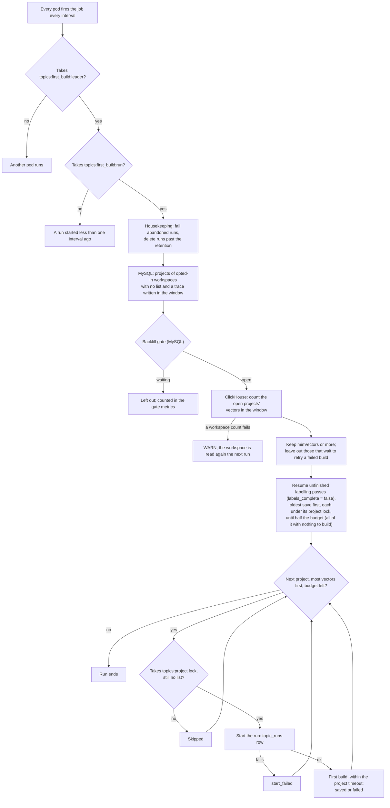
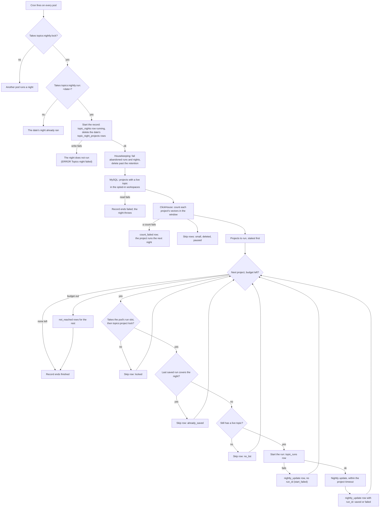

# ai-labels runbook

ai-labels labels every ended trace in opted-in workspaces with AI-generated labels, computed by opik-inference. It
runs only where `AI_LABELS_ENABLED=true`, and is off by default everywhere, OSS included. Nothing stops an OSS install
from turning it on, but it needs an opik-inference deployment and its credential, which only Comet-hosted deployments
have.

## Turning it on for a deployment

| Env var | Value |
|---|---|
| `AI_LABELS_ENABLED` | `true` |
| `AI_LABELS_INFERENCE_URL` | the opik-inference cell, e.g. `https://opik-inference.comet.com`. The backend refuses to start with an `http` URL, except to `localhost` or a loopback address, even with `AI_LABELS_ENABLED=false`: guardrails use the same URL |
| `AI_LABELS_INFERENCE_CREDENTIAL` | the deployment's opik-inference credential, from a secret (`component.backend.secretRefs`) |

- The backend refuses to start with ai-labels on unless `ANALYTICS_DB_DATA_MODEL_TRACE_COLUMNS_NON_NULLABLE=true`
  (the cut-over `traces` table). The `spans` cutover doesn't need to be done.
- opik-inference: the deployment needs its own `deployments` entry and credential in `config/inference.yaml`, with
  `allowed_orgs: "*"`. Opik sends workspace ids as `org_id`, so a real-org allow-list answers 403 `org_not_allowed`.
- Calls to opik-inference (ai-labels, guardrails and topic vectors) never follow a redirect, and read at most
  `AI_LABELS_INFERENCE_MAX_RESPONSE_BYTES` (32 MiB) of a response body. A redirect or a longer body fails the call
  as `upstream_error`; a longer body's connection is closed without reading the rest.
- Every other `aiLabels` setting is in `apps/opik-backend/config.yml` and overridable as `AI_LABELS_*`.

## Opting workspaces in and out

Opt-in is the `ai_label_workspaces` table in the state database (MySQL). There is no API.

Before enabling a workspace, check how much it will backfill: its traces in the horizon (7 days by default). Traces
created before a task's `applies_from` are never labeled.

```sql
-- ClickHouse
SELECT count()
FROM traces
WHERE workspace_id = '<workspace_id>'
  AND created_at >= now64(6) - INTERVAL 7 DAY;
```

The pool's throughput binds first: one L40S on the 4B model labels about 3 traces a second at 7K tokens each (22K
tokens/s), and a trace with large spans costs up to 50 times a small one. The sweep takes the newest traces first, so a
backfill works backward from now, and when the pool can't keep up the oldest traces age out of the horizon unlabeled
(`ai_labels.unsettled` stops shrinking). The global budget (`AI_LABELS_BUDGET_BYTES`, about 3 minutes of the pool by
default) bounds how much waits in opik-inference, and is shared out evenly between the workspaces that have traces to
label.

```sql
-- MySQL: enable (or re-enable) a workspace
INSERT INTO ai_label_workspaces (workspace_id, enabled, added_by)
VALUES ('<workspace_id>', TRUE, '<your name>')
ON DUPLICATE KEY UPDATE enabled = TRUE, added_by = '<your name>';

-- MySQL: disable a workspace. Immediate: the next sweep drops it. Jobs in flight still load, and labels stay.
UPDATE ai_label_workspaces SET enabled = FALSE WHERE workspace_id = '<workspace_id>';

-- MySQL: list the enabled workspaces
SELECT workspace_id, added_at, added_by FROM ai_label_workspaces WHERE enabled = TRUE ORDER BY added_at;
```

## Reading summaries

There is no UI yet. Take each trace's latest label (by write time):

```sql
-- ClickHouse
SELECT trace_id, task_version, JSONExtractString(output, 'summary') AS summary
FROM ai_labels
WHERE workspace_id = '<workspace_id>'
  AND project_id = '<project_id>'
  AND task = 'trace_summary'
  AND key = 'output'
ORDER BY workspace_id, project_id, task, trace_id, key, updated_at DESC
LIMIT 1 BY workspace_id, project_id, task, trace_id, key;
```

## What to watch

| Metric | Meaning |
|---|---|
| `ai_labels.unsettled_past_slo` | Unsettled (trace, task) pairs past the SLO, per workspace. The headline. |
| `ai_labels.budget.in_flight` / `.limit` | Cost in flight against the budget. Pinned at the limit means the pool is the bottleneck. |
| `ai_labels.unsettled` | Unsettled (trace, task) pairs in the horizon: the backlog. |
| `ai_labels.tick.phase_seconds` by `phase` | Time in load, sweep and submit. Loading stops starting jobs at 40% of the tick budget. |
| `ai_labels.tick.interval_seconds`, `.budget_seconds` | The tick cadence and the time a tick may use, as configured (`AI_LABELS_TICK_INTERVAL`, `AI_LABELS_TICK_BUDGET`). Loading stops at 40% of the budget, the sweep at 70%, submit at all of it. |
| `ai_labels.sweep.buckets` / `.buckets_reached` | N as configured vs the buckets the latest sweep got through before its share of the tick budget. Fewer than N means the sweep ran out of time (`ai_labels.sweep.overrun`); the first bucket swept rotates, so none starves. |
| `ai_labels.sweep.candidates` / `ai_labels.tick.workspaces` | Traces the latest sweep found to label, and the workspaces they span. Many candidates but few admitted (`ai_labels.submit.traces`) means the budget, not the sweep, bounds throughput. |
| `ai_labels.jobs.submitted` by `endpoint` | Jobs opik-inference accepted (202) and the tick recorded as open. Flat while `ai_labels.sweep.candidates` is high means submits fail: see `ai_labels.submit.throttled`, `.rejected` and the logs. |
| `ai_labels.jobs.open` | Jobs submitted and not yet loaded, as the leader last knew them. Growing while `ai_labels.items.done` is flat means jobs finish slower than they start, or never: the pool, or the service, is behind. |
| `ai_labels.jobs.oldest_open_seconds` | How long the oldest open job has been out, measured at scrape time. Past a few tick intervals the pipeline is stuck: the job is hung at the service, or the leader stopped ticking (the gauge then keeps growing on the last leader). 0 with none open. |
| `ai_labels.render.traces` / `ai_labels.submit.traces` | Traces rendered vs admitted. Far apart means renders are wasted: raise `AI_LABELS_MIN_ITEM_BYTES` toward a typical item. |
| `ai_labels.items.failed` by `error_code` | `render_over_budget`, `render_error`, `item_too_large`, `job_lost`, `missing_result`, `missing_answer`, or the service's code. |
| `ai_labels.submit.rejected` | A submit rejected with 400: a renderer or task bug. |
| `ai_labels.sweep.guard_trips` | A sweep query hit a ClickHouse guard: raise `AI_LABELS_SWEEP_BUCKETS`. |
| `ai_labels.render.compaction_level`, `.bytes` | How far traces had to be compacted to fit. |
| `ai_labels.render.history_turns`, `.history_bytes` | The earlier thread turns left in each fitted history, and their size. |
| `ai_labels.render.history_errors` | Failed reads of earlier turns. The chunk's render fails and is retried as `render_error`. |
| `ai_labels.render.duration_seconds` by `outcome` | Wall time per chunk (ClickHouse reads + render): `ok`, or `one_at_a_time` after a chunk read failed. |
| `ai_labels.render.cpu_seconds` | Java CPU spent rendering, excluding ClickHouse reads; its rate is cores. Spec 10 budgets about 0.25 core of Opik CPU per tick. Emitted only when the JVM supports and enables current-thread CPU time: no series means no measurement, not zero CPU or a met budget. ClickHouse's side is in `system.query_log`, where `log_comment` starts with `ai-labels:render:` (filter `log_comment LIKE 'ai-labels:render:%'`). |

## Topics first-build job

The first-build job builds the topic list of each project that has none yet, from the project's topic vectors. A
project with a saved list is not built again: updating a list is the nightly job's work (see "Topics nightly job").
The job reads the same workspaces as ai-labels, and runs only with `TOPICS_ENABLED=true`.

A first build reads the project's window: the 30 whole UTC days before the window's end. The job's window ends at
tomorrow's start (UTC), so it holds today's traces so far. A window of more than 100,000 traces is sampled: the build
reads the 100,000 traces with the lowest `cityHash64(trace_id)`, an even sample over the window that changes little
from one day to the next (a trace's hash never changes). The run's stats keep both sizes: `window_traces` (the
window's exact count) and `sample_traces`. The build merges identical intent texts, groups them with k-means (30 to 50
groups, about one per 30 unique texts), asks Qwen through opik-inference `/v1/generate` to name up to 10 topics over
the groups, and assigns every trace it read to its nearest topic prototype or to Other. After the save, the labelling
pass gives every other trace of the window a topic by the same rule (see below). The prompt shows each group's share
and 5 to 10 example requests (the most frequent, then the ones nearest the group's centre); the answer names the
topics and places every group in one topic or in Other, and a name that is a catch-all as a whole ("Other", "General
Requests") is dropped. It writes:

| Table | Database | What |
|---|---|---|
| `topics` | MySQL | One row per topic: name, definition, `born` (the window's end date, or the day of the run if that is later: the job's window ends tomorrow), `size` (traces the run read: the window, or its sample). |
| `topic_prototypes` | MySQL | The vectors traces are assigned by, several per topic, and the known-Other ones (`topic_id` null). |
| `topic_project_states` | MySQL | One row per project with a saved list: `rebuilds`, `last_run_id`, `window_until`, `labels_complete` (false until the labelling pass of `last_run_id` has given every window trace a row; see "Saving and labelling"). |
| `topic_runs` | MySQL | One row per run: `running`, then `saved` or `failed` with `error_code`. Kept 90 days. |
| `trace_topics` | ClickHouse | One row per window trace and run (`source = 'run'`, `run_id` of the run, from the run's insert or the labelling pass): its `topic_id`, the all-zeros id for Other. The latest row by `last_updated_at` wins across sources (dedupe by `trace_id`, not by the sort key); a latest row with `is_deleted = 1` hides the trace. The sort key ends in `source`, so merges keep one run row and one arrival row per trace. |

### Turning it on and off

| Env var | Default | Meaning |
|---|---|---|
| `TOPICS_FIRST_BUILD_ENABLED` | `true` | Runs the job. Needs `TOPICS_ENABLED=true`. |
| `TOPICS_FIRST_BUILD_INTERVAL` | `10m` | How often every pod fires the job; one run per interval across the cluster. At most `1d`. |
| `TOPICS_FIRST_BUILD_BUDGET` | `9m` | No project starts after this much of a run; the rest wait for the next run. Unfinished labelling passes use up to half of it while a first build waits, and all of it otherwise. Under the interval. |
| `TOPICS_FIRST_BUILD_BACKFILL_MAX_WAIT` | `72h` | How long a first build waits for the project's vectors backfill before it decides by the share of traces with a vector (see "First builds and the vectors backfill"). At most `30d`. |
| `TOPICS_BUILD_PROJECT_TIMEOUT` | `15m` | One run is stopped and failed with `timeout` after this. At most `2h`. |
| `TOPICS_BUILD_MIN_VECTORS` | `100` | A project is built when its window holds at least this many traces with a vector. At most 100000. |
| `TOPICS_BUILD_WINDOW_DAYS` | `30` | The window, in whole UTC days before its end. At most 90. |
| `TOPICS_BUILD_MAX_VECTORS` | `100000` | A larger window is sampled: the run finds topics on this many of its traces, spread evenly by a hash of the trace id, and then labels every trace of the window. At least `TOPICS_BUILD_MIN_VECTORS`. |
| `TOPICS_BUILD_QWEN_DEADLINE` | `120s` | The deadline of the Qwen call. Under the project timeout. The call uses the `batch` lane, which takes up to 300s. |
| `TOPICS_BUILD_RUNS_RETENTION` | `90d` | `topic_runs` rows are deleted after this. At most `365d`. |

The `TOPICS_BUILD_*` settings are those of one project's build, by the job or by hand. The window count and the window
read also use `TOPICS_VECTORS_FIND_MAX_ROWS_TO_READ` as their ClickHouse `max_rows_to_read`.

To turn the job off, set `TOPICS_FIRST_BUILD_ENABLED=false` and restart. Saved lists stay. A run by hand still works,
but the runs' housekeeping stops with the job: a run by hand left `running` by a dead pod stays `running`, and old
`topic_runs` rows and the topic rows of deleted projects stay.

To stop it for one workspace, remove the workspace from `TOGGLE_TOPICS_WORKSPACES` (a deploy), or, without a deploy,
disable it in `ai_label_workspaces`, which also stops its ai-labels summaries (see "Opting workspaces in and out").
Either one also stops its topic vectors. The next run skips it; a run already going reads the workspaces once, at its
start, so it still builds the workspace's projects it listed.

### How a run works

Where a run stops and where it goes on:



- Every pod fires the job every interval, each at its own second. Two Redis locks make that one run per interval
  across the cluster:
  - `topics:first_build:leader` is held for the run and released when it ends, so two runs never overlap. Its lease is
    budget + project timeout + 8.5 minutes (the last run's `trace_topics` insert) + 5 minutes. It matters only when the
    pod dies mid-run.
  - `topics:first_build:run` is taken by the leader before it runs and never released. It expires one interval (less
    up to 1s for trigger jitter) after the run started, so a pod that fires sooner skips.
- A run first fails runs left `running` by a pod that died (`error_code = 'abandoned'`), and deletes runs older than
  the retention. A run counts as left only once it is older than a project lock's lease (project timeout + 8.5 minutes
  + 5 minutes): a younger one may be a live run started by hand.
- It reads MySQL first: the projects of the opted-in workspaces that have no list and whose `last_updated_trace_at` is
  in the window. Then the backfill gate (see "First builds and the vectors backfill"). ClickHouse counts the vectors
  of the open projects only, one query per project, with the window count query and its guards. A run with nothing to build reads no
  ClickHouse.
- It keeps the projects with at least `TOPICS_BUILD_MIN_VECTORS` vectors that do not wait to retry a failed build (see
  "Retries"), and builds them one at a time, the most vectors first.
- Before the builds, it goes on with the labelling passes that did not finish (see "Saving and labelling"). While a
  build waits, the passes stop at half of `TOPICS_FIRST_BUILD_BUDGET`; with nothing to build they may use all of it. So
  unfinished passes and new projects both get time in every run.
- Each run holds the Redis lock `topics:project:<project_id>`, so a run started by hand and the job never build the
  same project at once. Under the lock the job reads the project's list again: a project built by hand meanwhile is
  skipped. A project whose lock is held, or whose run cannot start, is skipped too, and the job goes on with the next
  one.
- A pod runs one first build or nightly update at a time: each holds its window in memory. Before the project's lock,
  the job waits for the pod's run slot while a night or a run by hand on the same pod holds it. It waits up to one run
  limit (project timeout + 8.5 minutes), and never past the budget's end. If the slot stays taken, the project is
  skipped (INFO `another run on this pod held its run slot`) and waits for the next run. It takes no lock and leaves no
  `topic_runs` row. The resumed labelling passes do not take the slot.
- A first build under 1,000 traces is saved with `"provisional": true` in its stats.

Each run logs `Topics first builds started` and `Topics first builds finished` with the window end and its counts;
each project's outcome is its `topic_runs` row.

### Retries

A failed run writes nothing but its `topic_runs` row. The job tries the project again 1 hour after its first failed
first build, 6 hours after its second, and 24 hours after each later one. It counts the project's failed `first_build`
runs since its last saved run (runs by hand and `abandoned` ones included), and waits from the end of the last one.
Each run logs at INFO how many projects it left out for this (`they wait to retry a failed build`). A run by hand does
not wait. A project whose first failed first build started more than 24 hours ago counts in
`topics.first_build.waiting_projects` (see "What to watch").

### Saving and labelling

A run saves in this order: one MySQL transaction (state, topics, prototypes, the run `saved`), then the
`trace_topics` insert, retried up to 3 times; each attempt stops after 120s. If the insert still fails, the run stays
saved and an ERROR names it (`saved, but its trace_topics insert failed`); the labelling pass below then gives the
window's traces their topics. A timeout that comes after the MySQL commit finds the run saved: it logs a WARN (`saved, ... but its
trace_topics insert outlasted the stop`), the run counts as saved, and the project's locks are held until the insert
ends (at most about 8.5 minutes; the lock leases cover it).

Then the labelling pass gives a `trace_topics` row of the run to every window trace that has none: the traces outside
the sample, and the run's own traces when its insert failed. It reads the saved prototypes from MySQL and the vectors
from ClickHouse in pages of 10,000 traces (`topics:read_unlabelled` in `system.query_log`), assigns them in the backend
and inserts each page. It stops 30 seconds before the run's timeout and logs `labelling pass ended` with `complete`.
The run's Other share stays that of the traces it read.

The pass reads from the window's start up to the later of `window_until` and the save (`last_success_at`), and at
most one day past `window_until`. A first build by the job saves before its window ends. A nightly update's window ends at the night's start, so its pass also
labels the traces vectored between then and the save: arrival labelled them by the old list. A run by hand for an
earlier date saves long after its window; the one-day cap keeps its pass near the window it was asked for.

The save writes `labels_complete = false` on the project's `topic_project_states` row. A pass that reaches the end of
the window sets it to true, but only while `last_run_id` still names its run: a pass of an older run never marks a
newer one. While the flag is false, the traces the pass did not reach have no topic. What is left is read from
ClickHouse each time (the window's traces without a row of the run), so a pass that was cut or failed loses nothing.

The first-build job finishes such a pass. Each run reads the projects with `labels_complete = false` in the opted-in
workspaces, the oldest save first, and goes on with each pass under the project's lock (`trigger = resume` in the
logs and metrics). A paused or opted-out workspace is not read. A pass stops at half the job's budget while a first
build waits (4.5 minutes by default), at the whole budget otherwise, and 30 seconds before the project timeout. A
window that needs more time is finished over several runs, one every `TOPICS_FIRST_BUILD_INTERVAL`; a project waits
behind the projects saved before it. A resumed pass takes the window's start from `TOPICS_BUILD_WINDOW_DAYS` as it is
then: change that setting while passes are unfinished, and they label the new window.

To see the projects that wait:

```sql
-- MySQL: projects whose last saved run's labels are not complete, the oldest save first.
SELECT workspace_id, project_id, last_run_id, last_success_at FROM topic_project_states
WHERE labels_complete = FALSE ORDER BY last_success_at;
```

When a project stays on that list:

1. Check that its workspace is opted in to both topics and ai-labels (see "Opting workspaces in and out").
2. Search the logs for its project id. `labelling pass ended` with `trigger 'resume'` means the job reached it.
   `labelling pass not resumed, ... another run holds its lock` means a run of the project holds
   `topics:project:<project_id>`.
3. Read how the pass ended: `labelling pass ended` with `complete 'false'`, `labelling pass cut` with its reason, or
   `labelling pass failed` with the exception. A pass that fails again and again usually means a ClickHouse read or
   insert failure: look for `topics:read_unlabelled` in `system.query_log`.
4. `topics.label.passes` with `trigger = resume` and `outcome = incomplete` growing run after run means the passes
   start but do not finish.
5. To start over, forget the project's list and build it again (see "Running by hand").

| `error_code` | Meaning |
|---|---|
| `qwen_timeout` | The Qwen call ran out of `TOPICS_BUILD_QWEN_DEADLINE`. |
| `qwen_error` | The Qwen call failed after its 2 retries, or with a 4xx. `error_message` has the code and HTTP status. |
| `qwen_bad_answer` | Qwen's answer has no JSON object, or breaks the schema: opik-inference answers `schema_violation` for a cut or off-schema answer, which is not retried. The run logs the answer's length and SHA-256, not its text. |
| `window_read` | The ClickHouse window read failed (it stops after 120s, or after `TOPICS_BUILD_PROJECT_TIMEOUT` if shorter), or the window had no usable vector. |
| `invariant` | The check before the save failed: a prototype without 384 values or not of unit length (a NaN value included). |
| `timeout` | The run outlasted `TOPICS_BUILD_PROJECT_TIMEOUT`, or the job was interrupted. |
| `save` | The MySQL transaction failed, or another run saved the project meanwhile (`error_message` says so; only if the project's Redis lock was lost). Nothing of the run is written: the `trace_topics` insert comes after the commit. |
| `abandoned` | The pod stopped during the run. |
| `internal` | A bug: read the logs for the run id. |

### Today's runs

```sql
-- MySQL: the runs started since midnight UTC, newest first
SELECT run_id, workspace_id, project_id, mode, status, error_code, started_at, finished_at,
       JSON_EXTRACT(stats, '$.vectors') AS vectors, JSON_EXTRACT(stats, '$.topics') AS topics,
       JSON_EXTRACT(stats, '$.other_share') AS other_share, JSON_EXTRACT(stats, '$.provisional') AS provisional
FROM topic_runs
WHERE started_at >= UTC_DATE()
ORDER BY started_at DESC;

-- MySQL: a project's live topics
SELECT name, size, born, definition FROM topics
WHERE project_id = '<project_id>' AND retired_at IS NULL
ORDER BY size DESC;
```

```sql
-- ClickHouse: a project's trace counts per topic in the last saved window
-- (window_from and window_until are in the run's stats)
SELECT topic_id, count() AS traces
FROM (
    SELECT trace_id, topic_id, is_deleted
    FROM trace_topics
    WHERE workspace_id = '<workspace_id>' AND project_id = '<project_id>'
    AND trace_created_at >= '<window_from>' AND trace_created_at < '<window_until>'
    ORDER BY trace_id, last_updated_at DESC, run_id DESC
    LIMIT 1 BY trace_id
)
WHERE is_deleted = 0
GROUP BY topic_id
ORDER BY traces DESC;
```

Each run logs at INFO, by run id: Qwen's token counts, and one line with the window, vectors, the topics with their
sizes, the Other share and the phase timings. The algorithm's own numbers are in the run's `stats` in `topic_runs`:
`unique_texts`, `k` (the k-means groups), `seed`, and `other_groups` (the groups the answer placed in Other).

The author prompt and Qwen's raw answer hold users' trace text, so no log level prints them: the run logs their length
and a SHA-256 of each, with `call '<call>'`, which matches the same prompt or answer across runs. Each LLM call's
request id is `<run_id>:<call>`, for example `<run_id>:author`, so the call can be found in opik-inference's logs.
Search the logs for `Topics run '<run_id>'`.

### Running by hand

An internal endpoint starts a project's first build now instead of waiting for the job. Call it from inside the
cluster. It works while `TOPICS_ENABLED` is on, also with the job off, and answers `501` otherwise.

```bash
curl -X POST "http://<opik-backend>:8080/v1/internal/topics/projects/<project_id>/run?workspace_id=<workspace_id>"
```

The job's rules apply: the workspace is opted in to topics, the project's window holds at least
`TOPICS_BUILD_MIN_VECTORS` vectors, and the project's vectors backfill has drained (see "First builds and the vectors
backfill"). A failed build's retry wait does not apply. Only one run by hand goes at a time across the cluster
(`topics:by_hand`). `&night=yyyy-MM-dd` sets the window's end: today (UTC) by default, so the window ends at today's
start; at most tomorrow, whose window holds today's traces so far, and at least 365 days ago.

It answers `202` with the `run_id`. The run goes on in the background with the same timeout; read its outcome in
`topic_runs`. It answers `409` when the workspace is not opted in, the window is too small (or the project is not the
workspace's), a run of the project or another run by hand is in progress, another run (a first build or a night's
update) holds the run slot of the pod that took the request, the project already has a list, or its
vectors backfill has not drained (gate `waiting` or `timed_out_waiting`). Add `&ignore_backfill=true` to build it
anyway, from the vectors it has so far. It answers `503` with `Retry-After: 30` when Redis fails or does not answer
within 10s while it takes a lock; `409` means a lock is really held.

To build a project that already has a list again (for example after a bad first build), delete its list first. Its
`trace_topics` rows stay until the new run replaces them:

```sql
-- MySQL: forget a project's list, so the next first-build run (or the endpoint) builds it again
DELETE FROM topics WHERE workspace_id = '<workspace_id>' AND project_id = '<project_id>';
DELETE FROM topic_prototypes WHERE workspace_id = '<workspace_id>' AND project_id = '<project_id>';
DELETE FROM topic_project_states WHERE workspace_id = '<workspace_id>' AND project_id = '<project_id>';
```

### First builds and the vectors backfill

When a workspace is opted in, the topic vectors tick embeds the traces it already has in a backfill, project by
project. A project's first list waits until the project's backfill has drained. Otherwise the list is built from the
part of the window that has vectors so far.

The gate reads the MySQL table `topic_vector_backfills`, one row per project. The vectors tick writes it, and a
project's delete removes the project's row. Each first-build run reads the rows once, for the workspaces of its
projects without a list; the gate reads nothing from ClickHouse. The columns:
`started_at`, `checked_at` (the last time the tick discovered the workspace's projects, about once per
`TOPICS_VECTORS_LONG_WINDOW_INTERVAL`, `1d` by default), `drained_at` (null until drained), `traces_total` and
`traces_done` (about how many of the project's traces can get a vector, and how many have one).

Each project gets one of four states. "Fresh" means `checked_at` is within 2 × `TOPICS_VECTORS_LONG_WINDOW_INTERVAL`.

| State | When | First build |
|---|---|---|
| `open` | `drained_at` is set and the row is fresh. | Built. |
| `waiting` | Not `open`, and the backfill started `TOPICS_FIRST_BUILD_BACKFILL_MAX_WAIT` (`72h`) ago or less. | Waits. |
| `timed_out_open` | Not `open`, the backfill started more than `72h` ago, and `traces_done` is at least 99% of `traces_total`. | Built. |
| `timed_out_waiting` | Not `open`, the backfill started more than `72h` ago, and fewer than 99% have a vector, or `traces_total` is 0. | Waits. A list is never built from clearly partial data. |

A project with no row is `open` when its workspace has a fresh row: the tick has seen the workspace and found nothing
to backfill for this project. With no fresh row in the workspace, the tick has not seen it yet, and the project is
`waiting`. When the tick has not run for a workspace for 2 × the interval (it was off, or topics were off), it sets
`started_at` again when it next runs, so the wait starts again.

To see it:

- `topics.first_build.gate` by workspace, `outcome`: each first-build run counts each project without a list and with
  a trace in the window by its state, before the `TOPICS_BUILD_MIN_VECTORS` check.
- `topics.first_build.gate.longest_wait_seconds` by workspace: how long the oldest backfill a first build waits for
  has run, as the last first-build run on the pod saw it; 0 with no waiting project. Published until one first-build
  interval after the longest a run can last: read it with `max`.
- For a workspace with `timed_out_waiting` projects, a first-build run logs a WARN with their count and the longest
  wait: `Topics first builds wait for the vectors backfill past topics.firstBuild.backfillMaxWait`.

On `timed_out_waiting`, first check that the vectors tick still runs for the workspace:

```sql
-- MySQL: the workspace's backfill rows, the oldest check first
SELECT project_id, started_at, checked_at, drained_at, traces_done, traces_total
FROM topic_vector_backfills
WHERE workspace_id = '<workspace_id>'
ORDER BY checked_at;
```

- A `checked_at` older than 2 × `TOPICS_VECTORS_LONG_WINDOW_INTERVAL`: the tick has stopped for the workspace. Check
  that the workspace is opted in to both topics and ai-labels (see "Opting workspaces in and out"), and search the
  logs for `Topic vectors` WARNs with the workspace id.
- A fresh row whose `traces_done` grows from one check to the next: the backfill goes on. Wait for it.
- A fresh row whose `traces_done` stays below 99%: some traces never get a vector (for example the embed service
  refuses them).

To build the project anyway, call the project endpoint with `&ignore_backfill=true` (see "Running by hand"). The run
logs a WARN `ignores the vectors backfill gate`. The cost: the list is built only from the traces that have a vector
now, so its topics can miss what the other traces are about. The list stays until you delete it and build it again.

### What to watch

Every metric of one workspace's work has `workspace_id` and `workspace_name` (the name falls back to the id). The
counters and histograms are for the dashboard: the job moves between pods, and `increase()` misses a series' first
count on each pod. The alerts read the gauges.

| Metric | Meaning |
|---|---|
| `topics.runs` by `status`, `error_code` | Finished runs. Each failed run counts once: `start_failed` when the run could not start (it has no `topic_runs` row), `abandoned` when housekeeping fails a run left `running`. A run is counted by the write that ends its row: when marking a run failed throws, its row stays `running` and nothing counts it until housekeeping fails it as `abandoned`. |
| `topics.run.duration_seconds` by `phase` | Time in `window` (ClickHouse read), `kmeans`, `qwen`, `assign`, `save`, `label` (the labelling pass). |
| `topics.label.passes` by `trigger`, `outcome` | Labelling passes: `trigger` is `run` (after a save) or `resume` (the first-build job finishing one); `outcome` is `complete` or `incomplete` (cut, failed, or the saved list could not be read). See "Saving and labelling". |
| `topics.qwen.calls` by `call`, `outcome` | `call` is the kind of call: `author`, and `naming` and `verify` for a nightly update; `outcome` is `ok`, `timeout`, `error`, `bad_answer`. A call counts after its answer is read: an answer that cannot be read is `bad_answer`, not `ok`. |
| `topics.save.rows` by `table` | Rows saved runs wrote. A `trace_topics` insert that failed after the save adds none. |
| `topics.run.other_share` | The Other share of each saved run (its `stats.other_share`). No alert: no threshold is set. |
| `topics.first_build.gate` by `outcome` | See "First builds and the vectors backfill". |
| `topics.first_build.gate.longest_wait_seconds` | A gauge. See "First builds and the vectors backfill". |
| `topics.first_build.waiting_projects` | A gauge: the projects with at least `TOPICS_BUILD_MIN_VECTORS` vectors and no list whose first failed first build started more than 24 hours ago, as the last first-build run on the pod saw them; 0 for each opted-in workspace without one. Published until one first-build interval after the longest a run can last: read it with `max`. Above 0 means a first build keeps failing: read the project's `error_code` in `topic_runs`. |

A failed window count read only logs a WARN (`Topics first builds count read failed`) with the workspace and the
project; that project is read again the next run, and the workspace's other projects are not affected.

The Prometheus names replace the dots with underscores, for example `topics_first_build_waiting_projects`; the
counters end in `_total`.

ClickHouse queries of the job have a `log_comment` that starts with `topics:`.

### Alerts

The rules are a PrometheusRule kept outside this repo and armed per environment. They read the gauges
only, and every rule groups by `k8s_namespace_name`.

| Alert | Condition | PromQL | Check | First step |
|---|---|---|---|---|
| First build stuck on backfill | A workspace's longest wait for a project's vectors backfill passes `TOPICS_FIRST_BUILD_BACKFILL_MAX_WAIT` (72 h) for 15 minutes: gate state `timed_out_waiting`, the project has no list. Warning. | `max by (k8s_namespace_name, workspace_id, workspace_name) (topics_first_build_gate_longest_wait_seconds) > 259200` with `for: 15m` | The backfill query in "First builds and the vectors backfill"; the paragraph below. | Fix why the vectors tick does not finish the workspace. To build the list anyway, run the project by hand with `&ignore_backfill=true` (see "Running by hand"). |

First build stuck on backfill: past the max wait, a first build goes ahead only when at least 99% of the backfill's
traces have a vector. Below that, each first-build run (every `TOPICS_FIRST_BUILD_INTERVAL`, 10 minutes by default)
checks the project again. Look for the vectors alerts on the same workspace (workspace not read, lag, invalid
vectors). Then look at the Topics dashboard panels "ClickHouse read failures" (phase `find`), "Skipped traces by
reason" and "Embed failures by HTTP status and code". The WARN `Topics first builds wait for the vectors backfill
past` gives the workspace, the project count and the longest wait. Fix the tick's problem first; the list builds by
itself on the next first-build run after the backfill drains or reaches 99%. To build the list anyway, call the
project run endpoint with `&ignore_backfill=true`. The list is then built only from the traces that have a vector,
and the run logs a WARN `ignores the vectors backfill gate`.

The gate is read before the window count, so a project with fewer than `TOPICS_BUILD_MIN_VECTORS` traces with a
vector can also hold this alert. Such a project cannot be built by hand either: the endpoint answers 409, window too
small. The alert clears when its backfill reaches 99%, or when the project gets no new trace for one window.

### Deletes

A `trace_topics` row lives as long as its trace, as for `topic_vectors`: retention and the trace-delete cascade delete
both. Deleting a project deletes its MySQL rows too: `topics`, `topic_prototypes`, `topic_project_states`,
`topic_runs` and `topic_vector_backfills`, since names, definitions and prototypes come from its traces. When that
delete fails, or a save commits after its project was deleted, the next run of the first-build job deletes the rows
of the opted-in workspaces' projects that no longer exist.
`topic_runs` rows go after 90 days anyway. Deleting a workspace does not delete its MySQL rows, as for `ai_labels`.

## Topics nightly job

Two jobs keep the topic lists:

- The first-build job builds the first list of a project that has none (see "Topics first-build job").
- The nightly job updates each list once a night. A project with a live topic is the night's.

The nightly job reads the same workspaces as ai-labels, and runs only with `TOPICS_ENABLED=true`.

### Turning it on and off

| Env var | Default | Meaning |
|---|---|---|
| `TOPICS_NIGHTLY_ENABLED` | `true` | Runs the job. Needs `TOPICS_ENABLED=true`. |
| `TOPICS_NIGHTLY_SCHEDULE` | `0 0 2 * * ?` | Quartz cron, UTC. The night is the UTC date the job starts on. |
| `TOPICS_NIGHTLY_BUDGET` | `2h` | No project starts after this; the rest run the next night. At most `20h`. |
| `TOPICS_BUILD_NAMING_DEADLINE` | `30s` | The deadline of a nightly update's naming calls. At most `300s`, under the project timeout. |
| `TOPICS_BUILD_VERIFY_DEADLINE` | `60s` | The deadline of a nightly update's verify call. At most `300s`, under the project timeout. |

The other `TOPICS_BUILD_*` settings apply to a night's runs as to a first build: the project timeout, the minimum and
maximum vectors, the window days. `TOPICS_BUILD_RUNS_RETENTION` also deletes the night records (`topic_nights`,
`topic_night_projects`).

To turn the job off, set `TOPICS_NIGHTLY_ENABLED=false` and restart. Saved lists stay and freeze at their last saved
night. This is the rollback of the nightly update. The first-build job goes on.

To stop it for one workspace, opt the workspace out (see "Opting workspaces in and out"). The next night skips it. A
night already running reads the workspaces once, at its start, so it still runs the workspace's projects.

### How a night runs



- Every pod fires the job on the cron. Two Redis locks make that one night per date across the cluster:
  - `topics:nightly:lock` is held for the night and released when it ends, so two nights never overlap, a night
    started by hand included. Its lease is the budget + the project timeout + 8.5 minutes (the last run's
    `trace_topics` insert) + 5 minutes. It matters only when the pod dies mid-night.
  - `topics:nightly:run:<date>` is taken by the night lock's holder before it runs and never released. It expires
    after one day, so a pod whose trigger fires later for the same date skips.
- If the pod dies during the night (a deploy), the rest of the night waits for the next night: the cron does not fire
  again for the date. To finish the night sooner, call the night endpoint (see "Running by hand"). It answers `409`
  until the night lock's lease ends.
- The night first fails runs left `running` by a pod that died (`error_code = 'abandoned'`), and deletes runs older
  than the retention. It does the same for the night records: a night left `running` past the night lock's lease is
  set to `failed`, and records older than the retention are deleted.
- It lists the projects with a live topic in the opted-in workspaces. A project without a list is the first-build
  job's. ClickHouse counts each project's vectors in the window, one query per project. A failed count gives the
  project a `count_failed` row; the project runs the next night, and the other projects are not affected. No count
  starts after the budget's end: the projects left get a `not_reached` row, so the night ends within the night lock's
  lease.
- It skips a project under `TOPICS_BUILD_MIN_VECTORS` (`small`), a deleted project (`deleted`), and a paused project
  (`paused`). A project whose last 3 runs all failed (`abandoned` included) is paused for 7 nights from the night of
  the last failure, so it does not take the budget every night. A saved run ends the pause.
- It runs the rest one at a time, stalest first: the oldest `window_until`, and among equals the fewest vectors. A
  project that a night does not reach has the oldest `window_until`, so it goes first the next night.
- A pod runs one first build or nightly update at a time: each holds its window in memory. Before the project's lock,
  the night waits for the pod's run slot while a first build or a run by hand on the same pod holds it. It waits up to
  one run limit (the project timeout + 8.5 minutes), and never past the budget's end. If the slot stays taken, the
  project gets a skip row `locked` and runs the next night. It takes no lock and starts no run.
- Each run holds the Redis lock `topics:project:<project_id>`, so the night and the first-build job never run the same
  project at once. Under the lock the night reads the project again. It skips the project when its last saved run
  already covers the night (`already_saved`), or when it has no live topic left (`no_list`).

A failed run writes nothing but its `topic_runs` row. The project runs again the next night. A skipped or failed night
does not count: the lifecycle counters and `rebuilds` change only on a saved run.

Each night logs `Topics night '<night>' started` and `finished` with its counts; each project's outcome is its
`topic_night_projects` row and its `topic_runs` row.

### Nightly update

A project with live topics keeps its list and updates it. A topic's prototypes never move: a topic keeps the group
centres it was born with and the ones a night's decision adds, while they take traces (step 7), so its meaning does not
drift from its name. The run reads the window (or its sample, as a first build does) and the saved list (live topics,
their prototypes, the known-Other prototypes, `rebuilds`), then:

1. Every trace it read goes to its nearest prototype at cosine 0.75 (with the 0.95 gate on known Other, as in the first
   build): a topic, known Other, or unassigned.
2. The Other traces (known Other and unassigned together) are grouped by k-means when they number 20 or more, seeded
   with `rebuilds`. A group of 20 or more traces is a candidate; a candidate is big when its share of the window is 2%
   or more.
3. `naming` (`naming_group.md`): one call per night for every candidate tight enough (0.80). A loose candidate is known
   Other without a call, and a night without a candidate makes no call. Qwen sees the live topics and may give a
   candidate to one of them, put same-kind candidates into one new topic, or send a candidate to Other. A candidate
   given to a topic is checked by one batched verify call (`verify_naming`, `verify_batch.md`); a rejected one goes to
   a second call (`naming_new`, `naming_group_new.md`) that offers a new topic or Other only. A new name equal to a
   live topic's (case and spaces ignored) joins that topic, and equal new names are one topic. A new topic is born
   only when its candidates' share of the window is 2% or more; below that its candidates stay in Other. On a full
   list a new topic replaces the topic (not born tonight) with the lowest share of the window, if that share is below
   the new topic's. A full list with no such topic, a catch-all or blank name, or a candidate the answers leave out
   goes to known Other, and the run goes on. So does an answer that is not a JSON object: it counts as
   `bad_answer` in `topics.qwen.calls`, the run logs a WARN (`answer could not be read`), and the candidates it covers
   stay in Other. A naming or verify call that fails or runs out of its deadline fails
   the run.
4. The centre of each candidate given to a topic becomes one more prototype of that topic. The known-Other memory keeps
   its prototypes whose traces mostly stayed in Other, then the centre of each candidate left in Other (not a loose
   one), unless one kept is within cosine 0.95 of it.
5. Every trace it read is assigned again, as in the first build (cosine 0.75, the 0.95 gate on known Other).
6. Lifecycle, then a reassignment when a topic was retired:
   - A topic that holds no trace is retired the same night (`low_share`).
   - Otherwise `low_nights` counts saved nights in a row under 0.5% of the window; at 3 the topic is retired
     (`low_share`). A topic born after the first build is measured as any other.
   - There is no cap rule: a birth on a full list replaces a topic, so the list never grows past 10.
   - A retired topic does not come back. When its theme returns, the naming sees it as new traffic, and it is born as
     a new topic with a new id.
7. A known-Other prototype that held none of the traces in the final assignment is dropped. Then a live topic's
   prototype that took none of them is dropped; a topic keeps at least its first prototype. A retired topic keeps no
   prototypes.

`retired_reason` is `low_share` or `replaced` (replaced by a new topic on a full list). A new topic's `born` is the
night, or the day of the run if that is earlier.

Most nights make no Qwen call. A night with a candidate makes one to three: the naming, the verify of its assigns, and
the second naming for the rejected ones.

The save is the first build's (see "Saving and labelling"): one MySQL transaction (the new topics, the changed
columns of the topics it read, the project's prototypes, `rebuilds` + 1, `labels_complete = false`, the run `saved`),
then the `trace_topics` insert of the traces the run read, then the labelling pass for the rest of the window, up to
the save. A pass
that does not finish is finished by the first-build job. The transaction checks that `last_run_id` is still the one
the run read; if another run saved the project meanwhile, the run fails with `save` and writes nothing.

A night can retire every live topic. The save then keeps the topics' rows (retired) and the run, deletes the project's
`topic_project_states` row and prototypes, and writes no `trace_topics` rows: the traces keep their last topics. The
project has no list now, so the first-build job builds it again: `rebuilds` 1, a new `first_built_at`, and new topic
ids. The retired topics stay retired.

The run's stats hold the churn, computed in memory over every trace it read: the trace's label by the list saved
before tonight against tonight's label.

- `churn_any` is the share whose label changed, Other included.
- `churn` is the same over the traces in a topic both before and after: a trace that moved from one topic to another.

A trace that moved to or from Other counts in `churn_any` only. A trace now in a topic born tonight has changed. No
alert reads the churn yet: a threshold will be chosen from live values.

| `error_code` | Meaning |
|---|---|
| `qwen_timeout` | A naming or verify call ran out of its deadline (`TOPICS_BUILD_NAMING_DEADLINE`, `TOPICS_BUILD_VERIFY_DEADLINE`). |
| `qwen_error` | A naming or verify call failed after its 2 retries, or with a 4xx. `error_message` has the code and HTTP status; the run's log lines name the call. |
| `qwen_bad_answer` | opik-inference answered `schema_violation`: a cut or off-schema answer, which is not retried. |
| `window_read` | The ClickHouse window read failed, or the window had no usable vector. |
| `invariant` | A check before the save failed: two live topics with one name (case and spaces ignored), or a prototype not of unit length (a NaN value included). |
| `timeout` | The run outlasted `TOPICS_BUILD_PROJECT_TIMEOUT`, or the job was interrupted. |
| `save` | The MySQL transaction failed, or another run saved the project meanwhile. |
| `abandoned` | The pod stopped during the run. |
| `internal` | A bug: read the logs for the run id. |

### Tonight's runs

```sql
-- MySQL: the nightly updates started since midnight UTC, newest first
SELECT run_id, workspace_id, project_id, status, error_code, started_at, finished_at,
       JSON_EXTRACT(stats, '$.vectors') AS vectors, JSON_EXTRACT(stats, '$.topics') AS topics,
       JSON_EXTRACT(stats, '$.other_share') AS other_share, JSON_EXTRACT(stats, '$.candidates') AS candidates,
       JSON_EXTRACT(stats, '$.born') AS born, JSON_EXTRACT(stats, '$.retired') AS retired,
       JSON_EXTRACT(stats, '$.churn') AS churn, JSON_EXTRACT(stats, '$.churn_any') AS churn_any
FROM topic_runs
WHERE mode = 'nightly_update' AND started_at >= UTC_DATE()
ORDER BY started_at DESC;

-- MySQL: a project's retired topics
SELECT name, born, retired_at, retired_reason, size FROM topics
WHERE project_id = '<project_id>' AND retired_at IS NOT NULL
ORDER BY retired_at DESC;
```

A nightly update's `stats` holds, besides `vectors`, `topics`, `other_share`, `window_traces`, `sample_traces` and
`seconds`:

| Key | Meaning |
|---|---|
| `mode` | `nightly_update`. |
| `rebuilds_before`, `topics_before` | `rebuilds` and the live topics the run started from. |
| `unassigned`, `candidates`, `big` | Other traces before the night's decisions (known Other included); candidate groups; the ones with 2% of the window. `candidates` 0 means no Qwen call. |
| `forced` | Candidates by outcome: `born`, `assigned` (given to a live topic and verified), `same_name`, `other_loose`, `other_small` (named new, under 2%), `other_full`, `other_name`. |
| `born`, `retired` | The number of tonight's new topics; tonight's retirements by reason. |
| `other_prototypes` | Known-Other prototypes after the night. |
| `churn`, `churn_any` | See "Nightly update". |
| `qwen_calls`, `qwen_input_tokens`, `qwen_output_tokens` | The number of Qwen calls, and their tokens summed. |

Prompts, Qwen's answers and topic names hold users' trace text, so no log level prints them. The run logs each naming
and verify prompt and each answer at INFO as its length and SHA-256, with `call '<call>'`: `naming`, `naming_new` or
`verify_naming`. The call's request id is `<run_id>:<call>`, so the call can be found in opik-inference's logs. In
`topics.qwen.calls`, `call` is `naming` (both namings) or `verify`. Search the logs for `Topics run '<run_id>'`.

### Running by hand

An internal endpoint runs a whole night now, as the scheduled job does, under the same night lock. Call it from
inside the cluster. The lock is released when the night ends.

```bash
curl -X POST "http://<opik-backend>:8080/v1/internal/topics/nights/run?night=<yyyy-MM-dd>"
```

`night` is today (UTC) by default, at most tomorrow, and at least 365 days ago. The endpoint answers `202` with the
`night`. It answers `409` when a night is in progress or `TOPICS_NIGHTLY_ENABLED` is off, `400` for a bad `night`,
`501` when `TOPICS_ENABLED` is off, and `503` with `Retry-After: 30` when Redis fails or does not answer within 10s.
Each project's outcome is its `topic_night_projects` and `topic_runs` rows.

A night run again for a date replaces that date's record. A project whose last saved run already covers the night is
skipped as `already_saved`, so a second run of the same date runs only the projects the first one did not save.

A night run by hand for today or an earlier date also takes the date's lock `topics:nightly:run:<date>`, so the
scheduled job skips that date. A run for tomorrow does not: tomorrow's scheduled night still reads the rest of today.

There is no endpoint for one project's nightly update. The project endpoint builds first lists only: for a project
with a list it answers `409`.

### What to watch

The metrics carry `workspace_id` and `workspace_name`. The counters and histograms are for the dashboard: a nightly
series starts on the night's pod, so `increase()` misses the event that creates it. The alerts read the state gauges.

The night's decisions have no counter. Each one is a `topic_night_projects` row, and the state gauge
`topics.nightly.last_night.projects` (below) is their source, by `decision` and `reason`. A failed window count read
also logs a WARN (`Topics night count read failed`) with the workspace and the project.

| Metric | Meaning |
|---|---|
| `topics.nightly.budget_used_seconds` | Wall time of each night (no workspace). Near `TOPICS_NIGHTLY_BUDGET` means projects will soon be `not_reached`. |
| `topics.topics.live` | Live topics of a project after each saved run. |
| `topics.topics.born` | Topics born by saved runs. A few a week per project is normal; many every night means the list does not settle. |
| `topics.topics.retired` by `reason` | `low_share`, `replaced`. |
| `topics.run.churn`, `topics.run.churn_any` | Per saved nightly update, see "Nightly update". No alert. |

`topics.runs`, `topics.run.duration_seconds` (nightly phases `window`, `state`, `update`, `qwen` within `update`,
`save`, `label`),
`topics.qwen.calls`, `topics.save.rows`, `topics.label.passes` and `topics.run.other_share` count the night's runs as
they count first builds (see the first-build job's "What to watch").

Each night writes its record as it goes:

| Table | What |
|---|---|
| `topic_nights` | One row per night (the UTC date): `started_at`, `finished_at`, `outcome` (`running`; `finished`; `failed` when a read of the workspaces or the projects failed). Written when the night starts and when it ends, also with no project. |
| `topic_night_projects` | One row per project the night looked at, skips included: `workspace_id`, `project_id`, `decision`, `reason`, `run_id` (null when no run started). `decision` is `nightly_update`, `not_reached` (the budget ran out; above zero means the budget is too short), `count_failed` (the window count read failed; the project runs the next night), or `skip` with a `reason`: `small`, `deleted`, `paused`, `locked` (the pod's run slot or the project's lock is held by another run, or Redis is down), `already_saved`, `no_list` (no live topic left under the lock). |

A night run again for the same date replaces its row and its project rows. A night whose start write fails does not
run, so a rerun never mixes its rows with an earlier run's; if starts keep failing, "Night not started" fires. A later
record write that fails logs a WARN (`could not write its record`) for the first of the night, DEBUG for the rest, and
a WARN with their count at the night's end; the night goes on.

The state gauges come from these tables. Each pod reads them once a minute and keeps the result; a scrape reads no
table. Every pod publishes the same values: read them with `max`, never `sum`. They are published only while
`TOPICS_ENABLED` and `TOPICS_NIGHTLY_ENABLED` are on, and only from the first night on, except the heartbeat
`state_age_seconds`. A workspace counts only while it is opted in to both topics and ai-labels.

| Gauge | Value |
|---|---|
| `topics.nightly.state_age_seconds` | Seconds since this pod last read the night tables; before its first good read, since it started trying. Above a few minutes, every other state gauge is stale. |
| `topics.nightly.state_refresh_failures` | A counter: failed reads of the night tables (WARN `could not read the night tables`). Set to 0 at startup when the job is on. |
| `topics.nightly.last_started_age_seconds` | Seconds since the latest night started, scheduled or by hand. Before the first night ever, seconds since the pod started reading. |
| `topics.nightly.running_seconds` | Age of the oldest night still `running`; 0 when none. A night whose pod died stays `running` until the next night's housekeeping fails it. |
| `topics.nightly.last_night.projects` by workspace, `decision`, `reason` | Projects per decision and reason in the latest ended night, `count_failed` included. The source for the night's decisions. |
| `topics.nightly.last_night.runs` by workspace, `status` | Runs the latest ended night started, by their `topic_runs` status: `saved`, `failed` (a run that could not start counts here), `running` (marking it failed threw). |
| `topics.nightly.last_night.failed` | 1 when the latest ended night failed, 0 when it finished. |
| `topics.nightly.stale_projects` by workspace | Projects expected on each of the last 3 ended nights with no saved run since the first of them (a first build counts). Expected is any decision but `count_failed` and a skip as `small`, `deleted`, `already_saved` or `no_list`. This covers `not_reached`, failed updates, start failures and `paused`. 0 for each workspace without one. |
| `topics.nightly.starved_projects` by workspace | Projects `not_reached` on each of the last 2 ended nights. 0 for each workspace without one. |

The Prometheus names replace the dots with underscores, for example `topics_nightly_stale_projects`; the counters end
in `_total`.

### Alerts

The rules are a PrometheusRule kept outside this repo and armed per environment. They read the state gauges only, and
every rule groups by `k8s_namespace_name`.

| Alert | Condition | PromQL | Check | First step |
|---|---|---|---|---|
| Night not started | No night started for 25 hours. Before the first night ever, the age counts from the pod's start. | `max by (k8s_namespace_name) (topics_nightly_last_started_age_seconds) > 25 * 3600` | The latest nights query below. | Read the logs for `Topics night` around the cron time. Run the night by hand (see "Running by hand"). |
| Night too long | A night runs longer than budget + project timeout + 30 minutes (2 h 45 m with the defaults). | `max by (k8s_namespace_name) (topics_nightly_running_seconds) > 9900` | The latest nights query below; its `running` row. | A night whose pod died stays `running` until the next night: check for a pod restart. Otherwise find the `running` run in `topic_runs` and its logs. |
| Last night failed | The latest ended night failed: a read failed, or its pod died and the next night's housekeeping failed it. | `max by (k8s_namespace_name) (topics_nightly_last_night_failed) > 0` | The latest nights query below; its `failed` row. | The ERROR `Topics night failed` (or `started by hand failed`) has the error. No ERROR: the pod died, check for a restart. Clears when the next night finishes. |
| Stale projects | A project was expected on each of the last 3 nights and got no saved run. | `max by (k8s_namespace_name, workspace_id, workspace_name) (topics_nightly_stale_projects) > 0` | The stale-project query below. | Find its runs in `topic_runs`: failed (read `error_code`), never started (a `nightly_update` row with no `run_id`), `not_reached` (the budget), or `paused` (fix the cause; a saved run ends the pause). |
| Starved projects | A project was `not_reached` on each of the last 2 nights. | `max by (k8s_namespace_name, workspace_id, workspace_name) (topics_nightly_starved_projects) > 0` | The starved-project query below. | Raise `TOPICS_NIGHTLY_BUDGET`. |
| Failed share | More than 20% of the latest night's runs failed, with at least 5 runs in the namespace. | See below. | The latest night query below. | Group the failures by `error_code`: `qwen_*` points at opik-inference, `window_read` and `save` at ClickHouse or MySQL. A `nightly_update` row with no `run_id` could not start: MySQL. |
| Count read failed | A project's window count read failed in the latest night. | `max by (k8s_namespace_name, workspace_id, workspace_name) (topics_nightly_last_night_projects{decision="count_failed"}) > 0` | The latest night query below. | The WARN `Topics night count read failed` has the project and the ClickHouse error (often a guard trip). The project runs the next night. |
| State gauges stale | A pod has not read the night tables for 10 minutes: the other nightly alerts are blind. | `max by (k8s_namespace_name) (topics_nightly_state_age_seconds) > 600` | `topics_nightly_state_refresh_failures_total`. | The WARN `Topics nightly gauges could not read the night tables` has the MySQL error. |

The failed-share rule (a pod's series per workspace, so `max` first):

```promql
sum by (k8s_namespace_name) (max by (k8s_namespace_name, workspace_id, status) (topics_nightly_last_night_runs{status="failed"}))
  / sum by (k8s_namespace_name) (max by (k8s_namespace_name, workspace_id, status) (topics_nightly_last_night_runs)) > 0.2
and sum by (k8s_namespace_name) (max by (k8s_namespace_name, workspace_id, status) (topics_nightly_last_night_runs)) >= 5
```

A quiet day fires none of these but the heartbeats (Night not started, State gauges stale). A night with no project
still writes its record. With the job off, no gauge is published.

```sql
-- MySQL: the latest nights, with their projects per decision
SELECT n.night, n.outcome, n.started_at, n.finished_at, np.decision, COUNT(np.id) AS projects
FROM topic_nights n
LEFT JOIN topic_night_projects np ON np.night = n.night
GROUP BY n.night, n.outcome, n.started_at, n.finished_at, np.decision
ORDER BY n.started_at DESC, np.decision
LIMIT 30;

-- MySQL: the latest ended night, per workspace, decision and run outcome
SELECT np.workspace_id, np.decision, np.reason, r.status, r.error_code, COUNT(*) AS projects
FROM topic_night_projects np
LEFT JOIN topic_runs r ON r.run_id = np.run_id
WHERE np.night = (SELECT night FROM topic_nights WHERE outcome <> 'running' ORDER BY started_at DESC LIMIT 1)
GROUP BY np.workspace_id, np.decision, np.reason, r.status, r.error_code;

-- MySQL: stale projects: expected on each of the last 3 ended nights, no saved run since the first of them
WITH nights AS (
    SELECT night, started_at FROM topic_nights WHERE outcome <> 'running' ORDER BY started_at DESC LIMIT 3
)
SELECT np.workspace_id, np.project_id, GROUP_CONCAT(DISTINCT np.decision) AS decisions
FROM topic_night_projects np
JOIN nights n ON n.night = np.night
WHERE np.project_id IS NOT NULL AND np.decision <> 'count_failed'
  AND NOT (np.decision = 'skip' AND np.reason IN ('small', 'deleted', 'already_saved', 'no_list'))
  AND NOT EXISTS (SELECT 1 FROM topic_runs r
                  WHERE r.project_id = np.project_id AND r.status = 'saved'
                    AND r.started_at >= (SELECT MIN(started_at) FROM nights))
GROUP BY np.workspace_id, np.project_id
HAVING COUNT(DISTINCT np.night) = 3;

-- MySQL: starved projects: not_reached on each of the last 2 ended nights
WITH nights AS (
    SELECT night FROM topic_nights WHERE outcome <> 'running' ORDER BY started_at DESC LIMIT 2
)
SELECT np.workspace_id, np.project_id
FROM topic_night_projects np
JOIN nights n ON n.night = np.night
WHERE np.decision = 'not_reached'
GROUP BY np.workspace_id, np.project_id
HAVING COUNT(DISTINCT np.night) = 2;
```

The gauges also leave out workspaces no longer opted in and deleted projects; these queries do not.
