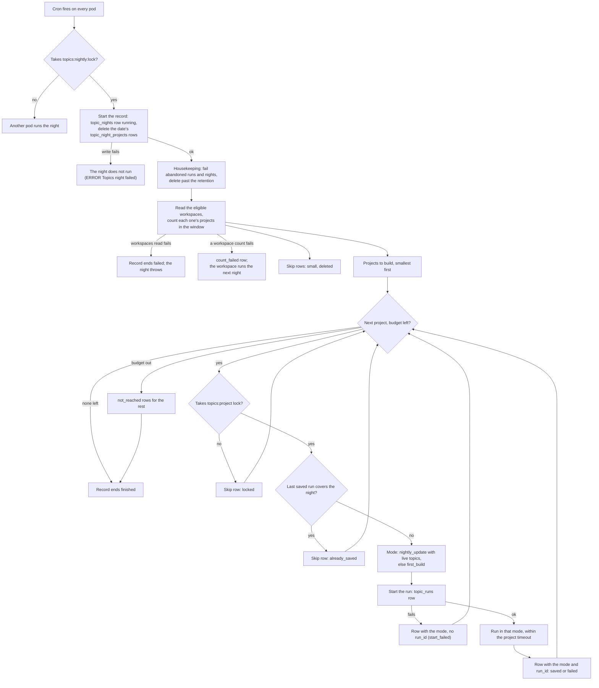

# ai-labels runbook

ai-labels labels every ended trace in opted-in workspaces with AI-generated labels, computed by opik-inference. It
runs only where `AI_LABELS_ENABLED=true`, and is off by default everywhere, OSS included. Nothing stops an OSS install
from turning it on, but it needs an opik-inference deployment and its credential, which only Comet-hosted deployments
have.

## Turning it on for a deployment

| Env var | Value |
|---|---|
| `AI_LABELS_ENABLED` | `true` |
| `AI_LABELS_INFERENCE_URL` | the opik-inference cell, e.g. `https://opik-inference.comet.com` |
| `AI_LABELS_INFERENCE_CREDENTIAL` | the deployment's opik-inference credential, from a secret (`component.backend.secretRefs`) |

- The backend refuses to start with ai-labels on unless `ANALYTICS_DB_DATA_MODEL_TRACE_COLUMNS_NON_NULLABLE=true`
  (the cut-over `traces` table). The `spans` cutover doesn't need to be done.
- opik-inference: the deployment needs its own `deployments` entry and credential in `config/inference.yaml`, with
  `allowed_orgs: "*"`. Opik sends workspace ids as `org_id`, so a real-org allow-list answers 403 `org_not_allowed`.
- Every other `aiLabels` setting is in `apps/opik-backend/config.yml` and overridable as `AI_LABELS_*`.

## Opting workspaces in and out

Opt-in is the `ai_label_workspaces` table in the state database (MySQL). There is no API.

Before enabling a workspace, check how much it will backfill: its traces in the horizon (7 days by default). Traces
created before a task's `applies_from` are never labeled.

```sql
-- ClickHouse
SELECT count()
FROM traces
WHERE workspace_id = '<workspace_id>'
  AND created_at >= now64(6) - INTERVAL 7 DAY;
```

The pool's throughput binds first: one L40S on the 4B model labels about 3 traces a second at 7K tokens each (22K
tokens/s), and a trace with large spans costs up to 50 times a small one. The sweep takes the newest traces first, so a
backfill works backward from now, and when the pool can't keep up the oldest traces age out of the horizon unlabeled
(`ai_labels.unsettled` stops shrinking). The global budget (`AI_LABELS_BUDGET_BYTES`, about 3 minutes of the pool by
default) bounds how much waits in opik-inference, and is shared out evenly between the workspaces that have traces to
label.

```sql
-- MySQL: enable (or re-enable) a workspace
INSERT INTO ai_label_workspaces (workspace_id, enabled, added_by)
VALUES ('<workspace_id>', TRUE, '<your name>')
ON DUPLICATE KEY UPDATE enabled = TRUE, added_by = '<your name>';

-- MySQL: disable a workspace. Immediate: the next sweep drops it. Jobs in flight still load, and labels stay.
UPDATE ai_label_workspaces SET enabled = FALSE WHERE workspace_id = '<workspace_id>';

-- MySQL: list the enabled workspaces
SELECT workspace_id, added_at, added_by FROM ai_label_workspaces WHERE enabled = TRUE ORDER BY added_at;
```

## Reading summaries

There is no UI yet. Take each trace's latest label (by write time):

```sql
-- ClickHouse
SELECT trace_id, task_version, JSONExtractString(output, 'summary') AS summary
FROM ai_labels
WHERE workspace_id = '<workspace_id>'
  AND project_id = '<project_id>'
  AND task = 'trace_summary'
  AND key = 'output'
ORDER BY workspace_id, project_id, task, trace_id, key, updated_at DESC
LIMIT 1 BY workspace_id, project_id, task, trace_id, key;
```

## What to watch

| Metric | Meaning |
|---|---|
| `ai_labels.unsettled_past_slo` | Unsettled (trace, task) pairs past the SLO, per workspace. The headline. |
| `ai_labels.budget.in_flight` / `.limit` | Cost in flight against the budget. Pinned at the limit means the pool is the bottleneck. |
| `ai_labels.unsettled` | Unsettled (trace, task) pairs in the horizon: the backlog. |
| `ai_labels.tick.phase_seconds` by `phase` | Time in load, sweep and submit. Loading stops starting jobs at 40% of the tick budget. |
| `ai_labels.tick.interval_seconds`, `.budget_seconds` | The tick cadence and the time a tick may use, as configured (`AI_LABELS_TICK_INTERVAL`, `AI_LABELS_TICK_BUDGET`). Loading stops at 40% of the budget, the sweep at 70%, submit at all of it. |
| `ai_labels.sweep.buckets` / `.buckets_reached` | N as configured vs the buckets the latest sweep got through before its share of the tick budget. Fewer than N means the sweep ran out of time (`ai_labels.sweep.overrun`); the first bucket swept rotates, so none starves. |
| `ai_labels.sweep.candidates` / `ai_labels.tick.workspaces` | Traces the latest sweep found to label, and the workspaces they span. Many candidates but few admitted (`ai_labels.submit.traces`) means the budget, not the sweep, bounds throughput. |
| `ai_labels.jobs.submitted` by `endpoint` | Jobs opik-inference accepted (202) and the tick recorded as open. Flat while `ai_labels.sweep.candidates` is high means submits fail: see `ai_labels.submit.throttled`, `.rejected` and the logs. |
| `ai_labels.jobs.open` | Jobs submitted and not yet loaded, as the leader last knew them. Growing while `ai_labels.items.done` is flat means jobs finish slower than they start, or never: the pool, or the service, is behind. |
| `ai_labels.jobs.oldest_open_seconds` | How long the oldest open job has been out, measured at scrape time. Past a few tick intervals the pipeline is stuck: the job is hung at the service, or the leader stopped ticking (the gauge then keeps growing on the last leader). 0 with none open. |
| `ai_labels.render.traces` / `ai_labels.submit.traces` | Traces rendered vs admitted. Far apart means renders are wasted: raise `AI_LABELS_MIN_ITEM_BYTES` toward a typical item. |
| `ai_labels.items.failed` by `error_code` | `render_over_budget`, `render_error`, `item_too_large`, `job_lost`, `missing_result`, `missing_answer`, or the service's code. |
| `ai_labels.submit.rejected` | A submit rejected with 400: a renderer or task bug. |
| `ai_labels.sweep.guard_trips` | A sweep query hit a ClickHouse guard: raise `AI_LABELS_SWEEP_BUCKETS`. |
| `ai_labels.render.compaction_level`, `.bytes` | How far traces had to be compacted to fit. |
| `ai_labels.render.history_turns`, `.history_bytes` | The earlier thread turns left in each fitted history, and their size. |
| `ai_labels.render.history_errors` | Failed reads of earlier turns. The chunk's render fails and is retried as `render_error`. |
| `ai_labels.render.duration_seconds` by `outcome` | Wall time per chunk (ClickHouse reads + render): `ok`, or `one_at_a_time` after a chunk read failed. |
| `ai_labels.render.cpu_seconds` | Java CPU spent rendering, excluding ClickHouse reads; its rate is cores. Spec 10 budgets about 0.25 core of Opik CPU per tick. Emitted only when the JVM supports and enables current-thread CPU time: no series means no measurement, not zero CPU or a met budget. ClickHouse's side is in `system.query_log`, where `log_comment` starts with `ai-labels:render:` (filter `log_comment LIKE 'ai-labels:render:%'`). |

## Topic vectors

The topic vectors job stores one bge-small vector (384 numbers, unit length) for every trace that has a `done`
`trace_summary` label. It embeds the summary text through opik-inference `/v1/embed` and writes the row to the
ClickHouse table `topic_vectors`, one row per (trace, task version). It is off by default everywhere.

### Opting workspaces in and out

Topics have their own opt-in, the `topic_workspaces` table in the state database (MySQL). It works like
`ai_label_workspaces`, and there is no API. Topics read the ai-labels `trace_summary`, so a workspace runs topics only
when it is enabled in **both** tables. Opting a workspace in to ai-labels does not turn topics on.

```sql
-- MySQL: enable (or re-enable) topics for a workspace. It must also be enabled in ai_label_workspaces.
INSERT INTO topic_workspaces (workspace_id, enabled, added_by)
VALUES ('<workspace_id>', TRUE, '<your name>')
ON DUPLICATE KEY UPDATE enabled = TRUE, added_by = '<your name>';

-- MySQL: disable topics for a workspace. The next tick drops it. Stored vectors stay.
UPDATE topic_workspaces SET enabled = FALSE WHERE workspace_id = '<workspace_id>';

-- MySQL: the workspaces topics run for
SELECT t.workspace_id, t.added_at, t.added_by
FROM topic_workspaces t JOIN ai_label_workspaces a ON a.workspace_id = t.workspace_id
WHERE t.enabled = TRUE AND a.enabled = TRUE ORDER BY t.added_at;
```

A workspace opted in after its traces were labeled gets vectors for the last 7 days (the long window). For older
labels, see "Backfill".

### Turning it on

| Env var | Default | Meaning |
|---|---|---|
| `TOPICS_ENABLED` | `false` | Runs the job. The backend refuses to start with it on unless `AI_LABELS_ENABLED=true` and `AI_LABELS_INFERENCE_URL` is set: it uses the same opik-inference URL and credential. |
| `TOPICS_VECTORS_TICK_INTERVAL` | `1m` | How often the job ticks. At most one tick runs per interval across all pods (see "How ticks run"). |
| `TOPICS_VECTORS_TICK_BUDGET` | `50s` | Every query and embed call of a tick starts within this. Must be under the tick interval. |
| `TOPICS_VECTORS_WINDOW` | `24h` | How far back, by `ai_label_status` write time, a normal tick looks. Never before the task's `applies_from`. |
| `TOPICS_VECTORS_LONG_WINDOW` | `7d` | The window of the long-window pass, for rows a normal tick missed. At least `TOPICS_VECTORS_WINDOW`. |
| `TOPICS_VECTORS_LONG_WINDOW_INTERVAL` | `1d` | How often the long-window pass starts. The pass stays on until it drains (see "How ticks run"); the interval runs from the tick that drained it. |
| `TOPICS_VECTORS_BACKFILL_WINDOW` | `0s` (off) | When above zero, the long-window pass uses this window instead of `TOPICS_VECTORS_LONG_WINDOW`. 0, or at least `TOPICS_VECTORS_WINDOW`; at most `365d`. See "Backfill". |
| `TOPICS_VECTORS_MAX_TRACES_PER_TICK` | `5000` | The most traces one tick embeds **per workspace**, oldest first. The tick budget bounds the total. The rest wait for the next tick. |
| `TOPICS_VECTORS_EMBED_BATCH_SIZE` | `256` | Texts per embed call. 256 is the most `/v1/embed` takes. |
| `TOPICS_VECTORS_EMBED_TIMEOUT` | `10s` | Each embed call's deadline. A chunk starts only with at least this much of the tick budget left; the rest is `over_budget`. Under the tick budget, at most 60s. |
| `TOPICS_VECTORS_FIND_MAX_ROWS_TO_READ` | `30000000` | ClickHouse `max_rows_to_read` of one workspace's window read. A trip fails that workspace's read for the tick. |
| `TOPICS_VECTORS_FIND_MAX_MEMORY_USAGE` | `1073741824` | ClickHouse `max_memory_usage` of one window read (1 GiB). |
| `TOPICS_VECTORS_FIND_MAX_EXECUTION_TIME` | `30s` | ClickHouse `max_execution_time` of one window read, cut to the time left in the tick. At most `TOPICS_VECTORS_TICK_BUDGET`. |
| `TOPICS_VECTORS_FIND_CREATED_AT_SLACK` | `1d` | The window read skips traces created before its lower bound minus `AI_LABELS_HORIZON` minus this margin. The margin covers the time from the ai-labels sweep to the status write. |

To turn it off, set `TOPICS_ENABLED=false` and restart. Stored vectors stay. When it is turned on again, the next
ticks write the vectors that are missing in the window, and the long-window pass writes the ones in the long window.
Older ones need a backfill.

### How ticks run

- Every pod fires the job every tick interval, each at its own second. Two Redis locks make that one tick per interval
  across the cluster:
  - `topics:vectors:leader` is held for the tick and released when it ends, so two ticks never overlap. Its lease is
    tick budget + embed timeout + find max execution time + 5s (95s by default). It matters only when the pod dies
    mid-tick: the next tick starts when the lease expires.
  - `topics:vectors:tick` is taken by the leader before it ticks and never released. It expires one interval (less up to
    1s for trigger jitter) after the tick started, so a pod that fires sooner skips.
- A skipped tick logs `Topic vectors tick skipped, lock '<name>' ...` at INFO. With several pods, expect most firings
  to skip on `topics:vectors:tick`. Ticks skipped on `topics:vectors:leader` for longer than one lease mean a tick
  is stuck.
- Each tick reads the enabled workspaces in turn, starting at an offset that moves by one every interval, so no
  workspace is always last. A read starts only with at least 1s of the budget left. A workspace that is not reached in
  time is read the next tick (one WARN).
- After an embed call fails with a 429 or a 5xx (whatever the error code), a timeout or a retryable code, the job stops
  calling for **that workspace** for the rest of the tick (`embed_failed`). Other workspaces go on.
- **Long-window pass.** Once per `TOPICS_VECTORS_LONG_WINDOW_INTERVAL` a tick uses the long window (Redis key
  `topics:vectors:long_window`). The pass stays on, tick after tick, until one of its ticks drains it: every workspace
  read with no failure, each under the per-workspace cap, and no candidate left for want of time (`over_budget`), a
  read (`read_failed`), a back-off or an insert (`insert_failed`). Then the interval starts. After an outage longer than
  the short window, the pass therefore runs every tick until the backlog in the long window is written. A summary that
  makes `/v1/embed` fail with a 5xx every time keeps the pass on until its status leaves the long window: each pass
  tick costs one long-window read per workspace.

### Backfill

The job only looks back as far as the long window (7 days). To write vectors for older labels, for example when
topics is turned on weeks after ai-labels, or a workspace is opted in to topics later than to ai-labels:

1. Set `TOPICS_VECTORS_BACKFILL_WINDOW` to the age to cover (for example `30d`), and restart.
2. Delete the Redis key `topics:vectors:long_window` to start the pass now. Otherwise it starts at the next interval.
3. Watch `topics.vectors.long_window.missed` and `topics.vectors.written`. The pass stays on until it drains.
4. Set `TOPICS_VECTORS_BACKFILL_WINDOW=0s` again, and restart.

Cost: the window read's cost grows with the window, not with what it finds. In the load test (one workspace, 2.07M
statuses) a 24h read took 220–440 ms and read 0.9–2.7M rows; a 7d read took 570–750 ms, read 2.4–5.0M rows and used
about 300 MiB. A 30d or 90d read of a large workspace reads proportionally more and can trip
`TOPICS_VECTORS_FIND_MAX_ROWS_TO_READ` or `..._MAX_MEMORY_USAGE`; the read then fails every pass tick for that workspace
(`topics.vectors.read.failures{phase=find}`). Raise the guards for the backfill, or backfill in steps (7d, 14d, 30d).
While the pass is on, every tick does this read for every enabled workspace.

### Checking that vectors flow

Run both queries for one workspace. The counts must match, up to the traces labeled since the last tick. A gap that
stays means the job skips traces: see `topics.vectors.skipped` and the logs.

```sql
-- ClickHouse: traces with a done trace_summary label in the last 24 hours (latest status per trace, as the job reads it)
SELECT count()
FROM (
    SELECT status, updated_at
    FROM ai_label_status
    WHERE workspace_id = '<workspace_id>'
      AND task = 'trace_summary'
    ORDER BY workspace_id, project_id, task, trace_id, updated_at DESC
    LIMIT 1 BY workspace_id, project_id, task, trace_id
)
WHERE status = 'done'
  AND updated_at >= now64(6) - INTERVAL 24 HOUR;

-- ClickHouse: vectors for the same traces
SELECT count()
FROM (
    SELECT trace_id, task_version
    FROM topic_vectors
    WHERE workspace_id = '<workspace_id>'
      AND (project_id, trace_id, task_version) IN (
          SELECT project_id, trace_id, task_version
          FROM (
              SELECT project_id, trace_id, task_version, status, updated_at
              FROM ai_label_status
              WHERE workspace_id = '<workspace_id>'
                AND task = 'trace_summary'
              ORDER BY workspace_id, project_id, task, trace_id, updated_at DESC
              LIMIT 1 BY workspace_id, project_id, task, trace_id
          )
          WHERE status = 'done'
            AND updated_at >= now64(6) - INTERVAL 24 HOUR
      )
    ORDER BY workspace_id, project_id, trace_id, task_version, updated_at DESC
    LIMIT 1 BY workspace_id, project_id, trace_id, task_version
);
```

### What to watch

Every metric but `topics.vectors.ticks` and `topics.vectors.tick.phase_seconds` carries `workspace_id` and
`workspace_name`. The name comes from the React service, once an hour per pod, and is the workspace id when the lookup
fails. Every series also carries `k8s_namespace_name`: group by it.

| Metric | Meaning |
|---|---|
| `topics.vectors.oldest_unvectored_seconds` by workspace | Age of the oldest done label without a vector that the last tick found in its window. The headline. It grows when the job falls behind or stops. Only the pod that ticked within the last two tick intervals publishes it, so read it with `max` across pods. A workspace whose window read failed, or was not reached, has no value for that tick: watch `topics.vectors.read.failures` and `topics.vectors.workspaces_not_read` with it. It sees only the window: after an outage longer than the short window it stays near the window's length until the long-window pass runs. Once a day the long-window tick can show a spike up to the long window: rows normal ticks missed. |
| `topics.vectors.ticks` by `outcome` | Firings of the job, per pod: `ran`; `not_due` (a tick ran less than one interval ago: most firings with several pods); `lock_held` (another pod holds `topics:vectors:leader`: every firing on a pod that is not the leader); `failed` (the tick threw: the log has `Topic vectors tick failed`). Summed over pods, about one `ran` per tick interval. Each outcome starts at 0 on every pod with topics on. No `ran` while every pod counts `lock_held` means a tick stuck past its lease, or Redis down: the lock service then takes the same path and logs `Failed to acquire lock, executing fallback action`. |
| `topics.vectors.workspaces_not_read` by workspace | Enabled workspaces a tick did not read because its budget ran out (one WARN per tick). They have no lag value for that tick. The offset moves by one workspace per tick, so the same workspaces can stay unread for many ticks in a row. Counted every tick: too many enabled workspaces, or slow window reads (see `topics.vectors.tick.phase_seconds{phase="find"}`). |
| `topics.vectors.written` by workspace | Vectors stored. |
| `topics.vectors.skipped` by `reason`, workspace | `missing_summary` (the output row the window read saw was gone or of another task version by the summary read, which usually clears on the next tick; a WARN per workspace per tick names the count and the oldest trace), `embed_failed` (the call failed, or the workspace backed off: the next tick retries), `invalid_vector` (a missing, null, zero or wrong-dimension vector), `over_budget` (not enough of the tick left to start a call: the next tick continues), `insert_failed` (the ClickHouse insert failed: the next tick embeds them again), `read_failed` (the summary read failed: the next tick reads them again). |
| `topics.vectors.read.failures` by `phase`, `error_type`, workspace | Failed ClickHouse reads: `find` (one workspace's window read, for example a guard trip) or `summaries` (one workspace's summary read). `error_type` is the root cause's class name. |
| `topics.vectors.embed.failures` by `http_status`, `code`, `error_type`, workspace | Failed embed calls. 429 `quota_exceeded` means the embed pool is full. Do not alert on it alone: a failure backs off one workspace for one tick, and the next tick retries. |
| `topics.vectors.embed.duration_seconds` by `outcome`, workspace | Wall time per embed call: `ok`, or the error code. |
| `topics.vectors.tick.phase_seconds` by `phase` | Time in `find` (ClickHouse window reads) and `embed` (summary reads, embed calls, inserts and the arrival steps; see `topics.arrival.duration_seconds`). |
| `topics.vectors.long_window.missed` by workspace | Vectors the long-window pass wrote for statuses older than the short window: rows normal ticks missed, for example after an outage longer than the window. Above zero outside a backfill or an outage means normal ticks miss rows. |

The window read leaves out a done status whose latest output is missing, of another task version, or empty or only
whitespace. Such a status gets no vector and is not counted, and it does not take a place in the per-workspace cap, so
it never holds back newer traces.

ClickHouse queries of the job have a `log_comment` that starts with `topics:`.

### Alerts

The rules live in comet-monitoring as a PrometheusRule, armed per environment, not in this repo. None fires on a
quiet day: a workspace with no new traces reports 0, and a disabled workspace, or a deployment with topics off,
publishes no series.

| Alert | PromQL | Drill down |
|---|---|---|
| Vectors lag | `min_over_time(max by (k8s_namespace_name, workspace_id, workspace_name) (topics_vectors_oldest_unvectored_seconds)[15m:1m]) > 1800` | Run "Checking that vectors flow" for the workspace. Then `topics.vectors.skipped` by reason and `topics.vectors.embed.failures` for it: a trace that fails every tick (`invalid_vector`, or `embed_failed` with a 4xx) holds the age up until its status leaves the window. Many workspaces at once: opik-inference, or the tick budget (`over_budget`). |
| Vectors tick stopped | `sum by (k8s_namespace_name) (increase(topics_vectors_ticks_total{outcome="ran"}[10m])) == 0` | `topics.vectors.ticks` by outcome. `failed`: the backend log line `Topic vectors tick failed`. Only `lock_held`: Redis, or a tick stuck past its lease (the TTL of the Redis key `topics:vectors:leader`). Only `not_due`: the TTL of `topics:vectors:tick`. |
| Vectors workspace not read | `sum by (k8s_namespace_name, workspace_id) (increase({__name__=~"topics_vectors_workspaces_not_read_total\|topics_vectors_read_failures_total", phase=~"find\|"}[15m])) >= 10` | The workspace's window read failed, or the tick budget ran out before it, on most ticks of the last 15 minutes. `topics.vectors.read.failures` by `error_type` for it: ClickHouse timeouts or guards on a large workspace. Only `workspaces_not_read`: the tick budget is too short for the enabled workspaces, or one slow workspace ahead of it in the rotation. |

- **Vectors lag.** `min_over_time` over 15 minutes ignores the daily long-window spike and one slow tick, so the alert
  fires about 15 minutes after the lag first passes the threshold. The threshold, 30 minutes, is 15 times the 2-minute
  target and far above a healthy value (under two tick intervals). It is not measured on prod yet. It must stay under
  24 hours: the window caps the gauge. A workspace with no value (its read fails, or the budget never reaches it) is
  invisible to this alert: "Vectors workspace not read" covers it.
- **Vectors tick stopped.** The heartbeat. The lag gauge disappears when the job stops, so the lag alert resolves
  instead of firing; this one fires. Every outcome starts at 0 when a pod starts the job, so `increase()` loses at most
  the pod's first firing, not the ticks after a deploy.
- **Vectors workspace not read.** The heartbeat of one workspace: its lag series disappears exactly when its read
  fails or is never reached. Both counters carry the workspace, and the tick runs every minute, so 10 in 15 minutes
  means most ticks missed it; the first increment a new series loses does not matter at that rate. It groups by
  `workspace_id` alone: while a name lookup falls back to the id, the same workspace has two `workspace_name` values,
  and grouping by both would split the count under the threshold. Find the name on the lag panel or in the opt-in
  table.

### Deletes

A vector lives as long as its trace. Retention deletes vectors with the traces (the same rules as `ai_labels`), and a
trace delete deletes its vectors. There is no project or workspace delete path, the same as for `ai_labels`: deleting
a project or a workspace leaves its vectors until retention removes them. A trace deleted between a tick's read and its
insert (at most one tick) can leave a vector row behind, exactly like `ai_labels`. The retention sweep removes such rows
by trace id range and week.

A trace delete deletes the vectors before the ai-labels rows, each on its own, so neither failure skips the other.
If the ai-labels delete fails, the trace's `done` status stays in `ai_label_status`, and the next tick writes its vector
again from the label (the job reads only `ai_label_status` and `ai_labels`). Retention removes both, in workspaces with
a retention policy.

## Topics nightly job

Once a night the job builds or updates each project's topic list from its topic vectors. A project without live topics
gets a first build; a project with live topics gets a nightly update (see [Nightly update](#nightly-update)). It reads
the same workspaces as ai-labels, and runs only with `TOPICS_ENABLED=true`.

A first build reads the project's window (the 30 whole UTC days before the night, the newest 30,000 traces at most),
merges identical intent texts, groups them with k-means (15 to 50 groups), asks Qwen through opik-inference
`/v1/generate` to name up to 10 topics over the groups, and assigns every window trace to its nearest topic prototype
or to Other. It writes:

| Table | Database | What |
|---|---|---|
| `topics` | MySQL | One row per topic: name, definition, `born` (the night), `size` (window traces), and the nightly update's lifecycle columns: `low_nights`, `lo7`, `hi7`, `inactive_since`, `retired_at`, `retired_reason`, `revived_at` (the last night a retired topic came back). A retired topic keeps its row; its id is never reused. |
| `topic_prototypes` | MySQL | The vectors traces are assigned by, several per topic, and the known-Other ones (`topic_id` null). |
| `topic_project_states` | MySQL | One row per project with a saved list: `rebuilds` (saved nights), `last_run_id`, `window_until`. |
| `topic_runs` | MySQL | One row per run: `running`, then `saved` or `failed` with `error_code`. Kept 90 days. |
| `topic_run_counts` | MySQL | One row per topic of a saved run, and one for Other: `traces` in the run's window and `rank` (null for Other). The topics API compares a project's last two saved runs. Kept 90 days. |
| `trace_topics` | ClickHouse | One row per window trace and run: its `topic_id`, the all-zeros id for Other. The latest row wins; a failed run deletes its rows (best effort). |

### Turning it on and off

| Env var | Default | Meaning |
|---|---|---|
| `TOPICS_NIGHTLY_ENABLED` | `true` | Runs the job. Needs `TOPICS_ENABLED=true`. |
| `TOPICS_NIGHTLY_SCHEDULE` | `0 0 2 * * ?` | Quartz cron, UTC. The night is the UTC date the job starts on. |
| `TOPICS_NIGHTLY_BUDGET` | `2h` | No project starts after this; the rest run the next night. |
| `TOPICS_NIGHTLY_PROJECT_TIMEOUT` | `15m` | One run is stopped and failed with `timeout` after this. Under the budget. |
| `TOPICS_NIGHTLY_MIN_VECTORS` | `100` | A project is built when its window holds at least this many traces with a vector. |
| `TOPICS_NIGHTLY_WINDOW_DAYS` | `30` | The window, in whole UTC days before the night. |
| `TOPICS_NIGHTLY_MAX_VECTORS` | `30000` | A larger window keeps its newest traces. |
| `TOPICS_NIGHTLY_QWEN_DEADLINE` | `120s` | The deadline of the first build's author call and the nightly update's revise call. The verify (60s) and naming (30s) deadlines are fixed. Every call uses the `batch` lane, which takes up to 300s. |
| `TOPICS_NIGHTLY_RUNS_RETENTION` | `90d` | `topic_runs` and `topic_run_counts` rows and the night records (`topic_nights`, `topic_night_projects`) are deleted after this. |

To turn it off, set `TOPICS_NIGHTLY_ENABLED=false` and restart. Saved lists stay and freeze at their last saved night.
This is also the rollback of the nightly update.

To stop it for one workspace without a restart, opt the workspace out (`UPDATE topic_workspaces SET enabled = FALSE
WHERE workspace_id = '<workspace_id>'`). This also stops its topic vectors. The next night skips it; a night already
running reads the workspaces once, at its start, so it still runs the workspace's projects.

### How a night runs

Where a night stops and where it goes on:



Every record write after the start is best-effort: a failed one is logged and the night goes on (see "What to watch").

- Every pod fires the job on the cron. The first to take the Redis lock `topics:nightly:lock` runs the night and keeps
  the lock until it expires (budget + project timeout + 5 minutes), so no other pod runs the same night. If that pod
  dies during the night (a deploy), the rest of the night waits for the next night: the cron does not fire again, and
  the night endpoint answers `409` until the lock expires. To finish the night sooner, delete the Redis key
  `topics:nightly:lock` and call the night endpoint (see "Running by hand").
- The night first fails runs left `running` by an earlier night (`error_code = 'abandoned'`), and deletes runs and
  run counts older than the retention. It does the same for the night records: a night left `running` past the night
  lock's lease is set to `failed`, and records older than the retention are deleted.
- It counts each enabled workspace's projects in the window, drops those under `TOPICS_NIGHTLY_MIN_VECTORS`, and runs
  the rest smallest first, one at a time: a `nightly_update` for a project with live topics, else a `first_build`. A
  project whose last saved run already covers the night (a run by hand) is skipped.
- Each run holds the Redis lock `topics:project:<project_id>`, so a run started by hand and the night never build the
  same project at once.
- A first build under 1,000 traces is saved with `"provisional": true` in its stats.

A failed run keeps only its `topic_runs` row: when its save fails after the `trace_topics` insert, it deletes those
rows again (best effort). The project runs again the next night. A skipped or failed
night does not count: the lifecycle counters and `rebuilds` change only on a saved run.

| `error_code` | Meaning |
|---|---|
| `qwen_timeout` | A Qwen call ran out of its deadline: `TOPICS_NIGHTLY_QWEN_DEADLINE` for author and revise, 60s for verify, 30s for naming. |
| `qwen_error` | A Qwen call (author, revise, verify or naming) failed after its 2 retries, or with a 4xx. `error_message` has the call's kind, code and HTTP status. |
| `qwen_bad_answer` | The author or revise answer is not a JSON object, or the author answer breaks the schema. Or opik-inference answered `schema_violation` to any call: a cut or off-schema answer, which is not retried. The answer is in the DEBUG logs. |
| `window_read` | The ClickHouse window read failed, the window had no usable vector, or the nightly update could not read last night's labels. |
| `invariant` | A check before the save failed: more than 10 live topics, a retired id live again, a renamed topic, a new topic not born tonight, a blank or catch-all name, a prototype not of unit length, a trace not labelled once or labelled with a retired topic. |
| `timeout` | The run outlasted `TOPICS_NIGHTLY_PROJECT_TIMEOUT`, or the job was interrupted. |
| `save` | The ClickHouse insert or the MySQL transaction failed, or another run saved the project meanwhile (`error_message` says so; only if the project's Redis lock was lost). The run deletes the `trace_topics` rows it inserted; if that delete fails too (a WARN names the run), they stay until the next saved run replaces them. |
| `abandoned` | The pod stopped during the run. |
| `internal` | A bug: read the logs for the run id. |

### Nightly update

A project with live topics keeps its list and updates it. The run reads the window and the saved list (live topics,
their prototypes, the dormant topics and their prototypes, the known-Other prototypes, `rebuilds`), then:

1. On a review night the known-Other prototypes are dropped: the Other memory expires weekly.
2. Every window trace goes to its nearest prototype at cosine 0.75: a topic, known Other, or unassigned.
3. Each topic's prototypes move to its members of tonight (k-means, 1 to 10 prototypes by member count); so do the
   known-Other ones.
4. When 20 or more traces are unassigned, they are grouped by k-means. A group of 20 or more traces is a candidate. A
   candidate is big when its share of the window, or of the last 7 days, is 2% or more.
5. Qwen is called only when there is a big candidate or it is a review night. Most nights make no call.
   - `revise` (`revise_v4.md`, or `revise_review_v4.md` on review nights): assign candidates to topics, create new
     topics (not when the list holds 10), send candidates to Other; on review nights also merge, retire and redefine
     topics. A review never retires a topic with a 2% share or more (overall or in the last 7 days): such a topic
     can only be merged or redefined. A failed revise fails the run.
   - `verify` (`verify_batch.md`): one call checks every candidate given to a topic. A rejected or unanswered pair is
     undone. An unreadable verify answer undoes every pair and the run goes on. A failed verify call fails the run:
     read as "no pair verified", it would turn sound assigns into forced births.
   - `naming` (`naming_group.md`), one call per night for every big candidate left without a topic and tight enough
     (0.80). Qwen sees the live topics and may give a candidate to one of them, put same-kind candidates into one new
     topic, or send a candidate to Other. A candidate given to a topic is checked by one more verify call
     (`verify_naming`); a rejected one goes to a second call (`naming_new`, `naming_group_new.md`) that offers a new
     topic or Other only. A new name equal to a live topic's (case and spaces ignored) joins that topic, and equal new
     names are one topic. On a full list a new topic replaces the topic (not born tonight) with the lowest 7-day
     share, if that share is below the sum of its candidates' 7-day shares. A loose candidate, a full list with no
     such topic, a catch-all or blank name, or a candidate the answers leave out goes to known Other, and the run goes
     on. A failed naming call fails the run.
6. The centre of each candidate given to a topic becomes one more prototype of that topic; one given to Other becomes
   a known-Other prototype.
7. Rebirth. A dormant topic is one retired for its traffic (`low_share`, `cap` or `replaced`) before tonight and in the
   last `topics.nightly.reviveDays` (default 30; `TOPICS_NIGHTLY_REVIVE_DAYS`, 0 turns rebirth off). A topic born
   tonight whose traces belong to a dormant topic takes that topic's identity: each of its traces goes to its nearest
   dormant prototype at cosine 0.75, and when one dormant topic takes at least half of them (and at least 5), it is live
   again with the newborn's prototypes, the same id, name, definition and `born`, `revived_at` set to the night and
   fresh lifecycle streaks. The newborn is not saved. The night's other decisions do not change. Without this, a theme
   whose traffic paused for a few days comes back as a second topic with a new name. A topic Qwen retired (`merged`,
   `review`) never comes back.
8. Every window trace is assigned again, as in the first build (cosine 0.75, the 0.95 gate on known Other).
9. Lifecycle, then a reassignment when a topic was retired:
   - `low_nights` counts saved nights in a row under 0.5% of the window; at 3 the topic is retired (`low_share`). A
     topic born after the first build is measured from 7 days before its birth (newborn protection).
   - More than 10 live topics: the smallest is retired (`cap`).
   - Inactive is a display state, not a retirement: 3 nights in a row under 0.5% of the last 7 days set
     `inactive_since` (`lo7` counts them); 2 nights at 1% or more clear it (`hi7`). An inactive topic still counts
     traces and can still be retired.
   - New is a display state too: born less than 7 days ago.

`retired_reason` is one of `low_share`, `cap`, `merged` (dropped by a review night's merge), `review` (retired by a
review night's answer) or `replaced` (replaced by a forced new topic on a full list).

The save writes tonight's `trace_topics` rows, then in one MySQL transaction: tonight's new topics, the changed
columns of the topics it read, the project's prototypes (replaced: the live topics', the dormant topics' and known
Other), and `rebuilds` + 1. `topic_prototypes` therefore holds prototypes of retired topics too: a reader that assigns
traces must take only the prototypes of live topics (`topics.retired_at IS NULL`).

#### Review nights

A review night is a run whose `rebuilds` (saved nights before it) is a multiple of 7, above 0: every 7th saved night.
On a review night the known-Other memory is dropped, and Qwen gets the review prompt, which may also merge, retire and
redefine topics (a redefine keeps the name). A run is also a review when it has a big candidate and the list already
holds 10 topics (`"review": true`, `"review_night": false` in its stats).

To force a review night by hand, set `rebuilds` to the next multiple of 7. The next saved night is a review night, and
the weekly cadence moves with it. `rebuilds` also seeds the night's k-means, so the candidate groups change too.

```sql
-- MySQL: make the project's next night a review night
UPDATE topic_project_states SET rebuilds = 7 * CEIL(rebuilds / 7)
WHERE project_id = '<project_id>' AND rebuilds > 0;
```

#### Churn

Before writing tonight's labels, the run reads last night's label of each window trace. Over the traces labelled on
both nights:

- `churn_any` is the share whose label changed, Other included;
- `churn` is the same over the traces in a topic on both nights: a trace that moved from one topic to another.

A trace that moved to or from Other counts in `churn_any` only. A retired topic's traces moving to Other raise
`churn_any`, not `churn`. Both are null on a night with no trace labelled the night before. A stable list stays near 0:
the target for a project is a mean `churn` under 0.01 over two weeks, with no night over 0.05.

### Tonight's runs

```sql
-- MySQL: the runs started since midnight UTC, newest first
SELECT run_id, workspace_id, project_id, mode, status, error_code, started_at, finished_at,
       JSON_EXTRACT(stats, '$.vectors') AS vectors, JSON_EXTRACT(stats, '$.topics') AS topics,
       JSON_EXTRACT(stats, '$.other_share') AS other_share, JSON_EXTRACT(stats, '$.provisional') AS provisional,
       JSON_EXTRACT(stats, '$.review') AS review, JSON_EXTRACT(stats, '$.born') AS born,
       JSON_EXTRACT(stats, '$.retired') AS retired, JSON_EXTRACT(stats, '$.churn') AS churn,
       JSON_EXTRACT(stats, '$.churn_any') AS churn_any
FROM topic_runs
WHERE started_at >= UTC_DATE()
ORDER BY started_at DESC;

-- MySQL: a project's live topics with their lifecycle state
SELECT name, size, born, inactive_since, low_nights, lo7, hi7, definition FROM topics
WHERE project_id = '<project_id>' AND retired_at IS NULL
ORDER BY size DESC;

-- MySQL: a project's retired topics
SELECT name, born, retired_at, retired_reason, size FROM topics
WHERE project_id = '<project_id>' AND retired_at IS NOT NULL
ORDER BY retired_at DESC;
```

A nightly update's `stats` holds, besides `vectors`, `topics`, `other_share`, `seconds` and `task_version_shares`:

| Key | Meaning |
|---|---|
| `mode` | `nightly_update`. |
| `rebuilds_before`, `topics_before` | `rebuilds` and the live topics the run started from. |
| `review_night`, `review` | A review night by `rebuilds`; a review at all (also forced by a full list). |
| `unassigned`, `candidates`, `big` | Traces no prototype took at 0.75; candidate groups; big ones. `big` 0 and `review` false mean no Qwen call. |
| `verify_pairs`, `verify_failed` | Pairs sent to verify; true when the answer was unreadable and every pair was undone. |
| `forced` | Big candidates left without a topic, by outcome: `born`, `assigned` (given to a live topic and verified), `same_name` (a new name equal to a live topic's), `other_loose`, `other_full`, `other_name`. |
| `born`, `revived`, `retired` | Names of tonight's new topics; names of the dormant topics a topic born tonight brought back; tonight's retirements by reason. |
| `other_prototypes` | Known-Other prototypes after the night. |
| `churn`, `churn_any` | See [Churn](#churn). |
| `qwen_calls`, `qwen` | The number of calls, and per call its `kind` (`revise`, `verify`, `naming`), `outcome` and tokens. |
| `seconds` | Phases: `window`, `state`, `update`, `churn`, `save`. |

```sql
-- ClickHouse: a project's trace counts per topic in the last saved window
-- (window_from and window_until are in the run's stats)
SELECT topic_id, count() AS traces
FROM (
    SELECT trace_id, topic_id
    FROM trace_topics
    WHERE workspace_id = '<workspace_id>' AND project_id = '<project_id>'
    AND trace_created_at >= '<window_from>' AND trace_created_at < '<window_until>'
    ORDER BY trace_id, updated_at DESC
    LIMIT 1 BY trace_id
)
GROUP BY topic_id
ORDER BY traces DESC;
```

Each run logs at INFO, by run id: Qwen's token counts for each call, and one summary line. A first build's line has the
window, vectors, unique texts, k, seed, the topics with their sizes, the Other share and the phase timings; a nightly
update's has the review flag, the unassigned, candidates and big counts, the topics born and retired, the Other share,
the churn and the timings. The prompts (author, or revise, verify and naming) and Qwen's raw answers hold
trace-derived text, so they are logged at DEBUG only (logger `com.comet.opik.domain.topics.TopicsRebuildService`).
Search the logs for `Topics run '<run_id>'`.

### Running by hand

Two internal endpoints start work now instead of waiting for the night. Call them from inside the cluster. Both answer
`501` when `TOPICS_ENABLED` is off and `409` when `TOPICS_NIGHTLY_ENABLED` is off. Both take `&night=yyyy-MM-dd`
(`?night=` for the night endpoint): the night is today (UTC) by default, so the window ends at today's start. `night`
is at most tomorrow, whose window holds today's traces so far, and at least 365 days ago.

**One project.** The night's rules apply: the workspace is opted in to topics, and the project's window holds at least
`TOPICS_NIGHTLY_MIN_VECTORS` vectors. Only one run by hand goes at a time across the cluster.

```bash
curl -X POST "http://<opik-backend>:8080/v1/internal/topics/projects/<project_id>/run?workspace_id=<workspace_id>"
```

It answers `202` with the `run_id`. The run goes on in the background with the same timeout; read its outcome in
`topic_runs`. The mode is the night's: a `nightly_update` when the project has live topics, else a `first_build`. It
answers `409` when the workspace is not opted in, the window is too small (or the project is not the workspace's), a run
of the project or another run by hand is in progress, or the project's last saved run already covers the night (its
`window_until` is at or after the night's start).

**A whole night.** It runs every eligible project, as the scheduled job does, under the same night lock. The lock is
released when the night ends, so the scheduled job is skipped only while a night started by hand is still running.

```bash
curl -X POST "http://<opik-backend>:8080/v1/internal/topics/nights/run"
```

It answers `202` with the `night`, and `409` when a night is in progress. Each project's outcome is its `topic_runs`
row.

To build a project that already has a list again (for example after a bad first build), delete its list first. Its
`trace_topics` rows stay until the new run replaces them:

```sql
-- MySQL: forget a project's list, so the next night (or the endpoint) builds it again
DELETE FROM topics WHERE project_id = '<project_id>';
DELETE FROM topic_prototypes WHERE project_id = '<project_id>';
DELETE FROM topic_project_states WHERE project_id = '<project_id>';
```

### What to watch

Every metric of one workspace's work has `workspace_id` and `workspace_name` (the name falls back to the id). These
counters and histograms are for the dashboard. A nightly series starts on the night's pod, so `increase()` misses the
event that creates it: the alerts read the state gauges further down, not these.

| Metric | Meaning |
|---|---|
| `topics.nightly.projects` by `decision`, `reason` | Projects the night looked at: `skip` with a `reason` (`small`: under the minimum; `deleted`; `already_saved`: its last saved run already covers the night; `locked`: held by a run started by hand, or Redis is down), `first_build`, `nightly_update`, `not_reached` (the budget ran out: they run the next night). `not_reached` above zero means the budget is too short. |
| `topics.runs` by `status`, `error_code` | Finished runs. Each failed run counts once: `start_failed` when the run could not start (it has no `topic_runs` row), `abandoned` when the next night's housekeeping fails a run left `running`. A run is counted by the write that ends its row: when marking a run failed throws, its row stays `running` and nothing counts it until housekeeping fails it as `abandoned`. |
| `topics.run.duration_seconds` by `phase` | Time in `window` (ClickHouse read), `kmeans`, `qwen`, `assign`, `save` (first build); `window`, `state`, `update`, `churn`, `save` (nightly update). |
| `topics.qwen.calls` by `kind`, `outcome` | `kind` is `author`, `revise`, `verify` or `naming`; `outcome` is `ok`, `timeout`, `error` or `bad_answer`. A failed call of any kind fails the run. An author call counts after its answer is read: an author answer that cannot be read is `bad_answer`, not `ok`. A revise, verify or naming call counts `ok` when it answers; an unreadable revise answer then fails the run with `qwen_bad_answer`. |
| `topics.topics.live` | Live topics of a project after each saved run, first build or nightly update. |
| `topics.topics.born` by `mode` | Topics born by saved runs. A few a week per project is normal; many every night means the list does not settle. |
| `topics.topics.retired` by `reason` | `low_share`, `cap`, `merged`, `review`, `replaced`. |
| `topics.run.churn`, `topics.run.churn_any` | Per saved nightly update, see [Churn](#churn). They have no project attribute: the churn query under "Alerts" below names the project. |
| `topics.save.rows` by `table` | Rows saved runs wrote. |
| `topics.save.take_back_failures` by workspace, `error_type` | Failed saves whose `trace_topics` rows could not be deleted. Readers see those rows until the project's next saved run. |
| `topics.run.other_share` | The Other share of each saved run, first build or nightly update (its `stats.other_share`). No alert: no threshold is set. |
| `topics.nightly.count_failures` by workspace, `error_type` | Workspaces whose window count read failed. The night skips all their projects; they run the next night. |
| `topics.nightly.budget_used_seconds` | Wall time of each night (no workspace). Near `TOPICS_NIGHTLY_BUDGET` means projects will soon be `not_reached`. |

Each night writes its record as it goes:

| Table | What |
|---|---|
| `topic_nights` | One row per night (the UTC date): `started_at`, `finished_at`, `outcome` (`running`, `finished`, or `failed` when a read of the workspaces, lists or projects failed), `eligible_workspaces`, `count_failures`, and `projects` (JSON, projects per decision). Written when the night starts and when it ends, also with no project. A night run again for the same date replaces its row and its project rows. |
| `topic_night_projects` | One row per project the night looked at, skips included: `workspace_id`, `project_id`, `vectors`, `decision`, `reason`, `run_id` (null when no run started). A workspace whose count read failed has one row with a null `project_id` and decision `count_failed`. |

A night whose start write fails does not run, so a rerun of a date never mixes its rows with the earlier run's; if
starts keep failing, "Night not started" fires. A later record write that fails logs a WARN (`could not write its record`) for the first
of the night, DEBUG for the rest, and a WARN with their count at the night's end; the night goes on.

The state gauges come from these tables. Each pod reads them once a minute and keeps the result; a scrape reads no
table. Every pod publishes the same values: read them with `max`, never `sum`. They are published only while
`TOPICS_ENABLED` and `TOPICS_NIGHTLY_ENABLED` are on, and only from the first night on, except the heartbeat
`state_age_seconds`. A workspace counts only while it is opted in to both topics and ai-labels.

| Gauge | Value |
|---|---|
| `topics.nightly.state_age_seconds` | Seconds since this pod last read the night tables; before its first good read, since it started trying. Published whenever the job is on, also before the first night. Above a few minutes, every other state gauge is stale. |
| `topics.nightly.state_refresh_failures` | A counter: failed reads of the night tables (WARN `could not read the night tables`). Set to 0 at startup when the job is on. |
| `topics.nightly.last_started_age_seconds` | Seconds since the latest night started, scheduled or by hand. Before the first night ever, seconds since the pod started reading. |
| `topics.nightly.running_seconds` | Age of the oldest night still `running`; 0 when none. A night whose pod died stays `running` until the next night's housekeeping fails it. |
| `topics.nightly.last_night.projects` by workspace, `decision`, `reason` | Projects per decision in the latest ended night, `count_failed` included. |
| `topics.nightly.last_night.runs` by workspace, `status` | Runs the latest ended night started, by their `topic_runs` status: `saved`, `failed` (a run that could not start counts here), `running` (marking it failed threw). |
| `topics.nightly.last_night.failed` | 1 when the latest ended night failed (a read failed, or its pod died and the next night's housekeeping failed it), 0 when it finished. |
| `topics.nightly.stale_projects` by workspace | Projects expected on each of the last 3 ended nights with no saved run since the first of them (a run by hand counts). Expected is any decision but a skip as `small`, `deleted` or `already_saved`; a project with a list is expected every night, as a `nightly_update`. This covers `not_reached`, failed first builds and nightly updates, and start failures. 0 for each workspace without one. |
| `topics.nightly.starved_projects` by workspace | Projects `not_reached` on each of the last 2 ended nights. 0 for each workspace without one. |
| `topics.nightly.last_night.churn_max` by workspace | The highest `churn` (see [Churn](#churn)) of the latest ended night's saved nightly updates. No series for a workspace without one, or whose runs have a null churn (no trace labelled the night before). |
| `topics.workspaces.mismatched` by workspace | 1 for a workspace enabled in `topic_workspaces` and not in `ai_label_workspaces`: no night runs it. |

The Prometheus names replace the dots with underscores, for example `topics_nightly_stale_projects`; the counters end
in `_total`.

ClickHouse queries of the job have a `log_comment` that starts with `topics:`.

### Alerts

The rules live in comet-monitoring as a PrometheusRule, armed per environment, not in this repo. They read the state
gauges only, and every rule groups by `k8s_namespace_name`.

| Alert | Condition | PromQL | Check | First step |
|---|---|---|---|---|
| Night not started | No night started for 25 hours. Before the first night ever, the age counts from the pod's start, so a first night that never starts fires too. | `max by (k8s_namespace_name) (topics_nightly_last_started_age_seconds) > 25 * 3600` | The latest nights query below. | Read the logs for `Topics night` around the cron time. A night lock left by a dead pod (`topics:nightly:lock`) blocks nights until it expires. Run the night by hand (see "Running by hand"). |
| Night too long | A night runs longer than budget + project timeout + 30 minutes (2 h 45 m with the defaults). | `max by (k8s_namespace_name) (topics_nightly_running_seconds) > 9900` | The latest nights query below; its `running` row. | A night whose pod died stays `running` until the next night: check for a pod restart. Otherwise find the `running` run in `topic_runs` and its logs. |
| Last night failed | The latest ended night failed: a read failed, or its pod died and the next night's housekeeping failed it. A night whose reads fail writes no project rows, so no other nightly rule sees it. | `max by (k8s_namespace_name) (topics_nightly_last_night_failed) > 0` | The latest nights query below; its `failed` row. | The ERROR `Topics night failed` (or `started by hand failed`) has the error. No ERROR: the pod died, check for a restart. Clears when the next night finishes. |
| Stale projects | A project was expected on each of the last 3 nights and got no saved run. | `max by (k8s_namespace_name, workspace_id, workspace_name) (topics_nightly_stale_projects) > 0` | The stale-project query below. | Find its runs in `topic_runs`: failed (read `error_code`), never started (a `first_build` or `nightly_update` row with no `run_id`), or `not_reached` (the budget). |
| Starved projects | A project was `not_reached` on each of the last 2 nights. | `max by (k8s_namespace_name, workspace_id, workspace_name) (topics_nightly_starved_projects) > 0` | The starved-project query below. | Raise `TOPICS_NIGHTLY_BUDGET`, or split the night. |
| Failed share | More than 20% of the latest night's runs failed, with at least 5 runs in the namespace. | See below. | The latest night query below. | Group the failures by `error_code`: `qwen_*` points at opik-inference, `window_read` and `save` at ClickHouse or MySQL. A `first_build` or `nightly_update` row with no `run_id` could not start: MySQL. |
| Count read failed | A workspace's window count read failed in the latest night. | `max by (k8s_namespace_name, workspace_id, workspace_name) (topics_nightly_last_night_projects{decision="count_failed"}) > 0` | The latest night query below. | The WARN `Topics night count read failed, workspace '<workspace_id>'` has the ClickHouse error (often a guard trip). The workspace runs the next night. |
| Workspace mismatch | A workspace is opted in to topics and not to ai-labels, for 1 hour. Warning. | `max by (k8s_namespace_name, workspace_id, workspace_name) (topics_workspaces_mismatched) > 0` with `for: 1h` | The mismatch query below. | Opt the workspace in to ai-labels, or out of topics. |
| Churn | A saved nightly update of the latest night moved more than 5% of the traces that were in a topic on both nights. | `max by (k8s_namespace_name, workspace_id, workspace_name) (topics_nightly_last_night_churn_max) > 0.05` | The churn query below names the project. | Read the run's `born`, `retired` and `forced` stats and its revise answer in the logs. A merge or a replaced topic explains a one-night jump; a high churn every night means the list does not settle. |
| State gauges stale | A pod has not read the night tables for 10 minutes: the other nightly alerts are blind. | `max by (k8s_namespace_name) (topics_nightly_state_age_seconds) > 600` | `topics_nightly_state_refresh_failures_total`. | The WARN `Topics nightly gauges could not read the night tables` has the MySQL error. |

The failed-share rule (a pod's series per workspace, so `max` first):

```promql
sum by (k8s_namespace_name) (max by (k8s_namespace_name, workspace_id, status) (topics_nightly_last_night_runs{status="failed"}))
  / sum by (k8s_namespace_name) (max by (k8s_namespace_name, workspace_id, status) (topics_nightly_last_night_runs)) > 0.2
and sum by (k8s_namespace_name) (max by (k8s_namespace_name, workspace_id, status) (topics_nightly_last_night_runs)) >= 5
```

A quiet day fires none of these but the heartbeats (Night not started, State gauges stale). A night with no project
still writes its record. A project under the minimum, a deleted project and a project whose last saved run already
covers the night are not expected, so they are never stale; a project with a list is expected every night. Churn has
no series for a workspace without a saved nightly update. A workspace turned off in both opt-in tables is not counted;
turned off in only one of them, it is a mismatch. With the job off, no gauge is published.

```sql
-- MySQL: saved runs of the last day with churn over 0.05
SELECT run_id, workspace_id, project_id, started_at,
       JSON_EXTRACT(stats, '$.churn') AS churn, JSON_EXTRACT(stats, '$.churn_any') AS churn_any,
       JSON_EXTRACT(stats, '$.born') AS born, JSON_EXTRACT(stats, '$.retired') AS retired
FROM topic_runs
WHERE status = 'saved' AND mode = 'nightly_update' AND started_at >= NOW() - INTERVAL 1 DAY
  AND JSON_EXTRACT(stats, '$.churn') > 0.05;

-- MySQL: the latest nights
SELECT night, outcome, started_at, finished_at, eligible_workspaces, count_failures, projects
FROM topic_nights
ORDER BY started_at DESC
LIMIT 5;

-- MySQL: the latest ended night, per workspace, decision and run outcome
SELECT np.workspace_id, np.decision, np.reason, r.status, r.error_code, COUNT(*) AS projects
FROM topic_night_projects np
LEFT JOIN topic_runs r ON r.run_id = np.run_id
WHERE np.night = (SELECT night FROM topic_nights WHERE outcome <> 'running' ORDER BY started_at DESC LIMIT 1)
GROUP BY np.workspace_id, np.decision, np.reason, r.status, r.error_code;

-- MySQL: stale projects: expected on each of the last 3 ended nights, no saved run since the first of them
WITH nights AS (
    SELECT night, started_at FROM topic_nights WHERE outcome <> 'running' ORDER BY started_at DESC LIMIT 3
)
SELECT np.workspace_id, np.project_id, GROUP_CONCAT(DISTINCT np.decision) AS decisions
FROM topic_night_projects np
JOIN nights n ON n.night = np.night
WHERE np.project_id IS NOT NULL AND np.decision <> 'count_failed'
  AND NOT (np.decision = 'skip' AND np.reason IN ('small', 'deleted', 'already_saved'))
  AND NOT EXISTS (SELECT 1 FROM topic_runs r
                  WHERE r.project_id = np.project_id AND r.status = 'saved'
                    AND r.started_at >= (SELECT MIN(started_at) FROM nights))
GROUP BY np.workspace_id, np.project_id
HAVING COUNT(DISTINCT np.night) = 3;

-- MySQL: starved projects: not_reached on each of the last 2 ended nights
WITH nights AS (
    SELECT night FROM topic_nights WHERE outcome <> 'running' ORDER BY started_at DESC LIMIT 2
)
SELECT np.workspace_id, np.project_id, MAX(np.vectors) AS vectors
FROM topic_night_projects np
JOIN nights n ON n.night = np.night
WHERE np.decision = 'not_reached'
GROUP BY np.workspace_id, np.project_id
HAVING COUNT(DISTINCT np.night) = 2;

-- MySQL: workspaces opted in to topics and not to ai-labels
SELECT t.workspace_id
FROM topic_workspaces t
LEFT JOIN ai_label_workspaces a ON a.workspace_id = t.workspace_id
WHERE t.enabled = TRUE AND (a.workspace_id IS NULL OR a.enabled = FALSE);
```

The gauges also leave out workspaces no longer opted in and deleted projects; these queries do not.

### Deletes

A `trace_topics` row lives as long as its trace, as for `topic_vectors`: retention and the trace-delete cascade delete
both. Deleting a project deletes its MySQL rows too: `topics`, `topic_prototypes`, `topic_project_states` and
`topic_runs`, since names, definitions and prototypes come from its traces. `topic_runs` rows go after 90 days anyway,
and so do the night records (`topic_nights`, `topic_night_projects`); a project's night rows stay until then.
Deleting a workspace does not delete its MySQL rows, as for `ai_labels`.

## Topic on arrival

After each insert of topic vectors, the vectors tick gives those traces a topic at once: the topic of the nearest
prototype in the project's saved list. A trace then has a topic before the next night. Arrival runs inside the tick, so
it needs `TOPICS_ENABLED=true`, and it runs only with `TOPICS_ARRIVAL_ENABLED=true` (the default).

The rule belongs to the topic algorithm (`TopicAlgorithm.arrival`), so it agrees with the night. This section describes
the current algorithm, `KMeansTopicAlgorithm`.

### What it writes

- One `trace_topics` row per trace, with `source = 'arrival'`, an empty `run_id`, and the topic's id, or the all-zeros
  id for Other.
- It assigns by the saved list as the last night left it: the prototypes of live topics, then the known-Other ones, in
  their saved order, with the night's rules. A known-Other prototype within 0.95 cosine of a topic prototype is not
  used. A trace under 0.75 cosine to every topic prototype, or nearest to a known-Other prototype, gets Other.
- The prototypes of dormant and retired topics are not used. Only a night brings a retired topic back.
- A project without live topics gets no row. Its traces wait for its first build.
- Each tick reads a project's list from MySQL once, and only for the projects in the vectors it wrote.

### Why the night overwrites it

The next night writes a row for every trace of its window, with `source = 'night'`. Readers take the latest row per
trace by `updated_at`, which ClickHouse sets at insert. The night's row comes later, so it wins. When both rows have the
same `updated_at`, the night's row still wins: readers sort by `run_id DESC`, and the arrival `run_id` is empty.

The night writes rows only for its window: the traces created in the 30 whole UTC days before it, the newest 30,000 at
most. A trace outside the window keeps its arrival row. Examples: a trace created after midnight UTC keeps it until the
night after; a trace a backfill vectored, older than the window, keeps it.

A tick that runs while a night saves the same project can insert its rows after the night's rows, from the list before
that night. Those rows hold until the following night. This is expected.

So a reader must not assume that the latest `topic_id` of a trace is a live topic. An arrival row from the list before
a night can name a topic that night retired or merged. A row outside the night's window can name a topic retired later.
Look the id up in MySQL `topics`: a retired topic keeps its row, with `retired_at` set. The night itself never reads
arrival rows: it compares only the rows of its own runs, by `run_id`.

### Turning it off

| Env var | Default | Meaning |
|---|---|---|
| `TOPICS_ARRIVAL_ENABLED` | `true` | Labels traces on arrival. Needs `TOPICS_ENABLED=true`. Off: the tick reads no topic list and writes no `trace_topics` row. |
| `TOPICS_ARRIVAL_TIMEOUT` | `5s` | The most time one arrival step (the topic read and the `trace_topics` insert after one vectors insert) can take. 1s to 60s. |

To turn it off, set `TOPICS_ARRIVAL_ENABLED=false` and restart. Vectors still flow. Rows already written stay until a
night whose window covers their traces writes its rows.

### Failures

Arrival is best effort. A failed MySQL read, a failed rule or a failed `trace_topics` insert logs a WARN
(`Topic arrival ... failed`) and adds 1 to `topics.arrival.failures`. The vectors stay written, the tick goes on, and
arrival adds nothing to its `written` and `skipped` counts. The next night labels those traces.

- After a failed read or insert, arrival stops for the rest of the tick. The traces of the later chunks count as
  `after_failure`, with no WARN. The next tick tries again.
- After a failed rule, only that project is skipped for the rest of the tick, also as `after_failure`.

Arrival's time comes out of the tick's budget. With MySQL and ClickHouse healthy, it takes milliseconds per chunk.
When they hang, the first step runs out of time, fails, and stops arrival: the tick loses at most one
`TOPICS_ARRIVAL_TIMEOUT`. A high `topics.vectors.tick.phase_seconds{phase="embed"}` with a low
`topics.vectors.embed.duration_seconds` points here: check `topics.arrival.duration_seconds`.

Arrival never holds the tick past its budget. One step ends within `TOPICS_ARRIVAL_TIMEOUT` and before the tick's
budget (`TOPICS_VECTORS_TICK_BUDGET`) ends, whichever comes first:

- A read or insert that runs out of that time is a failure with `error_type` `TimeoutException`. Each MySQL query of the
  read has the time left as its query timeout, rounded up to a second, and no query starts after the step's end, so the
  read stops soon after the tick stops waiting.
- With less than 1s of that time left, the step does not start, or does not insert. Its traces count as `over_budget`,
  with no WARN.

### What to watch

Every series has `workspace_id` and `workspace_name`.

| Metric | Prometheus name | Meaning |
|---|---|---|
| `topics.arrival.labelled` by `outcome` | `topics_arrival_labelled_total` | Traces per outcome. `topic` and `other`: a row was written. `no_prototypes`: the project has no live topic, no row. `dimension_mismatch`: the vector length differs from the prototypes', no row, one WARN per project per tick. `no_text`: the summary is only whitespace, which the night skips too, no row. `over_budget`: less than 1s left, no row. `after_failure`: arrival stopped for the tick, or the project's rule failed, earlier in the tick, no row. |
| `topics.arrival.failures` by `phase`, `error_type` | `topics_arrival_failures_total` | Failed steps. `read`: the projects' lists in MySQL. `assign`: the algorithm could not make its rule from the saved list, or the rule failed. `insert`: the `trace_topics` insert. `error_type` `TimeoutException`: the step ran out of time. |
| `topics.arrival.duration_seconds` | `topics_arrival_duration_seconds` | Wall time of the arrival step after one vectors insert, a native histogram. |

No alert reads them: a trace that arrival misses gets its topic from the next night.

### Checking a project's arrival rows

```sql
-- ClickHouse: the project's traces whose current topic came from arrival, newest first
SELECT trace_id, trace_created_at, topic_id, updated_at
FROM (
    SELECT trace_id, trace_created_at, topic_id, source, updated_at
    FROM trace_topics
    WHERE workspace_id = '<workspace_id>'
      AND project_id = '<project_id>'
    ORDER BY workspace_id, project_id, trace_id, updated_at DESC, run_id DESC
    LIMIT 1 BY workspace_id, project_id, trace_id
)
WHERE source = 'arrival'
ORDER BY trace_created_at DESC
LIMIT 100;
```

The all-zeros `topic_id` is Other. The other ids are `topics.id` in MySQL.

## Reading topics

`GET /v1/private/topics?project_id=<project_id>` returns a project's live topics and their trace counts over the last
30 UTC days. The UI calls it. It reads MySQL, then runs at most one ClickHouse query, and writes nothing.

```bash
curl "http://<opik-backend>:8080/v1/private/topics?project_id=<project_id>" \
  -H "Authorization: <api_key>" \
  -H "Comet-Workspace: <workspace_name>"
```

The caller needs `PROJECT_DATA_VIEW` in the workspace, so the endpoint answers only for our own workspaces. For a
customer's project, run the queries under [Reading a project by hand](#reading-a-project-by-hand). They apply the same
rules.

### Status

Every body has `today`, `window_from` and `window_until` (UTC dates, both ends included) and `topics` (empty unless
`ready`).

| `status` | When | Other fields |
|---|---|---|
| `disabled` | The workspace is not opted in to both topics and ai-labels. This includes a workspace opted out after a build: its topics stay in MySQL and are not shown. | None. No ClickHouse query. |
| `collecting` | Opted in, and the project has no live topic: before its first build, or after all its topics retired. | `vectors_in_window` (traces with a topic vector in the window) and `min_vectors` (`TOPICS_NIGHTLY_MIN_VECTORS`): the first build runs when the first reaches the second. `last_run_at` after a saved night. |
| `ready` | Opted in, and the project has at least one live topic. | `last_run_at`, `total_traces`, `labelled_from`, `topics` in rank order, `other`. |

### How it counts

- **Window.** The 30 UTC days that end today: `[today - 29 days, today + 1 day)`. The day of a trace is
  `toDate(trace_created_at, 'UTC')`, the column the night uses. Near midnight UTC it can differ from the day the traces
  list shows. This is the window of tomorrow's night; tonight's window starts and ends one day earlier.
- **Rows.** Only arrival rows and rows of saved runs (`topic_runs.status = 'saved'`) count. When a failed run's rows
  were not deleted, they are skipped, and the trace counts by its earlier row.
- **Latest row.** Each trace counts once, by its latest row (the greatest `(updated_at, run_id)`), after the row
  filter.
- **Other.** The all-zeros id. A row whose `topic_id` is not a live topic counts as Other, and also in `other.stale`.
  Stale rows come from:
  1. An arrival row written from the list before a night that retired or merged its topic. The next night's row
     replaces it.
  2. A trace outside the newest 30,000 of a large project. It keeps an earlier night's topic until retention deletes it.
  3. A night that saves between the request's MySQL read and its ClickHouse read. Only that request.
- **Known gap.** When a ClickHouse merge runs between a failed run's insert and its delete, some traces have no row
  left. They are missing from `total_traces` until a later saved night labels them. A trace that no later night's
  window covers stays missing.
- **Numbers.** `count`: the topic's traces in the window. `total_traces`: all counted traces, Other included. `share`:
  `count / total_traces`, 0 with no trace. `series`: 30 `{day, count}` entries, oldest first, today last. `rank`:
  active topics first, then inactive ones (`inactive_since` set), each by `count` descending, then `born`, then `id`.
  `is_new`: born after the first build's date and in the last 7 days. `run_change`: the change between the last two
  saved runs (see "Changes since the last run").
- **`labelled_from`.** The first day in the window with any row, omitted with no row. Zeros before it mean nothing was
  labelled yet (a new opt-in, or a first build that kept only the newest 30,000 traces), not that there was no traffic.

### Reading a project by hand

The queries read only, so agentro can run them for any workspace. Run the MySQL ones first: the ClickHouse query
takes their output.

```sql
-- MySQL: 1 when the workspace is opted in to both topics and ai-labels; 0 means `disabled`
SELECT COUNT(*) > 0 AS eligible
FROM topic_workspaces t
JOIN ai_label_workspaces a ON a.workspace_id = t.workspace_id
WHERE t.workspace_id = '<workspace_id>' AND t.enabled = TRUE AND a.enabled = TRUE;

-- MySQL: the project's live topics; none means `collecting`
SELECT id, name, born, inactive_since
FROM topics
WHERE workspace_id = '<workspace_id>' AND project_id = '<project_id>' AND retired_at IS NULL
ORDER BY born, id;

-- MySQL: the first build and the last saved night (`last_run_at`)
SELECT first_built_at, last_success_at, last_run_id
FROM topic_project_states
WHERE workspace_id = '<workspace_id>' AND project_id = '<project_id>';

-- MySQL: the two id lists for the ClickHouse query, quoted and comma-separated. NULL saved_run_ids: no saved run.
-- The default group_concat_max_len (1024) cuts a list after about 26 ids, and a project keeps 90 days of runs.
SET SESSION group_concat_max_len = 65536;
SELECT
    (SELECT CONCAT('''', GROUP_CONCAT(id SEPARATOR ''','''), '''')
     FROM topics
     WHERE workspace_id = '<workspace_id>' AND project_id = '<project_id>' AND retired_at IS NULL) AS live_ids,
    (SELECT CONCAT('''', GROUP_CONCAT(run_id SEPARATOR ''','''), '''')
     FROM topic_runs
     WHERE workspace_id = '<workspace_id>' AND project_id = '<project_id>' AND status = 'saved') AS saved_run_ids;
```

```sql
-- ClickHouse: the API's counts per topic and UTC day. Paste <live_ids> and <saved_run_ids> from MySQL.
-- With no saved run, remove `OR run_id IN (<saved_run_ids>)`.
SELECT if(latest_topic IN (<live_ids>), latest_topic, '00000000-0000-0000-0000-000000000000') AS topic,
       toDate(created_at, 'UTC') AS day,
       count() AS traces,
       countIf(latest_topic NOT IN (<live_ids>) AND latest_topic != '00000000-0000-0000-0000-000000000000') AS stale
FROM (
    SELECT argMax(topic_id, (updated_at, run_id)) AS latest_topic, any(trace_created_at) AS created_at
    FROM trace_topics
    WHERE workspace_id = '<workspace_id>'
      AND project_id = '<project_id>'
      AND trace_created_at >= toDateTime64(toDate(now(), 'UTC') - 29, 6, 'UTC')
      AND trace_created_at < toDateTime64(toDate(now(), 'UTC') + 1, 6, 'UTC')
      AND (source = 'arrival' OR run_id IN (<saved_run_ids>))
    GROUP BY trace_id
)
GROUP BY topic, day
ORDER BY day, topic;
```

From the result: a topic's `count` is the sum of its `traces`, `total_traces` is the sum of all rows, and
`other.stale` is the sum of `stale`. To compare with the API, run the query right
after the API call, on the same UTC date, and outside the night's hours (from `TOPICS_NIGHTLY_SCHEDULE` until
`TOPICS_NIGHTLY_BUDGET` later): a night that saves between the two reads changes the counts.

### Changes since the last run

`run_change`, on each topic and on `other`, compares the project's last two saved nightly runs. Each saved run writes
its counts to the MySQL table `topic_run_counts`, in its save transaction: one row per live topic with `traces` (its
count in the run's window) and `rank`, and one row for Other (the all-zeros `topic_id`, no rank). ClickHouse cannot
give these numbers back: after merges, `trace_topics` keeps only the latest row per trace, so an older run's labels
are gone.

- `count`: the last run's `traces` minus the run before's.
- `count_ratio`: `count` over the run before's `traces`. Omitted when those are 0.
- `share`: the last run's share minus the run before's, in share units: 0.007 is 0.7 points. A run's share is a row's
  `traces` over the sum of the run's rows.
- `rank`: the run before's rank minus the last run's. Positive means the topic moved up. Other has no `rank`.
- A topic born in the last run has no row in the run before, so it has no `run_change`. With fewer than two saved
  runs, no topic has one, and neither has Other.

The topic's own `count`, `share` and `rank` are the live window's, from ClickHouse at request time. `run_change` uses
only the saved runs, so it changes once a night.

### Traces filtered by topic

The traces list takes a `topic_id` filter. "View all N logs" on a topic opens the list with it. The value is a topic's
`id` from this endpoint, or Other's all-zeros id. The operators are `=`, `!=`, `in` and `not_in`. `in` and `not_in`
take ids separated by commas. Any other operator, or a value that is not a UUID, gets a 400. The filter applies to the
list and its `total`, to `GET /v1/private/traces/stats`, and to the search stream (`POST /v1/private/traces/search`).

```json
[{"field": "topic_id", "operator": "=", "value": "<topic_id>"}]
```

The filter uses the rules of [How it counts](#how-it-counts). Only arrival rows and rows of saved runs count, each
trace goes by its latest row, and a topic that is not live is Other. So the Other filter also returns stale traces. A
trace with no counted row fails every operator, `!=` and `not_in` included, so `!=` is not the opposite of `=`. With
topics off, a workspace not opted in, or a project with no live topic, the filter returns no trace and no error.

To match a topic's `count`, the list needs the API's window. Add two `created_at` filters: `>=` the start of
`window_from` and `<` the start of the day after `window_until`, both in UTC (`2026-10-06T00:00:00Z`). Do not use
`from_time` and `to_time`. They select by the time in the trace id, which the client sets, and the API counts by the
trace's `created_at`. With the window, the list's `total` equals the topic's `count`. With the Other filter, it
equals Other's `count`. A night that saves between the two requests can change both.

The backend reads the live topics and the saved run ids from MySQL first, as this endpoint does. Then each trace
query gets `AND id IN (<subquery>)`, as score filters do. The subquery reads the project's `trace_topics` rows, keeps
the latest counted row of each trace, and returns the ids that pass the filter. It reads only the trace id range when
the list has `from_time`, `to_time` or a cursor. It has no `log_comment` of its own: in `system.query_log` it is part
of the list's queries (`find_traces_by_project_id`, `count_traces_by_project`).

```sql
-- MySQL: run_change per topic, as the API computes it. Other is the all-zeros topic_id. A live topic missing from the
-- result has no run_change.
WITH last_runs AS (
    SELECT run_id, ROW_NUMBER() OVER (ORDER BY MAX(saved_at) DESC, run_id DESC) AS n
    FROM topic_run_counts
    WHERE workspace_id = '<workspace_id>' AND project_id = '<project_id>'
    GROUP BY run_id
),
counts AS (
    SELECT r.n, c.topic_id, c.traces, c.`rank`,
           CAST(c.traces AS DOUBLE) / SUM(c.traces) OVER (PARTITION BY r.n) AS share
    FROM topic_run_counts c
    JOIN last_runs r ON r.run_id = c.run_id
    WHERE r.n <= 2
)
SELECT l.topic_id,
       l.traces,
       p.traces AS previous_traces,
       l.traces - p.traces AS count,
       CAST(l.traces - p.traces AS DOUBLE) / NULLIF(p.traces, 0) AS count_ratio,
       l.share - p.share AS share,
       p.`rank` - l.`rank` AS `rank`
FROM counts l
JOIN counts p ON p.topic_id = l.topic_id AND p.n = 2
WHERE l.n = 1
ORDER BY l.`rank` IS NULL, l.`rank`;
```

### Errors

| Code | When |
|---|---|
| 501 | `TOPICS_ENABLED=false`. No body. Checked before the project. |
| 404 | The project is not in the workspace. |
| 503, `Retry-After: 5` | A ClickHouse read stopped at a guard (code 158 or 396: rows to read; 159: time; 241: memory), or the backend waited 11 s for it. The backend logs a WARN `Topics read hit a ClickHouse limit` with the workspace and the project. The counts query has `max_execution_time` 10 s, and `max_rows_to_read` and `max_memory_usage` from `TOPICS_VECTORS_FIND_MAX_ROWS_TO_READ` and `TOPICS_VECTORS_FIND_MAX_MEMORY_USAGE`. |
| 429 | More than `RATE_LIMIT_GET_PROJECT_TOPICS_PER_WORKSPACE_LIMIT` requests from one workspace in 60 s. |
| 500 | Any other error. |

### What to watch

| Metric | Prometheus name | Meaning |
|---|---|---|
| `topics.api.duration_seconds` by `status` | `topics_api_duration_seconds` | Wall time of a request after its project check, a native histogram. `status` is `ready`, `collecting`, `disabled` or `error`. No workspace attributes. A 404 records nothing. |
| `topics.api.stale_traces` | `topics_api_stale_traces_total` | Stale traces counted as Other (`other.stale`), with `workspace_id` and `workspace_name`. Each response adds its own, so the same traces count again on each read of the project. |

In ClickHouse `system.query_log`, the counts query's `log_comment` starts with `topics:count_by_topic_and_day:` (filter
`log_comment LIKE 'topics:count_by_topic_and_day:%'`), then the workspace id and the project. No alert reads these
metrics.

### Turning it off

| Env var | Default | Meaning |
|---|---|---|
| `TOPICS_ENABLED` | `false` | Off: the endpoint answers 501. It also stops the vectors, the night and arrival. |
| `RATE_LIMIT_GET_PROJECT_TOPICS_PER_WORKSPACE_LIMIT` | `60` | Requests per workspace in 60 s. |

The endpoint has no switch of its own. The rollback is `TOPICS_ENABLED=false` and a restart; stored topics and rows
stay.
