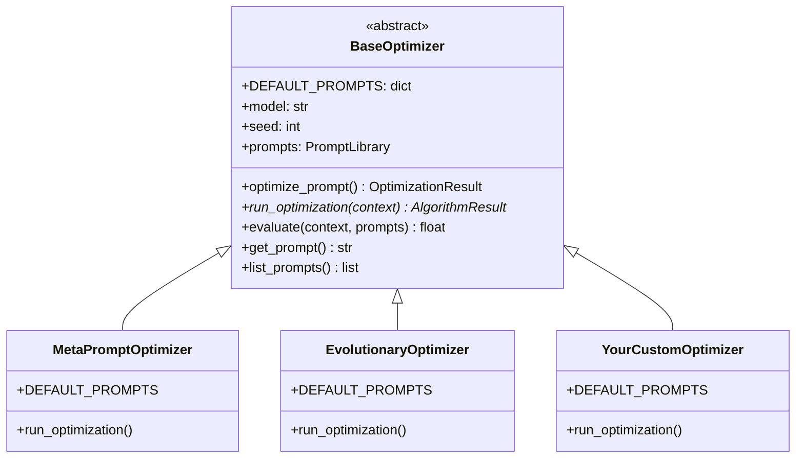

Opik Agent Optimizer is designed to be a flexible framework for prompt and agent optimization. While
it provides a suite of powerful built-in algorithms, you might have unique optimization strategies or
specialized needs. This guide shows how to build your own optimizer by extending the `BaseOptimizer`
class that all built-in optimizers use.

## Architecture Overview

All optimizers in the SDK extend `BaseOptimizer`, giving you access to the same infrastructure:



The public entrypoint, `optimize_prompt()`, is implemented once in `BaseOptimizer`. It validates the
inputs, creates the Opik optimization run, scores the baseline prompt, skips optimization when the
baseline already reaches `perfect_score`, calls your `run_optimization(context)`, and turns its
`AlgorithmResult` into an `OptimizationResult`. Your optimizer only implements the search loop.

## Core Concepts for a Custom Optimizer

To design a new optimization algorithm within Opik's ecosystem, your optimizer needs to interact with several key components:

1. **Prompt (`ChatPrompt`)**: Your optimizer receives the prompts to optimize as
   `context.prompts`, a dict of prompt name to `ChatPrompt` (a single prompt is a dict with one
   entry). A chat prompt is a list of messages, where each message has a role, content, and optional
   additional fields. This includes variables that need to be replaced with actual values.

2. **Evaluation Mechanism (Metric & Dataset)**: Your optimizer needs a way to score candidate
   prompts. Users pass a `metric` (function that takes `dataset_item` and `llm_output` as arguments
   and returns a float) and a `dataset`; `self.evaluate(context, prompts)` scores a candidate with
   them.

3. **Optimization Loop**: This is the heart of your custom optimizer. It involves:
   - **Candidate Generation**: Logic for creating new prompt variations. This could be rule-based, LLM-driven, or based on any other heuristic.
   - **Candidate Evaluation**: Calling `self.evaluate(context, prompts)` to get a score for each candidate.
   - **Selection/Progression**: Logic to decide which candidates to keep, refine further, or how to adjust the generation strategy based on scores.
   - **Termination Condition**: Criteria for when to stop the optimization (e.g., number of rounds, no improvement, or `context.should_stop`, which the framework sets when the trial budget or `perfect_score` is reached).

4. **Returning Results (`AlgorithmResult`)**: `run_optimization` returns an `AlgorithmResult` with
   the best prompts, their score, the recorded history, and algorithm-specific metadata.
   `BaseOptimizer` adds the framework fields (initial score, model, optimization ID, cost and usage
   counters) and returns an `OptimizationResult` to the user.

## Creating a Custom Optimizer

### Step 1: Define Your Optimizer Class

Extend `BaseOptimizer` and define your `DEFAULT_PROMPTS` - the internal prompts your algorithm uses:

```python wordWrap
from typing import Any

from opik_optimizer import (
    AlgorithmResult,
    BaseOptimizer,
    ChatPrompt,
    OptimizationContext,
    llm_calls,
)


class MyCustomOptimizer(BaseOptimizer):
    """
    A custom optimizer that implements [your algorithm description].
    """

    # Define internal prompts used by your algorithm.
    # Users can customize these via the prompt_overrides parameter.
    DEFAULT_PROMPTS = {
        "generation_prompt": """Generate an improved version of this prompt:

Original prompt:
{current_prompt}

Focus areas for improvement:
{improvement_focus}

Return targeted text edits using the supplied segment IDs and the requested response schema.""",
    }

    def __init__(
        self,
        model: str,
        max_iterations: int = 5,
        candidates_per_round: int = 3,
        improvement_threshold: float = 0.01,
        verbose: int = 1,
        seed: int = 42,
        **kwargs: Any,
    ) -> None:
        """
        Initialize the custom optimizer.

        Args:
            model: LiteLLM model name for the optimizer's internal LLM calls
            max_iterations: Maximum optimization rounds
            candidates_per_round: Number of candidate prompts to generate per round
            improvement_threshold: Minimum score improvement to continue
            verbose: Logging verbosity (0=off, 1=on)
            seed: Random seed for reproducibility
            **kwargs: Additional BaseOptimizer parameters (model_parameters, etc.)
        """
        super().__init__(model=model, verbose=verbose, seed=seed, **kwargs)
        self.max_iterations = max_iterations
        self.candidates_per_round = candidates_per_round
        self.improvement_threshold = improvement_threshold

    def get_optimizer_metadata(self) -> dict[str, Any]:
        """
        Expose optimizer-specific parameters for logging and tracking.
        This metadata is stored on the Opik optimization run.
        """
        return {
            "max_iterations": self.max_iterations,
            "candidates_per_round": self.candidates_per_round,
            "improvement_threshold": self.improvement_threshold,
        }
```

### Step 2: Implement the run_optimization() Method

This is the core method implementing your optimization logic. It receives an `OptimizationContext`
holding the prompts, dataset, metric, agent and the baseline score, and returns an `AlgorithmResult`:

```python wordWrap
def run_optimization(self, context: OptimizationContext) -> AlgorithmResult:
    """Search for better prompts, scoring every candidate through self.evaluate()."""
    best_prompts = context.prompts
    best_score = context.baseline_score

    for iteration in range(self.max_iterations):
        previous_best_score = best_score
        round_handle = self.pre_round(context, iteration=iteration)

        for candidate in self._generate_candidates(best_prompts):
            # evaluate() counts the trial, tracks the best score, shows progress
            # and sets context.should_stop when the budget or perfect_score is hit.
            score = self.evaluate(context, candidate)
            self.post_trial(context, candidate, score=score, round_handle=round_handle)
            if score > best_score:
                best_score = score
                best_prompts = candidate
            if context.should_stop:
                break

        self.post_round(
            round_handle,
            context=context,
            best_score=best_score,
            best_prompt=best_prompts,
        )
        if context.should_stop or best_score - previous_best_score < self.improvement_threshold:
            break

    return AlgorithmResult(
        best_prompts=best_prompts,
        best_score=best_score,
        history=self.get_history_entries(),
        metadata={"iterations_completed": iteration + 1},
    )
```

Use `self.evaluate_with_result(context, prompts)` instead when the algorithm also needs the
individual test results (for example to analyse failures); it returns `(score, evaluation_result)`
and shares the same accounting and stop checks.

### Step 3: Implement Candidate Generation

Your custom logic to create new prompt variations. Use `get_prompt()` to access internal prompts
(which respects the user's `prompt_overrides`) and `llm_calls.call_model()` for LLM calls:

```python wordWrap
from pydantic import BaseModel
from opik_optimizer import ReasoningEvidence, TextEdit, apply_text_edits


class CandidateEdits(BaseModel):
    edits: list[TextEdit]


def _generate_candidates(
    self, current_prompts: dict[str, ChatPrompt]
) -> list[dict[str, ChatPrompt]]:
    """Generate candidate prompt bundles using LLM-based improvement."""
    candidates = []
    for i in range(self.candidates_per_round):
        candidate = {}
        for name, prompt in current_prompts.items():
            # Get the generation prompt template (respects prompt_overrides)
            generation_request = self.get_prompt(
                "generation_prompt",
                current_prompt=name,
                improvement_focus=f"variation {i + 1}: explore different approaches",
            )
            # Calls are attributed to this run: counters, cost, project and tags.
            response = llm_calls.call_model(
                messages=[{"role": "user", "content": generation_request}],
                model=self.model,
                seed=self.seed + i,  # Vary seed for diversity
                model_parameters=self.model_parameters,
                evidence=ReasoningEvidence(prompts={name: prompt}),
                response_model=CandidateEdits,
            )
            candidate[name] = apply_text_edits(prompt, response.edits, self._optimizable_roles)
        candidates.append(candidate)
    return candidates

```

### Step 4: Run Your Optimizer

Your optimizer is used exactly like the built-in ones:

```python wordWrap
import opik
from opik.evaluation.metrics import LevenshteinRatio

dataset = opik.Opik().get_or_create_dataset(name="my-dataset")


def levenshtein_ratio(dataset_item: dict[str, Any], llm_output: str) -> float:
    return LevenshteinRatio().score(reference=dataset_item["answer"], output=llm_output).value


prompt = ChatPrompt(
    system="You are a helpful assistant.",
    user="{question}",
    model="openai/gpt-4o-mini",
)
optimizer = MyCustomOptimizer(model="openai/gpt-4o-mini", max_iterations=3)
result = optimizer.optimize_prompt(
    prompt=prompt,
    dataset=dataset,
    metric=levenshtein_ratio,
    max_trials=10,
)
result.display()
```

## What BaseOptimizer Provides

<Info>
  The `BaseOptimizer` class provides robust mechanisms for prompt evaluation that all existing optimizers leverage. Your
  custom optimizer reuses these internal evaluation utilities to ensure consistency with the Opik ecosystem.
</Info>

| Component | Description |
|-----------|-------------|
| `optimize_prompt()` | Public entrypoint: setup, baseline, perfect-baseline skip, Opik optimization run, result building. Calls your `run_optimization()`. |
| `evaluate(context, prompts)` | Scores a candidate bundle. Counts the trial, tracks the best score, updates scoring health and sets `context.should_stop`. |
| `evaluate_with_result(context, prompts)` | Same as `evaluate()`, also returning the `EvaluationResult` with per-item scores. |
| `pre_round()` / `post_round()` | Open and close a history round. |
| `pre_trial()` / `on_trial()` / `post_trial()` | Trial lifecycle hooks; `post_trial()` records a candidate in the current round. |
| `get_history_entries()` | Returns the recorded history to pass to `AlgorithmResult`. |
| `get_prompt(key, **fmt)` | Gets internal prompt template with optional formatting. Respects `prompt_overrides`. |
| `list_prompts()` | Lists all available prompt keys for this optimizer. |
| `llm_call_counter` | Tracks number of LLM calls made during the run. |
| `llm_cost_total` | Tracks total API cost (when available from provider). |
| `llm_token_usage_total` | Tracks token usage across all calls. |

The older `begin_round`, `finish_round`, `start_candidate`, and `finish_candidate` hook aliases emit
`DeprecationWarning` and remain available for compatibility.

## Structured evidence and text edits

Pass `ReasoningEvidence(prompts=current_prompts)` to shared LLM calls. During an optimization
run, the client attaches bounded selected cases with native images, outputs and scores. Use an
explicit `cases` list to select your own evidence, or `cases=()` for template-only context.
Agent messages remain user-provided evidence; their system roles are not promoted into the
optimizer's system instructions.

Use `TextEdit` and `apply_text_edits()` to update existing text slots. `message:0` addresses a
string message; `message:1:part:0` addresses a native text content block. This retains media and
configuration by construction and rejects invalid targets, duplicate edits and removed
placeholders. Custom generation overrides must return edits rather than full message arrays.

The shared client applies `reasoning_input` and `max_reasoning_examples`, validates the optimizer
model's vision capability, and preserves native blocks through structured-output retries.
Display summaries are separate from actual request content.

## LLM Call Accounting

`optimize_prompt()` binds LLM call accounting to the active optimizer run, so calls made through
`llm_calls.call_model()` update the run's counters, cost and token usage and are tagged with its
project and optimization ID. If your subclass overrides `optimize_prompt()` (or defines
`optimize_parameter()`), the override is bound the same way automatically. Entrypoints with other
names can bind the scope explicitly:

```python wordWrap
from opik_optimizer import llm_calls

with llm_calls.optimizer_scope(optimizer):
    # Internal reasoning calls are attributed to this optimizer's run.
    response = llm_calls.call_model(
        messages=[{"role": "user", "content": "Summarize the failures."}],
        model=optimizer.model,
    )
```

The scope restores the enclosing run on exit, including when a call raises. Custom agents should
continue to use the optimizer ownership attached by the base setup when reporting LLM usage from
evaluation worker threads.

## Using Structured Outputs

For complex generation, use Pydantic models for structured LLM responses:

```python wordWrap
from opik_optimizer import llm_calls
from pydantic import BaseModel


class PromptAnalysis(BaseModel):
    issues: list[str]
    suggestions: list[str]
    priority: str


# Inside an optimizer method: returns a parsed Pydantic object, not raw text
analysis = llm_calls.call_model(
    messages=[{"role": "user", "content": "Analyze this prompt: ..."}],
    model=self.model,
    response_model=PromptAnalysis,
)

print(analysis.issues)      # ['Issue 1', 'Issue 2']
print(analysis.suggestions) # ['Suggestion 1', ...]
```

## How to Contribute

Opik is continuously evolving, and community contributions are valuable!

- **Feature Requests & Ideas**: If you have ideas for new optimization algorithms, features, or
  improvements to existing ones, please share them through our community channels or by raising an
  issue on our [GitHub repository](https://github.com/comet-ml/opik).
- **Bug Reports**: If you encounter issues or unexpected behavior, detailed bug reports are greatly
  appreciated.
- **Use Cases & Feedback**: Sharing your use cases and how Opik Agent Optimizer is (or isn't)
  meeting your needs helps us prioritize development.
- **Code Contributions**: Pull requests for new optimizers are welcome! See the
  [contribution guide](/contributing/guides/agent-optimizer-sdk) for detailed instructions.

## Key Takeaways

- Extend `BaseOptimizer` to create custom optimization algorithms with full access to Opik's infrastructure
- Define `DEFAULT_PROMPTS` for your algorithm's internal prompts - users can customize these via `prompt_overrides`
- Implement `run_optimization(context)` with your search loop, scoring candidates with the inherited `evaluate()` and checking `context.should_stop`
- Return an `AlgorithmResult`; the inherited `optimize_prompt()` turns it into a standard `OptimizationResult`
- Use `llm_calls.call_model()` for LLM interactions with automatic cost/usage tracking

We encourage you to explore the existing [optimizer algorithms](/development/optimization-runs/algorithms/overview) to see different approaches to these challenges.

## Related

- [Custom optimizer prompts](/development/optimization-runs/advanced/prompt_customization) - Customize internal prompts
- [Custom metrics](/development/optimization-runs/advanced/custom_metrics) - Build evaluation metrics
- [API Reference](/development/optimization-runs/advanced/api_reference) - Full parameter documentation
